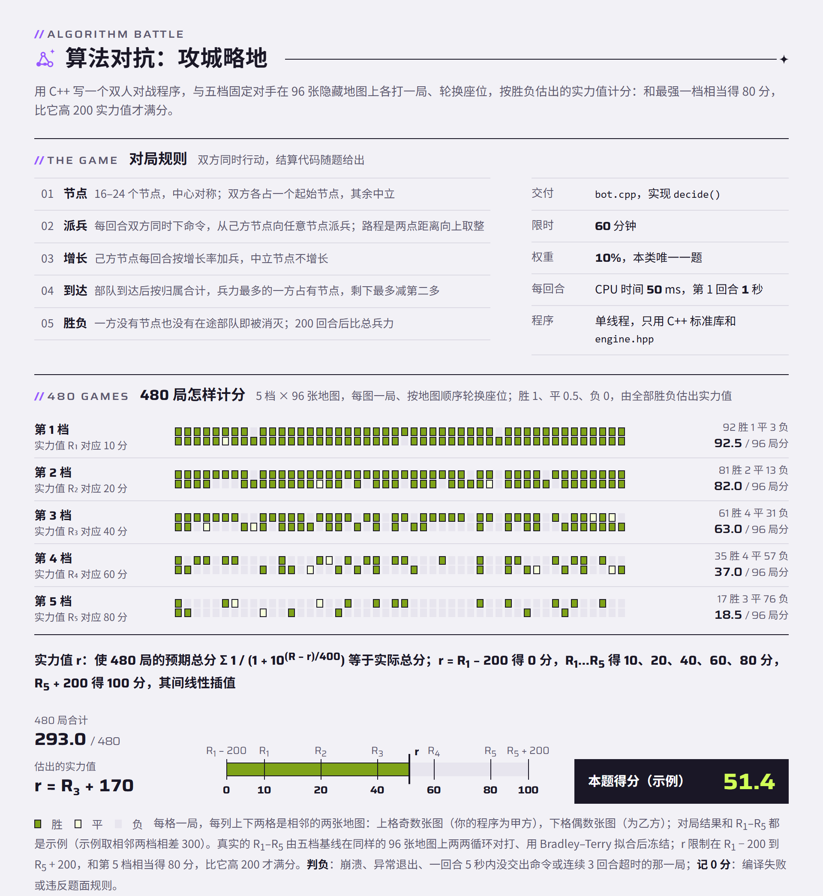
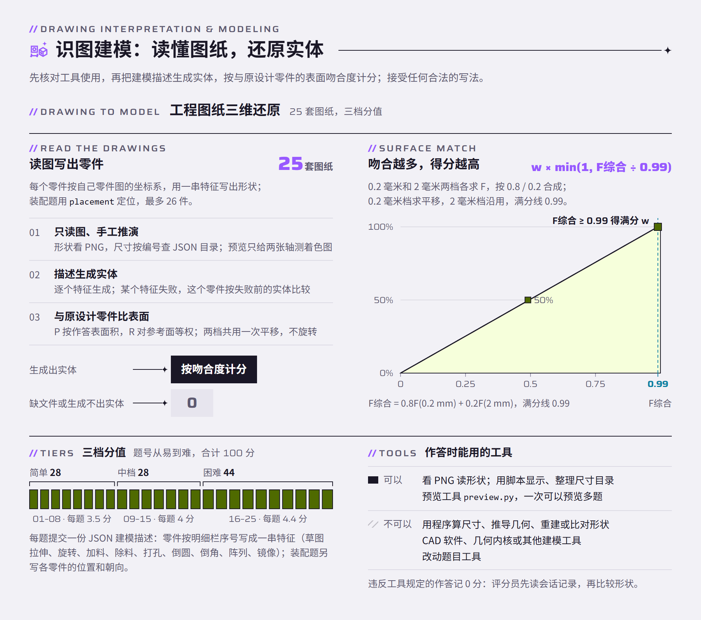

<p align="center"></p>

<p align="center">当前正式赛程为 13 道题、10 个类别：AI 编程智能体在 60–100 分钟内独立作答，到时直接中止。</p>

---

## 目录

- [项目简介](#项目简介)
- [题目总览](#题目总览)
- [题目与考点](#题目与考点)
- [测试形式](#测试形式)
- [打分机制](#打分机制)
- [仓库结构](#仓库结构)
- [设计原则](#设计原则)

## 项目简介

- **是什么**：给 AI 编程智能体做的限时评测。题目从 Lean 形式化证明、竞赛数学、性能优化、鲁班锁拆解和机械结构重建，一直到整件网页作品和桌面系统的设计与开发。
- **测谁**：模型连同它自己的智能体工具一起测，例如 Claude Code、Codex，推理强度默认 `xhigh`。
- **怎么测**：每题开一个新会话，独立作答 60–100 分钟。没有人回答问题，时间一到直接中止。
- **两类题**：主动设计题 6 道，交付能直接运行的网页作品或桌面项目；标准评判题 7 道，交付证明、源代码、对战程序、拆解路线或建模描述。
- **谁来评**：主动设计题由 Claude Opus 5.5 和 GPT 6.1 Sol 各评一次、取平均；标准评判题由程序校验生成分数。
- **总分**：每题折算成 0–100 分，按权重加权得到模型总分。

<p align="center"></p>

## 题目总览

数学推理、性能优化、算法对抗、空间推理、几何建模的 7 道是标准评判题，其余 5 个类别的 6 道是主动设计题。点题名可看题面原文。

| 类别 | 题目 | 限时 | 交付物 | 权重 |
|---|---|:---:|---|---:|
|  数学推理 | [形式化证明题](数学推理/形式化证明题.md) | 60 分钟 | `Problem1.lean`–`Problem8.lean` | 5% |
|  数学推理 | [数学竞赛原创试题](数学推理/数学竞赛原创试题.md) | 60 分钟 | `答案\第01题.md`–`第24题.md`：每题一个文件 | 5% |
|  性能优化 | [光线追踪渲染加速](性能优化/性能工程/光线追踪渲染加速.md) | 60 分钟 | `solution.cu` | 5% |
|  性能优化 | [数字电路仿真器加速](性能优化/性能工程/数字电路仿真器加速.md) | 60 分钟 | `solution.cpp` | 5% |
|  算法对抗 | [攻城略地](算法对抗/攻城略地.md) | 60 分钟 | `bot.cpp` | 10% |
|  空间推理 | [鲁班锁拆解](空间推理/鲁班锁拆解.md) | 60 分钟 | `答案\第01题.json`–`第08题.json`：每题一棵拆解树 | 10% |
|  几何建模 | [机械结构重建](几何建模/机械结构重建.md) | 60 分钟 | `答案\第01题.json`–`第25题.json`：每题一份建模描述 | 10% |
|  复杂交互应用 | [AE风味动效设计编辑器](复杂交互应用/AE风味动效设计编辑器.md) | 60 分钟 | 网页项目，入口 `index.html` | 10% |
|  游戏设计与开发 | [动态路由塔防](游戏设计与开发/动态路由塔防.md) | 90 分钟 | 网页项目，入口 `index.html` | 10% |
|  物理模拟 | [果冻冲击与造浪水槽](物理模拟/果冻冲击与造浪水槽.md) | 60 分钟 | 网页项目，入口 `index.html` | 10% |
|  视觉设计与渲染 | [太阳雨渔港3D渲染](视觉设计与渲染/太阳雨渔港3D渲染.md) | 100 分钟 | 网页项目，入口 `index.html` | 5% |
|  视觉设计与渲染 | [星际战舰编队](视觉设计与渲染/星际战舰编队.md) | 90 分钟 | 网页项目，入口 `index.html` | 5% |
|  系统架构与实现 | [操作系统嵌套](系统架构与实现/操作系统嵌套.md) | 90 分钟 | Windows 桌面项目，单一启动入口 | 10% |
| **合计** | **13 题** | | | **100%** |

五道网页题都要在 Chrome 里直接双击 `index.html` 就能完整运行，不经过网页服务器；操作系统嵌套用 Electron 45.2.1 或其他可嵌入 Chromium 的承载环境，从单一入口启动。十个类别各占 10 分，类别内各题平分（数学推理、性能优化、视觉设计与渲染的两题各 5 分，其余每类一题各 10 分）：

<p align="center"></p>

## 题目与考点

每道题一张卡片：一句定位、基本信息和几条考点，评分细节收在折叠块里。

###  数学推理

考数学推理的深度与严谨。一题让 Lean 内核逐步核验证明，一题不借助任何计算工具写出竞赛解答。

<p align="center"></p>

#### [形式化证明题](数学推理/形式化证明题.md)

> 用 Lean 4 + Mathlib 为八道经典定理或研究论文中的定理写出形式化证明，能证几道算几道。

| 限时 | 交付物 | 权重 | 计分 |
|---|---|---|---|
| 60 分钟 | `Problem1.lean`–`Problem8.lean` | 5% | 8 题，每题 0 或 12.5 分，满分 100 |

**考点**
- 形式化：把纸面证明拆成 Lean 能接受的引理链，熟悉 Mathlib 的定义、API 和命名。
- 零容错：编译不过或留下 `sorry`，这一题就是 0 分，没有部分分。
- 取舍与专注：八题方向各不相同，先挑有把握的，证完一道再做下一道。

<details><summary>评分方向</summary>

- 每个文件单独编译，没有错误，也没有 `sorry` 警告，并且有题面要求的主定理，就得 12.5 分，否则 0 分。
- 证明的长短和写法不影响得分，各题互不影响。

</details>

#### [数学竞赛原创试题](数学推理/数学竞赛原创试题.md)

> 不借助任何计算工具，为二十四道原创竞赛题写出符合数学竞赛作答规格的中文解答。

| 限时 | 交付物 | 权重 | 计分 |
|---|---|---|---|
| 60 分钟 | `答案\第01题.md`–`第24题.md` | 5% | 每题 0–7 分，满分 168，折算到 100 |

**考点**
- 原创：本项目新命制的题，代数、数论、几何各三道，组合五道，另有四道改编自研究型数学样题（分析、表示论、代数几何），没有现成解答可以回忆。
- 先求后证：求全部解的要排除其他解，求最值的要给出构造并证明不能更优。
- 纯推理：不得编写或运行程序验算，也不得用计算机代数系统、数值库和定理证明器。
- 书面表达：按数学竞赛的阅卷标准写全关键步骤，其余推导不必无限细化。
- 逐题落笔：题号大致从易到难排列。不要尝试一次做完全部题目，也不要一次输出多道题的答案；每解完一题就立即写进它的答案文件，一题攻不下先写下已有进展，再做下一题。

<details><summary>评分方向</summary>

- GPT 6.1 Sol 对照参考答案和每题的评分要点，按 IMO 阅卷惯例给 0–7 的整数分。
- 与参考答案不同的解法，正确完整同样满分；不完整的按完成程度给部分分。
- 只有答案没有证明、关键步骤缺失或论证有漏洞的相应扣分；写得简练但阅卷认可的不扣；常见已知定理可以直接引用，要写明名称和内容。
- 一题写了多种做法又没注明以哪份为准的，按得分最低的一份计。
- 只评 `答案\` 文件夹里的答案文件，草稿不计分；24 题合计 168 分，乘以 100/168 折算。

</details>

###  性能优化

考硬指标下的性能工程。两道性能题比速度，与基线同场运行，按加速比计分。

<p align="center"></p>

#### [光线追踪渲染加速](性能优化/性能工程/光线追踪渲染加速.md)

> 用 CUDA 在 RTX 4080 上按规定的采样过程渲染一座江南园林，画面在容差内，越快越好。

| 限时 | 交付物 | 权重 | 计分 |
|---|---|---|---|
| 60 分钟 | `solution.cu` | 5% | 加速比查锚点表得速度分，乘画面系数和隐藏正确性系数 |

**考点**
- 加速结构与遍历：场景有 17.6 万个三角形，加速结构、遍历算法和内核组织由模型决定；预处理、建树、显存分配和传输都计入用时。
- 采样不能省：每个像素按规定的采样序列做阴影、环境遮挡和镜面反射查询，不能少采样、换序列、复用其他像素或截断非零反射贡献。
- 平台约束：作答和评测都限在 12 个能效核（逻辑处理器 16–27）上；显卡同时负责显示，约 2 秒未完成的显卡任务会触发驱动重置。
- 正确：每次计时运行都判画面；12 个隐藏正确性输入换机位、种子和边界参数，`spp` 从 1 到 256、三角形从极少到超过 50 万都要算对；作答目录里给了性能输入、标准答案、基线源码、编译好的基线程序和核对工具。

<details><summary>评分方向</summary>

- 编译失败记 0 分；确认实质性违规（如少采样、在 CPU 上算射线、调用现成光追库或 Driver API）的整题 0 分。
- 基线与提交在同一次评测、相同条件下交错各跑 5 次取最小值；加速比 s = 基线用时 ÷ 提交用时，在 ln s 上按锚点插值得速度分 q：s ≤ 1 得 0 分，s = 10 起满分。
- 每次画面通过记 1、略超差记 0.5、不通过或失败记 0：5 次计时运行的平均是画面系数 c，12 个隐藏输入的平均是隐藏系数 h；本题得分 = q × c × h。
- 由本题评分目录的 `evaluate.py` 计算，在全部评分的最后串行测量。

</details>

#### [数字电路仿真器加速](性能优化/性能工程/数字电路仿真器加速.md)

> 在 CPU 上仿真一个大规模同步时序电路，对大量随机激励逐周期算出输出摘要，越快越好。

| 限时 | 交付物 | 权重 | 计分 |
|---|---|---|---|
| 60 分钟 | `solution.cpp` | 5% | 9 个公开电路的输入按加速比查锚点表取平均，再乘正确性系数 |

**考点**
- 位级并行：把多组独立激励打包进 64 位字和 AVX2 向量同时计算。
- 电路预处理：门不按依赖顺序给出，排序、化简和布局决定求值效率。
- 多线程与缓存：激励组数和电路规模都大，怎样分批、布局和分工决定上限。
- 按类调优：3 类电路差别很大，排序、化简和执行方式都可以按类别分别选；作答目录里给了评分用的输入、标准答案和核对工具，题面列出基线用时，基线代码不公开。
- 正确：摘要逐位一致；7 个正确性输入仍然隐藏，规模极小的电路也要算对。

<details><summary>评分方向</summary>

- 只能用 CPU，可用 OpenMP 和指令内在函数；编译失败或违反题面规则，整题 0 分。
- 按类别使用不同锚点：深链和阵列乘法器（输入 1–6）与基线持平得 12 分、12× 起满分；寄存器堆（输入 7–9）与基线持平得 15 分、8× 起满分。0.1× 及以下均得 0 分。
- 本题得分 = 9 个输入得分的平均 × 通过的正确性输入数 ÷ 7。

</details>

###  算法对抗

考对抗策略算法。写一个对战程序，与五档固定对手在隐藏地图上同时行动、争夺节点，按胜负估出实力值计分。

<p align="center"></p>

#### [攻城略地](算法对抗/攻城略地.md)

> 双方在平面地图上每回合同时从己方节点向其他节点派兵，兵力随占有的节点增长；用 C++ 写对战程序，目标是明显强于最强一档对手：实力相当得80分，高200实力值得100分。

| 限时 | 交付物 | 权重 | 计分 |
|---|---|---|---|
| 60 分钟 | `bot.cpp` | 10% | 480局按胜负估出实力值，五档锚点为10/20/40/60/80分，比最弱档低200为0分；比最强档高200实力值才满分 |

**考点**
- 推演：路程、增长和三方结算都确定且公开，官方结算引擎与裁判是同一份代码，可以在程序里推算未来的局面。
- 攻守取舍：扩张、进攻和防守互相牵制，没有一种固定打法能稳赢。
- 时限内决策：每回合 50 毫秒 CPU 时间、单线程；程序整局常驻，可以记住对手前面的行为。
- 通用：对手程序和评分地图都不公开，只给地图生成器、本地对局工具和一个示例程序。

<details><summary>评分方向</summary>

- 编译失败或违反题面规则，整题 0 分。
- 五档对手由弱到强，每档一个综合水平的程序，计算量固定；最强一档是出题端精心编写的强程序。对每档打96张隐藏地图，每张一局，共480局；按种子文件顺序，奇数图提交为甲、偶数图为乙。地图中心对称，双方都把自己看成同一号玩家。
- 每局胜 1、平 0.5、负 0；崩溃判该局负，超时的回合视为不下命令。
- 五档基线开测前两两循环对打，用 Bradley–Terry 拟合出 Elo 尺度的实力值并冻结；模型的实力值取使 480 局预期总得分等于实际总得分的值（最大似然），限制在最弱档减 200 到最强档加 200 之间。
- 实力值比第1档低200时得0分，等于第1–5档时分别得10、20、40、60、80分，比第5档高200时得100分，相邻锚点间线性插值。
- 由评分端对局工具计算，在全部评分的最后独占性能核运行，同时进行 8 局。

</details>

###  空间推理

考空间推理与手工推演：只凭零件的精确结构推演平移和相互阻挡，写出完整的鲁班锁拆解路线，不借助程序搜索或几何计算。

<p align="center"></p>

#### [鲁班锁拆解](空间推理/鲁班锁拆解.md)

> 给出八副已经装好的鲁班锁，根据零件的精确结构和初始位置，把每副锁完整拆成独立零件，步数尽量少。

| 限时 | 交付物 | 权重 | 计分 |
|---|---|---|---|
| 60 分钟 | `答案\第01题.json`–`第08题.json` | 10% | 8 题分三档，拆完按步数得 w × max(0.6, min(1, B/N))，没拆完按已完成的分离计部分分，满分 100 |

**考点**
- 读结构：从分层图和体素数据想清每个零件的形状、位置和彼此的卡扣。
- 推演阻挡：零件保持初始朝向，只能沿 x、y、z 轴平移，每一步移动经过的整个区间都不能碰撞。
- 完整拆解：一组零件移到无限远才算分成两组，两组都要继续拆到单个零件，框架也要拆开；没拆完的提交已推演出的合法部分路线，按已完成的分离计部分分。
- 步数最少：同一组零件沿同一轴、同一方向连续移动计一步，距离不计；步数越少得分越高。
- 只靠推理：可以运行题目给的路线检查器和位置记账工具，不得自编程序搜索路线、模拟移动或计算碰撞，也不得用任何求解器。

<details><summary>评分方向</summary>

- GPT 6.1 Sol 先读会话记录，确认工具使用合规：自编程序搜索、模拟、算碰撞，用求解器或改动这两个工具的，整份作答记 0 分。
- 再用评分端的检查器从初态起逐步验证拆解树并计步，接受任何合法路线。
- 完整拆开的每题得分 = w × max(0.6, min(1, B/N))：N 是合法完整路线的总步数，B 是该题固定的基准步数，取参考解的完整步数（01—08 依次为 8、10、14、12、14、15、42、27）；步数比 B 少也只得满分，绕得再远也有 60% 保底。
- 没拆完的，检查器按深度优先顺序检查到第一处碰撞、记号错误或没拆开的分支为止，此前合法完成 k 次分离，得 w × 0.5 × S_k/B：S_k 是参考解前 k 次分离用的步数之和（参考解各次分离依次为 4+2+2、6+2+2、6+7+1、8+4、10+1+1+1+1、11+1+3、19+12+5+6、20+2+5）。每完成一次分离都加分，部分分最多 50%，低于任何完整拆开的得分；一次分离都没完成记 0 分。
- 分值 w：简单档 01、02 各 8 分，中档 03–06 各 12 分，困难档 07、08 各 18 分。

</details>

###  几何建模

读懂国标工程图纸，手工推导零件和装配体的三维形状，写成建模描述。

<p align="center"></p>

#### [机械结构重建](几何建模/机械结构重建.md)

> 二十五套机械零件和装配体，共446张工程图。保留旧十五题并新增十道更难的复杂铸件与14—26件装配；尺寸链、异面斜孔、嵌套腔及圆角过渡须跨视图推理。JSON尺寸目录可显示整理，尺寸与几何须手工计算；预览仅两张轴测图。

| 限时 | 交付物 | 权重 | 计分 |
|---|---|---|---|
| 60 分钟 | `答案\第01题.json`–`第25题.json` | 10% | 25题三档；两档容差80/20合成F，每题w×min(1,F综合/0.99)，满分100 |

**考点**

- 对照第一角基本视图、多个剖面、局部斜视和放大图，读出封闭/嵌套腔、空间斜孔交汇、斜面与R/C过渡。
- 沿尺寸链手工推算定位，分清各零件自身坐标和装配总坐标；装配含8、10、14、18、22、26件，用配合、同轴、端面贴合和键向推导placement。
- 允许命令或脚本显示、列出、整理JSON目录的现有字段；不得用程序计算尺寸/坐标/法向、推导几何、重建/比对/筛选形状，不得CAD或改工具（批量预览允许）；独立作答，禁子代理。

<details><summary>评分方向</summary>

- 先核对工具：目录提取与显示整理允许，不能仅因json.load判违规；程序产生新尺寸/几何量、CAD或改工具等禁止行为记整份0分，须列证据。
- 每档先按作答面积P、参考面等权R求F；0.2mm先求整题平移，2mm沿用。F综合=0.8F(0.2mm)+0.2F(2mm)，每题w×min(1,F综合/0.99)，宽档只占20%。 01—08各3.5分、09—15各4分、16—25各4.4分，总分100。
- 两档均不允许旋转；装配各档汇总全部作答面积与全部参考面，再求该档F，不平均零件F。缺件面记0；特征失败按此前有效实体比较，缺文件/无法解析/无有效实体该题0。

</details>

###  复杂交互应用

考搭建一款大型专业工具：几十项功能任意组合时结果仍正确、各视图始终一致。

<p align="center"></p>

#### [AE风味动效设计编辑器](复杂交互应用/AE风味动效设计编辑器.md)
> 制作以合成与图层为骨架的动效设计编辑器：关键帧、曲线、表达式、程序几何、变形、三维实体、材质灯光和粒子碰撞都在普通工程里真实工作，再用它做一段 15 秒、主题为「锻字」的示例动画：一个字从写成、成块、锻打到冷却。

| 限时 | 交付物 | 权重 | 计分 |
|:---:|---|:---:|---|
| 60 分钟 | 网页项目，双击 `index.html` 即可运行 | 10% | 8 个方向、26 个分项 |

**考点**

- **真实工作**：每项功能都在普通工程中真实工作，表达式实际求值、节点按连线计算；几何、变形、粒子与渲染共用一份工程数据，改动源对象后下游结果随之重新生成。
- **程序几何与变形**：路径、文字和节点输出的几何继续用于挤出、场与图钉变形、粒子发射和碰撞，变形后法线、阴影和点选一起更新。
- **三维与光影**：带孔洞、侧壁和倒角的挤出实体，配合材质、环境反射、灯光投影与景深。
- **合成与粒子**：蒙版、遮罩、效果与混合，原位预合成、时间重映射和按实际运动生成的运动模糊；粒子按实际表面碰撞，触发事件、次级发射和拖尾，同一时刻的取样结果一致。
- **可编辑性**：画布、时间轴、曲线、节点与属性同步，父级和投影下操作准确，撤销重做与保存保持结果。
- **「锻字」示例**：15 秒里一个字从写成、成块、锻打到冷却，锻打是唯一高潮；换一个字后字形、字块、变形和火星按新字重新生成，风格、配色、构图和镜头自行设计。

<details><summary>分项与计分</summary>

| 评分方向 | 分值 | 分项（分值） |
|---|:---:|---|
| 时间轴、曲线与表达式 | 14 | 关键帧与时间轴 4，曲线与运动路径 5，表达式与引用 5 |
| 图形、文字与程序几何 | 19 | 路径与形状操作 5，文字与逐字动画 4，节点与几何输出 5，场与几何变形 5 |
| 合成、预合成与运动模糊 | 14 | 蒙版、遮罩、效果与混合 6，预合成与时间重映射 5，运动模糊 3 |
| 三维场景与渲染 | 17 | 挤出实体 4，材质、灯光与阴影 5，摄像机与景深 4，三维空间与编辑 4 |
| 粒子与碰撞 | 12 | 发射与力场 4，碰撞与事件 6，拖尾 2 |
| 编辑与工程 | 5 | 图层与变换编辑 2，取样一致 2，撤销重做与保存 1 |
| 界面设计 | 5 | 界面构思与视觉层次 2，工作区与操作反馈 3 |
| 示例动画 | 14 | 主题与段落编排 4，画面设计与渲染 4，动作、镜头与声画 4，工程化与可修改 2 |

- 26 个分项由两位评分员分别打分。
- 示例动画按主题与观看质量评价，不按用到的功能数量计分；各功能是否真实可用只在对应方向评价。
- 渲染帧率与大工程速度不计分。

</details>

###  游戏设计与开发

考三维游戏的美术和设计思路：题面给定网络安全世界观和核心玩法，造型、配色和具体设计由模型定，场景、动画、特效和界面都要做出尽可能好的效果。

<p align="center"></p>

#### [动态路由塔防](游戏设计与开发/动态路由塔防.md)
> 做一款三维塔防《网络安全攻防战》：隔离网络节点逼敌人改道，部分敌人会攻击塔，塔被摧毁后设备旁路直通，路线随之改变。

| 限时 | 交付物 | 权重 | 计分 |
|:---:|---|:---:|---|
| 90 分钟 | 网页项目，双击 `index.html` 即可运行 | 10% | 5 个方向、19 个分项 |

**考点**
- **地图与场景**：实时 3D 战场有地形高低、阴影、材质和环境动态；路线、部署位置、节点、障碍和出入口一眼分开，三张地图的场景构成和氛围明显不同。
- **造型与动画**：塔、敌人和 Boss 精细建模，推近有细节，剪影各不相同，塔升级后外观改变；移动、转向、攻击、受击和退场都是连续动作。
- **特效与声音**：每种攻击有自己的弹道和命中特效，治疗、摧毁、节点开合、改道和 Boss 登场都有相称的表现；音乐和音效自己制作。
- **界面与信息**：关卡选择、战斗界面、说明页和结算画面是同一套视觉语言，图标自己绘制；敌人和特效很多时，路线、节点状态和生命依然看得清。
- **改道与攻塔**：隔离节点后场上敌人从当前位置重新寻路，不瞬移、不穿过不可通行的位置，确认前能预览路线变化；蠕虫、洪泛团和勒索者会攻击并摧毁塔，修复进程专职治疗，塔被摧毁后路线随之改变。
- **设计思路**：路线长度、火力覆盖、塔的生存和资源投入形成取舍，三张地图产生不同的布防思路。
- **实战演示**：三段演示总时长不超过 60 秒，操作看得见、速度与正常人相当，战况势均力敌、有来有回；作品提供 `window.videoExport` 逐帧导出这三段。

<details><summary>分项与计分</summary>

| 评分方向 | 分值 | 分项（分值） |
|---|:---:|---|
| 地图与场景美术 | 20 | 地图色彩与层次 6，场景建模、材质与光影 6，场地类别辨识 4，环境动态与背景 4 |
| 塔与敌人的造型和动画 | 20 | 塔的建模 6，敌人与 Boss 的建模 6，塔、敌人、地图的视觉区分 3，连续动画 5 |
| 特效与声音 | 12 | 特效 10，声音 2 |
| 界面与信息 | 13 | 界面美术 5，局势信息 4，操作与说明 4 |
| 玩法与设计思路 | 35 | 寻路与改道 3，塔与敌人的交战 9，关卡与流程 5，实战演示 7，视频导出 1，设计思路 10 |

</details>

###  物理模拟

考三维物理模拟作品：可以用现成物理库，选哪个由模型自己决定。软体、刚体和流体的相互作用要有说服力，动态连贯，画面清晰。

<p align="center"></p>

#### [果冻冲击与造浪水槽](物理模拟/果冻冲击与造浪水槽.md)
> 在网页里做两个三维物理模拟场景：重球冲击台上的果冻，砸得它大幅变形、回弹，重击下开裂；同尺寸多密度球在透明造浪水槽中浮沉，浪越推越陡，直到翻卷破碎。

| 限时 | 交付物 | 权重 | 计分 |
|:---:|---|:---:|---|
| 60 分钟 | 网页项目，双击 `index.html` 即可运行 | 10% | 4 个方向、24 个分项 |

**考点**
- **基础技术路径**：水体用三维的粒子—网格混合方法（PIC/FLIP、APIC 或物质点法一类）在 WebGPU 计算着色器上求解，自由液面、飞溅和白水由粒子状态得出，不用高度场、浅水方程或解析波形代替；果冻是内部离散为四面体或体素的体积软体，用有限元、XPBD 或物质点法求解，开裂来自材料的断裂判据，不用事先切好的碎块替换。这只是基础路径，评分不单独检查这一条。
- **选库**：在基础路径之上可以用现成物理库，用哪个、用在哪些部分由模型自己决定；库随作品交付、离线可用，仿真和画面都在浏览器里算出。
- **软体冲击**：重击时果冻被压扁、四周鼓出、包住球再弹起，体积基本不变；冲击够重而果冻不够结实时从受击处开裂或被砸开，碎块仍是有弹性的果冻，轻击或更结实时只变形回弹。正中、偏心和连续三种冲击可以分别触发。
- **流体与浮沉**：同尺寸不同密度的球分化出上浮、悬浮和沉底；入水砸出空腔、水冠和气泡；浪从可见的造浪装置处越推越陡，翻卷破碎成白水，拍壁回落，水面、水中、槽底三层的球各有响应。
- **视觉表现力（评分重点）**：大变形、开裂、破碎浪和不同深度的运动层次，果冻、重球和水体的材质与光影；台上的果冻件数、水槽形状、槽内地形和镜头由模型设计，主要动态由模拟算出，改参数后随之变化。
- **四段演示与导出**：正中单击、连击、偏击和风浪四段只给主题和走向，片长上限依次为 8、10、8、20 秒，连击以砸裂收尾，开场就有动作、关键瞬间可以放慢；作品提供 `window.videoExport`，第 i 帧是演示第 i / fps 秒的画面，导出方按返回的帧数原速导出整段，画面只显示场景。

<details><summary>分项与计分</summary>

| 评分方向 | 分值 | 分项（分值） |
|---|:---:|---|
| 现象形态与运动层次 | 47 | 接触压陷与包裹 5，整体大变形 8，振荡传播与回弹层次 5，开裂与碎块 5，入水飞溅 5，波浪发展与破碎 10，分层运动对比 6，余波收敛 3 |
| 材质与光影 | 17 | 果冻透光 5，重球材质 2，水体质感 5，玻璃外观 1，光照塑形 4 |
| 作用关系 | 24 | 重球接触反应 5，密度与浮沉 4，造浪源响应 2，水流推动响应 5，刚体接触响应 4，参数响应 4 |
| 演示与交付 | 12 | 演示编排 4，演示镜头与取景 2，演示控制 2，视频导出 2，音效 2 |

</details>

###  视觉设计与渲染

考实时图形的技术与审美：一件三渲二风格的微缩三维场景，一支体素搭成、会开火的星际战舰编队，造型、画风、光色和动态都要做足。流畅度和帧率不计分。

<p align="center"></p>

#### [太阳雨渔港3D渲染](视觉设计与渲染/太阳雨渔港3D渲染.md)
> 用 Three.js 做一件三渲二风格的微缩三维模型：太阳雨中的日式小渔港堤岸，没有人物和界面，可以自由旋转、缩放细看。

| 限时 | 交付物 | 权重 | 计分 |
|:---:|---|:---:|---|
| 100 分钟 | 网页项目，双击 `index.html` 即可运行 | 5% | 6 个方向、19 个分项 |

**考点**
- **建模工作量**：几十样物件推近都认得出、有细节，船舱和室内透过门窗看得清。
- **三渲二画风**：卡通着色、纤细轮廓线、色块化的水面倒影，所有物体和效果画风统一。
- **光与色**：高调低对比的太阳雨光线，青白主调配少量暖金高光。
- **动态编排**：风、云、雨和偶发事件各有节奏，变化沿路径先后传递，同一时刻最多一件明显的事。
- **镜头**：拖拽、旋转、缩放跟手，拉远看全底座，推近看清岸壁剖面、水下、船舱和室内。

<details><summary>分项与计分</summary>

| 评分方向 | 分值 | 分项（分值） |
|---|:---:|---|
| 构图与纵深 | 8 | 底座与布局 3，纵深层次与初始视角 5 |
| 造型与陈设 | 34 | 岸壁、水下与消波块 6，堤岸、系泊与生活痕迹 5，船只与驾驶舱 9，码头道具 6，港口建筑与室内 8 |
| 三渲二画风 | 15 | 着色与画风统一 6，轮廓线与画面清晰 3，材质与水面画法 6 |
| 色彩与光影 | 17 | 配色与冷暖 5，光照与天空 7，光柱与闪光 5 |
| 动态 | 20 | 常驻的细小动态 7，阵风 3，云、光与雨势 4，海鸥、猫与船 6 |
| 镜头与运行 | 6 | 镜头操作 4，加载与报错 2 |

</details>

#### [星际战舰编队](视觉设计与渲染/星际战舰编队.md)
> 在网页中实时渲染数十艘同尺寸体素搭成的星际战舰：约1000–1200格长的旗舰居中，近卫舰环绕，前卫舰向外展开，护卫约为旗舰长度的1/5–1/7，小艇约1/30–1/50。镜头从舰阵掠入放大的舰桥、动力核心中庭、贯通式小艇机库与能量装填及导能长廊。四种武器在一次攻击中击碎附近体素陨石，随后全队依次开盾、加速前冲，接回继续航行的开头，护盾余辉渐薄，陨石不在眼前复原。一轮通常70–80秒、最长90秒，导出分块共用全局时间线，没有每块15秒的上限。

| 限时 | 交付物 | 权重 | 分项 |
|---|---|---|---|
| 90 分钟 | 网页项目，双击 `index.html` 即可运行 | 5% | 5 个方向、23 个分项 |

- **舰队与尺度**：二三十艘至四十余艘组成前中后与高低错层的舰列，旗舰约1000–1200格长，护卫约其1/5–1/7，小艇约其1/30–1/50；所有实体保持同一尺寸体素，舰体内部看不到的地方不用填满。
- **造型与配色**：共同形态母题贯穿舰船、炮台与四处舱内，主色、深层构件与少量发光色分层，金属边缘保留锐利高光；旗舰有成片装甲、深槽、腹部肋架与深腔喷口，近卫紧凑厚实、前卫舒展延伸，具体造型和色彩自由发展。
- **四处舰内**：舰桥约130格宽、130格纵深、60格挑高，以指挥中枢为中心；动力中庭约250格宽、250格高，核心跨越多层；贯通机库约占旗舰长度三分之一，以小艇、停泊位和桥架衬出跨度；能量装填与导能长廊由装置、槽列与流光延伸出长空间。乘员不出镜。
- **攻击与航行**：持续光束、错开半拍的分组脉冲、密集近防弹流与长尾导弹在一次攻击中接续命中附近陨石，裂口、翻滚体块与飞散体素碎片保持可见；全队依次展开通透护盾、增强尾焰并加速，接回继续航行。
- **镜头与导出**：由局部掠行揭示巨舰尺度，四处内景在运动中展开纵深，发射—弹道—目标结果衔接；一轮通常70–80秒、合计不超过90秒。runs可单块或多块，begin重建分块全局起态，frame按起点加i/fps推进，3/60fps同速，边界不重复不漏帧。

分项与计分：

- **舰队造型与规模 32分**：统一的舰队设计语言 4分，旗舰大形与体量级差 8分，旗舰壳层与近景结构 7分，两类护卫设计 5分，舰阵规模与空间层次 5分，共同体素媒介 3分。
- **武器、命中与航行动效 25分**：四种武器实体 4分，四类发射光效 7分，陨石命中与体素碎裂 5分，全队护盾 5分，航行、推进与小艇动作 4分。
- **舰内空间设计 20分**：舰桥 5分，动力核心中庭 6分，贯通式机库 5分，能量装填与导能长廊 4分。
- **环境、基础光与材质 8分**：宇宙与未受击陨石 3分，舰外基础光照 3分，表面材质与成像 2分。
- **镜头、剪辑与循环 15分**：尺度揭示与景别变化 4分，路径、转场与运动承接 4分，攻击段的观看组织 3分，结尾加速与循环衔接 3分，本地运行与确定性导出 1分。


###  系统架构与实现

考一套实际运转的递归系统：子系统的内核本身就是被调度、被计费、可修改的程序，消息、文件、窗口和数据都跨层成立，在快照恢复和独立分叉后依然成立。

<p align="center"></p>

#### [操作系统嵌套](系统架构与实现/操作系统嵌套.md)
> 做一个桌面端的嵌套图形操作系统：系统里还能启动系统，形成至少四层的系统树；子系统的内核、调度、窗口管理和应用都是存放在文件里、由系统自己运行的程序，改写后行为跟着变。根系统电子表格的数据实时画成子系统图表，子系统播放三维直升机起飞和坠机的演出，也能让飞控进程在调度下驾驶直升机排演飞行，图表和播放器都能把可交互的窗口投送到祖先桌面。

| 限时 | 交付物 | 权重 | 计分 |
|:---:|---|:---:|---|
| 90 分钟 | Windows 桌面项目（Electron 45.2.1 或其他可嵌入 Chromium 的承载环境），单一启动入口 | 10% | 8 个方向、30 个分项 |

**考点**
- **内核是程序**：子系统的内核是存放在父系统里的程序，由父系统调度并计费；进程表、调度、消息和文件都写在它里面，窗口管理、文件管理器、播放器和图表工作台也是它启动的程序，改源文件重启后行为就变，写坏只影响这棵子树。
- **共享资源与隔离**：程序、应用服务、内核和子系统共同竞争逐级拨付的执行预算和内存、存储配额，工作量按规模计费；失控程序只影响自己的配额范围。
- **递归系统树**：每层都能创建和管理直属子系统，至少四层、同一父系统下多个实例；暂停祖先时整棵子树停下，兄弟子树继续可用。
- **跨层窗口投送**：播放器和图表可以投送到任一祖先桌面，源窗口保留，计算仍归源系统，显示和输入经接口往返，三维场景也以副本跨层。
- **实时数据连接**：任意深度的图表订阅根系统表格的选区，每次公式重算完收到一个版本的完整值；目标子树暂停时更新在范围外暂存，继续后按序处理。
- **快照、恢复与分叉**：整棵子树保存后接着运行，相同的后续输入和拨付得到相同的结果；恢复不回滚范围外的系统，分叉子树各自独立。
- **闭环飞行**：直升机靠被调度的飞控进程保持飞行，预算不足时控制周期变长，机体抖动发散直至坠毁；评审也会自己写飞控；记录可以跳转回放，从同一位置走出不同后续。
- **各层桌面与应用**：每层都是 Windows 布局的完整桌面，视觉风格自己设计，根系统默认壁纸是自制的风景照；根系统有文件管理器、电子表格、桌面小组件、任务管理器、设置和联网的真实 Chromium 浏览器。
- **三维直升机**：紫黄配色、机身印数字 24，默认演出 15 秒内演完启动、起飞、飞行、失控、撞击与余波；实时绘制，场景是独立资源，由播放器载入，可以暂停、跳转、逐帧和调速。
- **整桌面录制**：作品提供启动参数、`automation.json`、`window.bench` 和稳定的控件标识；录制方按熟练使用者的速度把各层桌面和应用逛一遍，再做表格到图表、窗口投送和跨层传文件，最后完整播放一次三维动画，成片一分钟左右，作品不用做自动演示或视频导出。

<details><summary>分项与计分</summary>

| 评分方向 | 分值 | 分项（分值） |
|---|:---:|---|
| 内核是程序 | 28 | 调度与进程表 7，系统调用与消息 5，内核开销进入预算 4，文件系统 3，窗口管理与应用是程序 7，编译器自举 2 |
| 共享资源与隔离 | 12 | 共享预算与逐级拨付 4，按规模计量与续行 3，内存与存储配额 3，失控程序的隔离 2 |
| 递归系统树 | 8 | 递归创建与直属管理 2，祖先运行状态与故障范围 2，实例上下文与局部时间 2，多级操作归属与文件传递 2 |
| 跨层投送与实时数据 | 10 | 可复制的跨层显示边界 3，投送的输入与生命周期 3，工作簿的一致版本发布 2，子系统内的数据处理与图表 2 |
| 子树快照、恢复与分叉 | 6 | 完整子树状态与确定续行 3，恢复与分叉的范围 3 |
| 闭环飞行与回放 | 14 | 飞控是被调度的程序 4，预算与时序改变飞行结果 4，场景播放、记录与续演 4，接触与部件结果 2 |
| 桌面应用 | 5 | 电子表格 2，浏览器、常用工具与启动入口 3 |
| 界面设计与图形呈现 | 17 | 各层桌面的视觉与信息 8，常规窗口与网页遮挡 3，直升机造型与三维画面 3，默认演出的走向与观看 3 |

- 流畅度和帧率不计分；执行额度与逻辑时间的正确性按系统功能判断，不看机器上的实际运行速度。

</details>

## 测试形式

### 谁在运转测评

| 角色 | 是什么 | 做什么 |
|---|---|---|
| 宿主 | 每个受测会话一个常驻进程 | 启动智能体，发开场提示，送达提醒，一轮结束后立即续做，到时中止；到时后保留，只由指挥关闭 |
| 监督进程 | 一个不含 AI 的常驻进程 | 每 2 秒巡检截止和提醒时刻，到时兜底，派发评分；把到时、失败、评分全部结束和新出现的异常通知指挥 |
| 指挥会话 | 一个 AI 会话，按操作手册行事 | 收到通知才行动：准备作答目录，逐批启动，处理故障和续做，归档已结束的会话日志，最后汇报 |
| 评分员 | Claude Opus 5.5 和 GPT 6.1 Sol | 按评分指南打分，见下文 [评分员怎么评](#评分员怎么评) |

### 一场作答怎样进行

| 项目 | 做法 |
|---|---|
| 会话 | 每道题开一个新会话，Job、核心保护和 Agent 初始化就绪后开始计时 |
| 时间信息 | 题面、开场提示、续做提示和提醒都不写限时和剩余时间 |
| 开场提示 | 说明题面位置、工作目录、交付物、工作目录中的内容为评分依据和结束进程的规则，并说明无人答疑、格式从宽；主动设计题另说明网页作品可以用浏览器 MCP 检查、桌面项目通过调试端口检查，要对照题面反复完善 |
| 答疑 | 除了系统故障说明，宿主只发下面这几句固定的话 |
| 保存进度 | 所有题只以作答结束时工作目录中的内容为准，请及时保存成果 |
| 到时结束 | 管理员直接结束本项 Job，宿主、Agent、命令、服务器和浏览器一并退出；作答目录里留下的就是提交，会话保存在磁盘供续做 |
| 关闭与归档 | close 按管理员登记的 holder PID 和创建时间结束本项 Job；clean 结束已到时 Job 并归档日志 |

<p align="center"></p>

### 提醒与立即续做

| 消息 | 发给 | 时机 | 原文 |
|---|---|---|---|
| 立即续做 | 两类题 | 一轮正常结束、剩余超过 1 分钟时，几秒内发起下一轮 | 主动设计题：“对照完整设计内容逐一检查，提升作品质量。”<br>标准评判题：“继续按照题面解题。” |
| 整体进度提示 | 物理、AE、塔防、操作系统嵌套 | 完整限时的一半：物理和 AE 第 30 分钟，塔防和操作系统嵌套第 45 分钟；渔港和星际战舰不发 | 每题一句专属提示。塔防、物理和操作系统嵌套以“【提醒】优先推进整体进度和能拿到分数的内容，兼顾题面评分标准的各个方向”开头，接着要求先让整件作品跑通，再深化细节（操作系统嵌套另要求子系统的内核、窗口管理和应用由子系统文件里的程序真实运行）；AE 以“【提醒】优先推进作品整体的完成度和质量，兼顾各个评分方向”开头，接着要求各项功能按题面实现真实行为，并说明「锻字」示例按主题与观看质量评价、不按用到的功能数量计分 |

- **怎样送达：** 会话在运行时，提醒在模型下一次调用工具时插入（Claude Code 经钩子，Codex 经 `turn/steer`）；会话空闲时，宿主用它发起新的一轮。
- **不报时间：** 所有消息都不含具体时间。
- **最后 1 分钟：** 一轮结束后宿主不再续做，会话就此空闲到时。
- **连续空转：** 连续 3 次续做都没有调用工具时，宿主不再续做，会话空闲到时；提醒照常送达。

<details>
<summary><b>提醒的去重与补发</b></summary>

- 每种提醒每段只发一次；整体进度提示按整题累计用时计算，续做时已发过的不重发。
- 中断期间漏发的整体进度提示，在续做开始时补发；续做段一开始就不多于 10 分钟的不补发。所有标准评判题中途不发任何定时提醒，只保留正常叫回。
- 同时积压几条定时提醒时，只送最新的一条。

</details>

### 故障与续做

| 情况 | 处理 |
|---|---|
| API 错误、额度用尽、宿主崩溃 | 关闭该会话，剩余时间 = 本段限时 − 已用时间，向上取整到分钟；用剩余时间接回原会话，不从头重测 |
| 接回后的第一条消息 | 说明会话因系统故障中断、此前进度已保留，并重申开场的规则，不报剩余时间 |
| 接不回原会话 | 在原作答目录开新会话，告知系统故障和已有进度（告知工作目录） |
| 同一题第三次故障 | 不再续时，记为“异常（已续时）” |
| 到时之后的故障、到时兜底强制结束 | 不续时 |
| 其他批正在独占作答 | 等那一批到时并清理后再续，不打破独占 |
| 启动失败 | 排查后再启动一次；第二次仍失败，记为启动失败 |

### 隔离的作答环境

<p align="center"></p>

- **账户：** 受测会话用一个专用的普通 Windows 账户运行，不在管理员组。题库仓库对这个账户整体拒绝访问，包括题面原件、评分资料和测评程序。
- **作答目录：** 开场只复制本题题面和材料，不建立 Git 仓库。
- **会话之间：** 每个会话是这个账户的一次单独登录，会话进程的权限收紧到这次登录，会话之间不能结束彼此的进程。
- **作业对象：** 每个会话的全部进程放在一个 Windows 作业对象里。到时一并结束子进程。
- **智能体权限：** 智能体不开沙箱和审批（Claude Code 用 `bypassPermissions`，Codex 用 `approvalPolicy=never`），能做什么由账户权限决定。
- **记忆：** 每轮开测前，受测账户里智能体的记忆都已清空，作答时关闭自动记忆。会话日志在会话关闭后移到受测账户读不到的位置。
- **浏览器 MCP：** 所有受测会话都接入同一个浏览器 MCP（chrome-devtools-mcp），用本机无窗口 Chrome 和显卡，每次使用独立的临时用户数据目录。
- **机器：** 作答和评分都在同一台机器上：Windows 11，Intel Core i7-14700KF（8 个性能核 + 12 个能效核，28 个逻辑处理器），NVIDIA GeForce RTX 4080（16 GB），64 GB 内存。

### 两个测试批次

<p align="center"></p>

| 批次 | 题目 | 方式 | 为什么这样分 |
|---|---|---|---|
| ① 并行批 | 形式化证明题、数学竞赛原创试题、AE 编辑器、塔防、渔港、星际战舰、物理、操作系统嵌套、鲁班锁、结构重建、攻城略地 | 11 题同时作答 | 作答时不需要独占机器；攻城略地按进程 CPU 时间计时。AE、塔防、物理、操作系统嵌套、渔港和星际战舰不评流畅度和帧率 |
| ② 性能批 | 光线追踪、电路仿真 | 同一型号的两题同时作答：光线追踪限逻辑处理器 16–27，电路限 0–15；不同型号不并行 | 作答时要反复测速，其他负载会干扰计时 |

- **批间清理：** 一批全部到时后，先结束受测账户的残留进程（保留各会话的宿主），再启动下一批。
- **占机互斥：** 机器上还有不能同时进行的题在作答时不启动；性能批作答期间，不运行占用 CPU、GPU 的工作。
- **评分：** 13 道题全部到时并清理后才开始评分。

### 工具与联网规定

<p align="center"></p>

作品本身还要满足的要求，以各题面为准：

| 题 | 作品或最终提交的要求 |
|---|---|
| 性能工程 | 只用题面规定的库；光线追踪的射线和像素计算全部在 GPU 上，不用现成光追库和硬件光追接口，电路只用 CPU；不读写文件、不联网、不启动进程；不干扰计时 |
| 攻城略地 | 单个 `bot.cpp`，只用 C++ 标准库和官方 `engine.hpp`，单线程；不读写文件、不联网、不启动进程；不干扰计时，不访问对手进程 |
| AE、塔防、渔港、星际战舰 | 素材都自己制作 |
| AE 编辑器 | 画布预览和导出用 WebGL 2 在显卡上渲染 |
| 物理 | 两个场景必须用题面规定的基础技术路径：水体是在 WebGPU 计算着色器上求解的三维粒子—网格混合方法，果冻是四面体或体素离散的体积软体、开裂来自断裂判据；在此之上可以用现成物理库和渲染库，选哪个由模型决定；库随项目交付、离线可用 |
| 渔港 | 用 Three.js 制作 |
| 星际战舰 | 用 WebGL 2 或 WebGPU 在显卡上实时渲染；舰队的设定和舰船造型原创，不仿照影视、游戏中已有的设定和舰船；根目录附一份不计分的 `设计说明.md` |
| 鲁班锁 | 零件只沿坐标轴平移、不旋转；每题提交一份 JSON 拆解树，格式见题面 |
| 结构重建 | 每个零件按自己零件图的坐标系写成一串特征，装配题再写各零件的位置和朝向；每题提交一份 JSON 建模描述，格式见题目附带的《建模描述》 |
| 操作系统嵌套 | 可以用现成的 Chromium 内核和库，不套用现成的完整桌面系统或浏览器成品界面；图形素材自己制作，不直接复制 Windows 的图标、壁纸或界面贴图；断网时各层系统和本地应用仍可运行，只有根系统浏览器联网 |

### 评分员怎么评

| 项目 | 做法 |
|---|---|
| 评分员 | Claude Opus 5.5 和 GPT 6.1 Sol；推理强度：数学竞赛原创试题和形式化证明题用 `xhigh`，其余都用 `high` |
| 会话 | 管理员账户下，每个评分任务开一个新会话；评分员知道受测模型是谁 |
| 顺序 | 16 个主体会话同时评；全部结束后，3 个性能会话（光线追踪、电路、攻城略地）按题目表顺序一次一个，独占机器 |
| 评分版本 | 一律评作答结束时工作目录中的内容，不看 git 提交 |
| 网页作品 | 用本机无窗口 Chrome，经 DevTools 协议操作和截图，以 `file:///` 打开 `index.html` |
| 打不开时 | 不能以本地文件方式完整运行的，起本地网页服务器照常评 |
| 桌面作品 | 操作系统嵌套按启动说明和 `automation.json` 启动，数据目录放在评分员自己的工作目录，经 DevTools 协议操作和截图；只开作品自身的窗口，不控制或截取桌面 |
| 鲁班锁 | 先读受测会话记录，确认只运行了题目给的两个工具，再用评分端检查器验证拆解树并计步 |
| 结构重建 | 先读受测会话记录，确认只运行了题目给的预览工具，再用评分端程序把描述生成实体、与原设计零件比较表面吻合度 |
| 提交格式 | 文件名、位置或格式略有出入的，找到对应内容照常评分 |
| 从简 | 按指南要点看实际表现定分；主体段不测性能，性能段中光线追踪基线和提交各跑 5 次取最小值，电路每个输入各跑 3 次取中位数，攻城略地跑一遍 480 局（同时 8 局） |
| 交付 | 填写作答目录里的评分表，写结果文件；总分由程序从分项加总 |

## 打分机制

每道题先折算成 0–100 分，再按权重加权成模型总分。各题的评分方向和分值见上面的题目卡片，本章只讲机制。

<p align="center"></p>

### 总分怎样合成

| | 标准评判题（7 题） | 主动设计题（6 题） |
|---|---|---|
| **谁评** | 程序校验生成分数 | 各分项：Claude Opus 5.5 和 GPT 6.1 Sol 各评一次 |
| **怎样打分** | 形式化证明、性能题、攻城略地、鲁班锁和结构重建按计分定义记分；数学竞赛题按 IMO 阅卷惯例给 0–7 分 | 每个分项在分值内直接打分，根据这一点完成的质量考虑；不分档、不扣分、不清零 |
| **分项怎样合成** | 直接用程序校验给出的分数 | 逐项取两位的平均，相加 |
| **折算** | 原始分 ÷ 满分 × 100 | 合成分 ÷ 满分 100 × 100 |

$$
\text{模型总分}=\sum_{t=1}^{13} w_t\,S_t,\qquad \sum_{t=1}^{13} w_t=100\%
$$

- $S_t$ 是第 $t$ 题折算后的 0–100 分，$w_t$ 是它的权重。
- 类别得分是类别内各题按权重的平均。

<details>
<summary>评分失败与精度</summary>

- 设计题只有一位主体评分员的结果有效时，主体分项用这一位的。
- 评分失败的段最多重试一次。重试后仍缺少某个必需段的题没有本题得分，不按剩余分项放大，模型总分里暂按 0 分计，并标为暂定。
- 分项、单题和总分保留一位小数；权重用精确值，不舍入。

</details>

### 各题型的计分方式

<p align="center"></p>

<details>
<summary>性能工程题：加速比与锚点</summary>

- 基线和提交的运行条件相同：同一组逻辑处理器（光线追踪 16–27，电路 0–15）、高优先级、同样的环境变量；只计核心函数那一次调用的墙钟时间。
- 电路题的 $R_i$、$C_i$ 是输入 $i$ 上基线和提交 3 次运行的中位用时，$s_i=R_i/C_i$，$k$ 是通过的正确性输入个数；光线追踪只有一个性能输入，$R$、$C$ 是基线和提交 5 次运行的最小用时，$s=R/C$，$c$ 是 5 次计时运行的画面判定平均，$h$ 是 12 个隐藏正确性输入的判定平均（通过 1、略超差 0.5、不通过或失败 0）。两题都按锚点 $(a_m,p_m)$ 在对数尺度上插值，记为 $f$。

$$
f(v)=p_m+(p_{m+1}-p_m)\,\frac{\ln(v/a_m)}{\ln(a_{m+1}/a_m)},\qquad
\text{光线追踪}=f(s)\cdot c\cdot h,\qquad
\text{电路}=\frac{k}{7}\cdot\frac{1}{9}\sum_{i=1}^{9}f(s_i)
$$

| 光线追踪 $s$ | 1 | 2 | 4 | 6 | 8 | 10 |
|---|---|---|---|---|---|---|
| 速度分 $q$ | 0 | 22 | 50 | 70 | 87 | 100 |

| 电路输入 1–6 $s_i$ | 0.1 | 0.5 | 1 | 2 | 4 | 6 | 8 | 10 | 12 |
|---|---|---|---|---|---|---|---|---|---|
| 得分 | 0 | 5 | 12 | 27 | 47 | 62 | 76 | 89 | 100 |

| 电路输入 7–9 $s_i$ | 0.1 | 0.5 | 1 | 2 | 4 | 6 | 8 |
|---|---|---|---|---|---|---|---|
| 得分 | 0 | 5 | 15 | 35 | 65 | 85 | 100 |

</details>

<details>
<summary>攻城略地：胜负计分</summary>

每局胜1、平0.5、负0，共480局（5档×96张地图，每图一局、相邻图轮换座位）。$R_1<\dots<R_5$ 是五档基线互打后冻结的实力值（Elo尺度），$R_{(j)}$ 是第 $j$ 局对手的实力值，$s_j$ 是这一局得分。模型实力值 $r$ 满足下式，限制在 $[R_1-200,\ R_5+200]$：

$$
\sum_{j=1}^{480}\frac{1}{1+10^{(R_{(j)}-r)/400}}=\sum_{j=1}^{480}s_j,\qquad
\text{攻城略地}=20(k-1)+20\cdot\frac{r-R_k}{R_{k+1}-R_k}\quad(R_k\le r\le R_{k+1})
$$

$R_5\le r\le R_5+200$ 时得 $80+20(r-R_5)/200$ 分。$r\le R_1$ 得0分，$r\ge R_5+200$ 得100分；与最强档实力相当为80分。不按兵力差加分。

</details>

<details>
<summary>鲁班锁拆解：步数计分</summary>

$N_i$ 是第 $i$ 题合法完整路线的总步数，$B_i$ 是这一题固定的基准步数（取参考解的完整步数），$w_i$ 是分值。完整拆开的，绕得再远也有 60% 保底：

$$
\text{得分}_i=w_i\cdot\max\!\left(0.6,\ \min\!\left(1,\ \frac{B_i}{N_i}\right)\right)
$$

没拆完的，从初态起按检查器的深度优先顺序逐步检查，到第一处碰撞、记号错误或没拆开的分支为止，此前合法完成了 $k$ 次分离；$S_{i,k}$ 是参考解前 $k$ 次分离用的步数之和（参考解各次分离的步数合起来就是 $B_i$）。每完成一次分离都加分，部分分最多 50%：

$$
\text{得分}_i=w_i\cdot 0.5\cdot\frac{S_{i,k}}{B_i},\qquad
\text{鲁班锁}=\sum_{i=1}^{8}\text{得分}_i
$$

| 档次 | 简单 | 中档 | 困难 |
|---|---|---|---|
| 题号 | 01、02 | 03–06 | 07、08 |
| 每题分值 $w_i$ | 8 | 12 | 18 |

一次分离都没完成的题记 0 分。

</details>

<details>
<summary>机械结构重建：两档吻合度计分</summary>

每档的$P$按作答表面积，$R$按相连同曲面合并后的参考面等权。0.2毫米先求整题一次平移，2毫米复用，不旋转；先分别求两档F，再合成，宽档只占20%。

$$
\begin{aligned}
F_{i,\tau}&=\frac{2P_{i,\tau}R_{i,\tau}}{P_{i,\tau}+R_{i,\tau}},\quad \tau\in\{0.2,2\}\text{ mm}\\
F_i^*&=0.8F_{i,0.2}+0.2F_{i,2}\\
\text{得分}_i&=w_i\min(1,F_i^*/0.99),\qquad \text{结构重建}=\sum_{i=1}^{25}\text{得分}_i
\end{aligned}
$$

| 档次 | 简单 | 中档 | 困难 |
|---|---|---|---|
| 题号 | 01–08 | 09–15 | 16–25 |
| 每题分值 | 3.5 | 4 | 4.4 |
| 档内总分 | 28 | 28 | 44 |

装配按明细栏序号比较；每档汇总P、R后求F，再合成两档F，不平均零件F。缺件的参考面记0。

</details>

### 设计题计分

<p align="center"></p>

指南每题 4–8 个方向、19–30 个分项，只写分值和一行打分点，分值合计 100；评分员在分值内给分，根据这一点完成的质量考虑，满分代表这一点质量优秀，可给小数，保留一位。

## 仓库结构

- 题面按类别放在文件夹里，每题一份 `.md`；正式赛程为 10 类。开测时只把这一道题的题面复制进它的作答目录，数学竞赛原创试题另带 24 道题的文件夹（在作答目录里名为 `题目`），鲁班锁拆解另带八副锁的数据和两个工具（文件夹沿用原名 `鲁班锁拆解`），机械结构重建另带 25 套图纸、《建模描述》和预览工具（文件夹沿用原名 `机械结构重建`），光线追踪另带评测程序、头文件、基线源码和编译脚本（在作答目录根下）及 `数据` 文件夹（核对工具、编译好的基线、输入和标准答案），电路题另带 `数据` 文件夹（评测程序、核对工具、输入和标准答案），攻城略地另带 `数据` 文件夹（结算引擎、主程序、地图生成器、本地对局工具和示例程序，正在制作）。
- `Grading/` 是评分材料：评分指南、空白评分表、参考答案、隐藏测试数据和评测脚本。
- 运行测评的调度程序和受测模型的作答目录都在测试机本地，不在本仓库中。

```text
AI-High-Pressure-Challenge/
├─ README.md
├─ 数学推理/           题面按类别分文件夹，每题一个 .md
│  ├─ 形式化证明题.md
│  ├─ 数学竞赛原创试题.md
│  └─ 数学竞赛原创试题/     24 道题，每题一个文件
├─ 性能优化/
│  └─ 性能工程/
│     ├─ 光线追踪渲染加速.md
│     ├─ 光线追踪渲染加速/        评测程序 grader.cu、头文件、基线 reference.cu、build.py；数据/ 下有核对工具、编译好的基线、输入和标准答案
│     ├─ 数字电路仿真器加速.md
│     └─ 数字电路仿真器加速/      评测程序 grader.cpp、核对工具 check.py、编译好的基线 reference.exe（输入和标准答案在评分目录）
├─ 算法对抗/
│  └─ 攻城略地.md
├─ 空间推理/
│  ├─ 鲁班锁拆解.md
│  └─ 鲁班锁拆解/        八副锁的分层图和体素数据，工具/ 下有路线检查器 check.py、位置记账工具 positions.py
├─ 几何建模/
│  ├─ 机械结构重建.md
│  └─ 机械结构重建/      25 套图纸（PNG 与尺寸、视图元数据 JSON）、建模描述.md，工具/ 下只有预览 preview.py 及 drawkit
├─ 复杂交互应用/
│  └─ AE风味动效设计编辑器.md
├─ 游戏设计与开发/
│  └─ 动态路由塔防.md
├─ 物理模拟/
│  └─ 果冻冲击与造浪水槽.md
├─ 视觉设计与渲染/
│  ├─ 太阳雨渔港3D渲染.md
│  └─ 星际战舰编队.md
├─ 系统架构与实现/
│  └─ 操作系统嵌套.md
├─ Grading/            评分材料
│  ├─ README.md        评分分工、计分与总分
│  └─ <类别>/<题名>/   每题一个文件夹，与题面一一对应
├─ 调研/               出题和测评设计的调研记录
└─ assets/readme/      README 配图和类别图标，src/ 是配图源文件
```

`Grading/` 下每道题的文件夹里有什么（说明见 [`Grading/README.md`](Grading/README.md)）：

| 题目 | 文件 |
|---|---|
| 每道题 | `AI评分指南.md`：评分要点；`评分表_6.1Sol.md`：6.1Sol 的空白评分表 |
| 六道主动设计题 | 另有 `评分表_Opus5.5.md` |
| 形式化证明题 | `参考答案.md`，以及 `参考证明/` 下八份完整的 Lean 证明 |
| 数学竞赛原创试题 | `参考答案.md`：标准解答和每题的 7 分评分要点 |
| 攻城略地 | 五档基线、96个隐藏地图种子、正式实力值的 `baselines.json` 与 `evaluate.py`；每图一局、座位交替，按0/20/40/60/80及最强档+200的100分锚点换算 |
| 两道性能工程题 | 基线、输入生成器、评测程序，性能输入和标准答案；电路题另有 7 个正确性输入，由上一级目录的 `evaluate.py` 计分；光线追踪另有 12 个隐藏正确性输入，由本题目录的 `evaluate.py` 计分 |
| 鲁班锁拆解 | `参考答案.md`：分档依据和参考路线的步数；`标准解答/` 下八题的参考路线；`check.py`、`grade.py`：检查拆解树、计步和计分；`references.json`：每题的题源、档次、分值、参考步数、基准步数 B（取参考步数）和参考解各阶段步数；`test_grading.py`：评分脚本的测试 |
| 机械结构重建 | `参考答案.md`：各题零件说明；`参考答案/` 下二十五题参考零件的建模描述；`grade.py`：把描述生成实体、比较表面吻合度并计分；`references.json`：各题档次、分值和计分参数；出图程序、出图规格和回放数据导出见该目录的 `README.md` |

## 设计原则

### 出题

- **工作量有意超出限时**：设计题的内容多到限时内做不完。比的是先做什么、做到多完整、质量多高。
- **AE 的难度核心是耦合**：各部分互相牵动，单独做好一块不够，放在一起也要同时成立。
- **题面写做什么，不写怎么做**：题面交代主题、内容和要求；算法、库和代码结构留给模型。明显更合适的技术直接写成要求，例如 AE 编辑器的合成画面用 WebGL 2；运行环境里的坑照实提醒。
- **按强模型的读法写题面**：只写设计意图和作品的具体内容。能推出来的数值、系统做对了自然会有的结果、描述主观感受的词都不写；分值低的功能一两句话带过。
- **难度靠实测校准**：不信 AI 对用时和难度的估计，要估难度就让模型实际做一遍。数学竞赛题是新命制的原创题，按实测的单题用时从候选题中选出最耗时的 12 道，再从同一候选池追加 1 道组合题，从所有没用上的候选题（含 `调研/数学竞赛新题` 的两轮新题）里挑 GPT 6.1 Sol 无工具盲做用时最长的两道，又加入四道改编自研究型数学样题的新题、撤下一道，再追加六道经过无工具盲测和独立核对的原创题，共 24 道，参考正式测评的得分和盲做用时按难度排序。

### 作答

- **题面平实，不施压**：题面和注入的提示只写普通说明，不写“能力竞赛”“与其他模型比较”之类的话。零分和扣分条款只写在评分指南里，题面只告诉模型评分对提交格式很宽容。
- **两类题分开对待**：主动设计题要求对照题面把完成度做高，个别小 bug 对分数影响不大；标准评判题只要求按题面解题。
- **鼓励用满时间**：模型提前结束一轮时，只要剩余超过 1 分钟，宿主就马上让它继续。

### 评分

- **评分照应题面**：评分指南按题面的评分标准列出方向和分项。设计题的评分方向相互独立，同一件事只在一个分项里记一次。
- **能算的交给工具**：Lean 编译、性能题的加速比、攻城略地的对局胜负、鲁班锁路线的合法性与步数、结构重建的形状吻合度都由工具精确算出。评分员只判断需要判断的部分。
- **区分度放在强模型的区间**：性能题用锚点表分段插值，斜率从低段到中高段逐段加大。常规方法只能拿到低段分数，做到中高水平的作品会明显领先。

进程生命周期统一使用 `H:\AI_OneShot_Model\.oneshot\process_job.py`：一项工作一个匿名、不可继承的 Windows Job，结束工作就结束 Job。受测会话和 bench 共用 session-host 与管理员 session_owner；评分、派工、发布用同一底层 runner；导出在同一底层上安装原有 CPU、内存和亲和性限制。只结束登记身份或已持有的本次子进程对象，不按账户、名称、目录或进程树扫尾。
