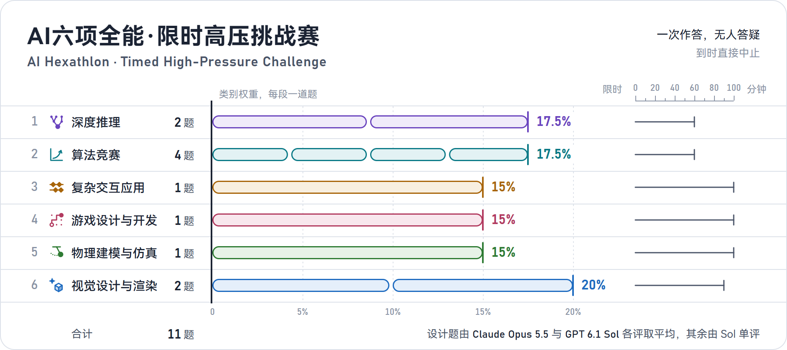
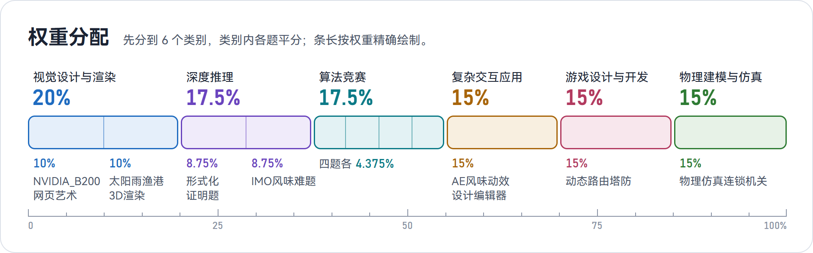
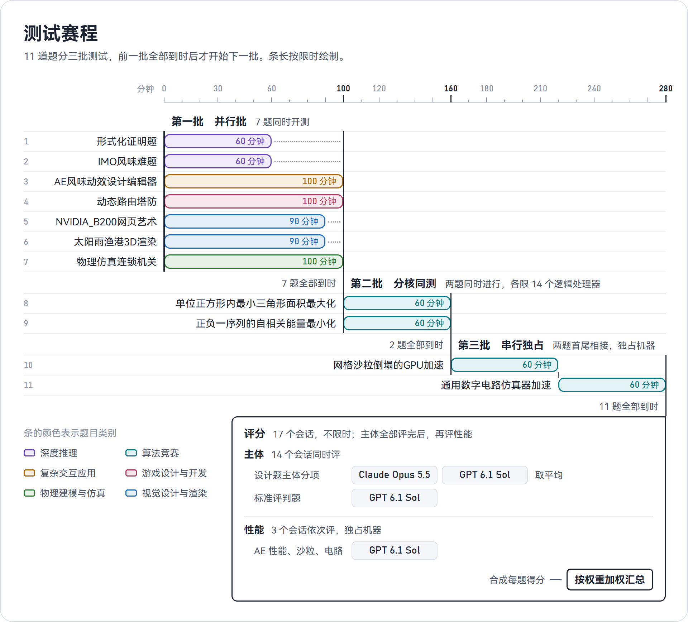
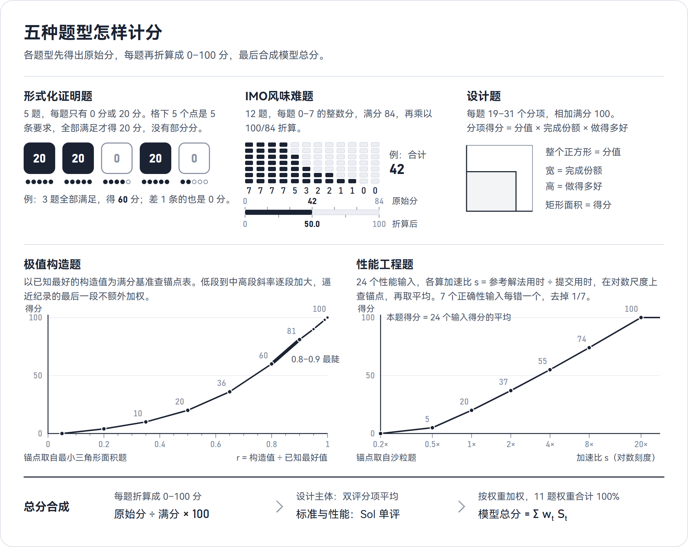
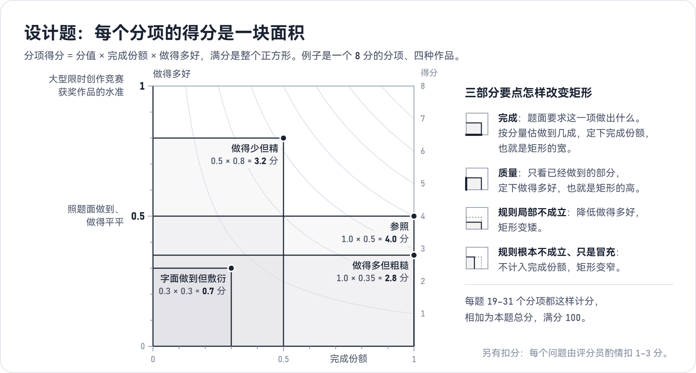

<p align="center"></p>

<p align="center">一次机会，限时作答，无人答疑：11 道题、6 个类别，看 AI 编程智能体能否独立交付完整、正确、出色的作品。</p>

---

## 目录

- [项目简介](#项目简介)
- [题目总览](#题目总览)
- [题目与考点](#题目与考点)
- [测试形式](#测试形式)
- [打分机制](#打分机制)
- [仓库结构](#仓库结构)
- [设计原则](#设计原则)

## 项目简介

AI六项全能·限时高压挑战赛（AI Hexathlon · Timed High-Pressure Challenge）是一套给 AI 编程智能体做的单次限时评测。受测模型通过自己的智能体工具，在 60–100 分钟内独立完成一道题：期间没有人回答问题，到时直接中止，也没有第二次机会。11 道题分属深度推理、算法竞赛、复杂交互应用、游戏设计与开发、物理建模与仿真、视觉设计与渲染 6 个类别，从 Lean 形式化证明、竞赛数学、极值构造、性能优化，一直到整件网页作品的设计与开发。主动设计题主体由 Claude Opus 5.5 和 GPT 6.1 Sol 独立评分，主体分项取平均；标准评判题和所有性能测试只由 Sol 评分。各题折算成 0–100 分后按权重汇总为模型总分。

## 题目总览

| 类别 | 题目 | 限时 | 交付物 | 权重 |
|---|---|:---:|---|---:|
|  深度推理 | [形式化证明题](深度推理/形式化证明题.md) | 60 分钟 | `Problem1.lean`–`Problem5.lean` | 8.75% |
|  深度推理 | [IMO风味难题](深度推理/IMO风味难题.md) | 60 分钟 | `answer.md` | 8.75% |
|  算法竞赛 | [单位正方形内最小三角形面积最大化](算法竞赛/极值构造/单位正方形内最小三角形面积最大化.md) | 60 分钟 | `answer.md` | 4.375% |
|  算法竞赛 | [正负一序列的自相关能量最小化](算法竞赛/极值构造/正负一序列的自相关能量最小化.md) | 60 分钟 | `answer.md` | 4.375% |
|  算法竞赛 | [网格沙粒倒塌的GPU加速](算法竞赛/性能工程/网格沙粒倒塌的GPU加速.md) | 60 分钟 | `solution.cu` | 4.375% |
|  算法竞赛 | [通用数字电路仿真器加速](算法竞赛/性能工程/通用数字电路仿真器加速.md) | 60 分钟 | `solution.cpp` | 4.375% |
|  复杂交互应用 | [AE风味动效设计编辑器](复杂交互应用/AE风味动效设计编辑器.md) | 100 分钟 | 网页项目，双击 `index.html` 即可运行 | 15% |
|  游戏设计与开发 | [动态路由塔防](游戏设计与开发/动态路由塔防.md) | 100 分钟 | 网页项目，双击 `index.html` 即可运行 | 15% |
|  物理建模与仿真 | [物理仿真连锁机关](物理建模与仿真/物理仿真连锁机关.md) | 100 分钟 | 网页项目，双击 `index.html` 即可运行 | 15% |
|  视觉设计与渲染 | [NVIDIA_B200网页艺术](视觉设计与渲染/NVIDIA_B200网页艺术.md) | 90 分钟 | 网页，双击 `index.html` 即可运行 | 10% |
|  视觉设计与渲染 | [太阳雨渔港3D渲染](视觉设计与渲染/太阳雨渔港3D渲染.md) | 90 分钟 | 网页项目，双击 `index.html` 即可运行 | 10% |
| **合计** | **11 题** | | | **100%** |

权重先分到类别，类别内各题平分：

<p align="center"></p>

## 题目与考点

每道题一张卡片：要做什么、考点在哪里、怎样计分。题面原文见各类别文件夹。

###  深度推理

考纯粹的数学推理深度与严谨性：一题要让 Lean 4 内核逐步认可证明，一题要在不用任何计算工具的情况下，按 IMO 竞赛的作答规格写出解答。两题都是 60 分钟内面对多道难题，先做哪几道、时间怎样分配，本身也是考点。

#### 形式化证明题
> 用 Lean 4 + Mathlib 写出能通过编译和公理检查的形式化证明，能证几道是几道。

| 限时 | 交付物 | 权重 | 计分 |
|---|---|---|---|
| 60 分钟 | `Problem1.lean`–`Problem5.lean` | 8.75% | 每题 0 或 20 分，全部要求都满足才得分 |

**要做什么**：五道题由易到难排列（题面不标难度），每题给出中文表述和一条固定的 Lean 命题，只能把 `sorry` 换成证明，定理名和命题一字不改。方向依次是常微分方程、有限域上的多项式方法、极值集合论、线性代数、复分析，都是经典定理或研究论文中的结论。本机装有预编译好的 Mathlib，可以随时编译检查、搜索 Mathlib 源码，但不能联网。

**考点**
- 形式化能力：把纸面证明拆成 Lean 能接受的引理链，熟悉 Mathlib 的定义、API 和命名。
- 零容错：编译不过、留下 `sorry`、改动命题或引入额外公理，这一题就是 0 分，没有部分分。
- 不许绕过内核：不得用 `native_decide`，也不得借 `set_option`、元编程跳过检查，`#print axioms` 只能出现三条标准公理。
- 数学与代码的切换：先理清纸面证明，再一步步落到可编译的代码。
- 限时取舍：编译检查有成本，要判断哪几道有把握、先做哪道，选定后一道道证完。

<details><summary>评分方向</summary>

每题单独检查：单独编译无错误，只导入 Mathlib 及其依赖库中的模块，定理名和命题与题面一致，没有 `sorry`、`admit`、新公理或 `native_decide`，`#print axioms` 只含 `propext`、`Classical.choice`、`Quot.sound`。全部满足得 20 分，否则 0 分；证明的长短和风格不影响得分。

</details>

#### IMO风味难题
> 不借助任何计算工具，按 IMO 竞赛的作答规格，为十二道 IMO 风格的原创题写出中文解答。

| 限时 | 交付物 | 权重 | 计分 |
|---|---|---|---|
| 60 分钟 | `answer.md` | 8.75% | 每题 0–7 分，共 84 分，折算到 100（每题 100/12 分） |

**要做什么**：十二道题都是本项目全新命制的原创题，从前三批原创题与加难题共 54 道候选中，按 GPT 6.1 Sol 无工具实测的单题用时选最耗时的题，并让代数、数论、几何、组合各占 3 道；不是历年原题，网上查不到，也无法靠记忆作答。题目覆盖有限值数列、多变量不等式、多项式、模素数、阶与原根、二项式整除、平面几何剖分、内切圆与圆内接多边形、组合几何、图上的过程、加法组合和映射串。12 道都要先求出答案（全部解、最值、最优常数或分类）再证明。解答用简体中文和 LaTeX 写进 `answer.md`，每题一节，做完一题就立即写入。求全部解的既要验证所给的解，也要排除其他解；求最值的既要给出取到的构造，也要证明不能更优；可以引用常见定理，但要写明名称和内容。全程只能靠推理：不得编写或运行任何程序验算，也不得使用计算机代数系统、数值库和定理证明器。

**考点**
- 竞赛级的数学洞察：每道题都要找到关键的构造、不变量或引理，套路做不出来。
- 按 IMO 作答规格书写：解答达到 IMO 阅卷给满分的标准，不多也不少。
- 纯推理：没有程序和数学软件兜底，验算、试例全靠推理。
- 书面表达：把推理写成评阅人能逐步核对的证明。
- 时间分配：60 分钟十二道题，先挑能拿分的题，把会做的写稳。

<details><summary>评分方向</summary>

GPT 6.1 Sol 对照参考答案，按 IMO 阅卷惯例逐题给 0–7 分的整数分：完整正确给满分，与参考答案不同的正确解法同样给满分；不完整的按完成程度给部分分，只有答案没有证明、关键步骤缺失或论证有漏洞的相应扣分，写得简练但 IMO 阅卷认可的不扣分。写了多种做法而没注明以哪份为准的，按得分最低的一份计。12 题满分 84，乘以 100/84 折算为本题得分。

</details>

###  算法竞赛

考在硬指标下做工程化的搜索与优化：两道极值构造题比构造的质量，两道性能题比相对参考解法的加速比。分数按题面公式精确算出：极值构造题从普通到较好水平分差逐段拉大，逼近纪录的最后一段不额外加权；性能题加速比越高，同样的提速得分越多。

#### 单位正方形内最小三角形面积最大化
> 在单位正方形里放 30 个点，让其中任意三点构成的最小三角形面积尽可能大。

| 限时 | 交付物 | 权重 | 计分 |
|---|---|---|---|
| 60 分钟 | `answer.md`（30 行坐标） | 4.375% | 按与已知最好构造值之比，在锚点表上插值 |

**要做什么**：给出 30 个点的坐标，评测按所写的十进制值精确计算全部 4060 个三点组合的最小面积 $\Delta$，越大越好。点必须落在 $[0,1]^2$ 内，越界的构造无效；坐标的书写格式从宽处理，读得出内容就按内容评测。可以在本机自由编写、编译和运行搜索程序；本题与另一道极值构造题同时进行，各限 14 个逻辑处理器，共用一块 GPU。

**考点**
- 搜索策略：目标是“最小值的最大化”，不光滑、局部最优极多，普通梯度和随机重启很快到平台。
- 逼近前沿：越往上越需要高效退火、对称结构搜索和高精度的局部精修。
- 精确性：按书面十进制值精确判定，舍入后共线或越界都会前功尽弃。
- 算力受限：在 14 个逻辑处理器、60 分钟里权衡并行广搜和单点精修。
- 换思路：某个方向停滞时能否及时转向。

<details><summary>评分方向</summary>

无效提交得 0 分。有效时计算 $r=\Delta/\Delta^*$（$\Delta^*$ 为已知最好的构造值），在锚点表上分段线性插值：低段、中段到中高段斜率逐段加大，0.9 以后逼近纪录不额外加权，达到或超过已知最好值得 100 分。

</details>

#### 正负一序列的自相关能量最小化
> 构造一条长 251 的 ±1 序列，让它的非周期自相关能量尽可能小。

| 限时 | 交付物 | 权重 | 计分 |
|---|---|---|---|
| 60 分钟 | `answer.md`（一行 251 个 `+`/`-`） | 4.375% | 按能量值在锚点表上插值 |

**要做什么**：对序列 $s\in\{-1,+1\}^{251}$，能量 $E(s)$ 是各阶非周期自相关 $C_k(s)$ 的平方和，越小越好。提交只有一行 251 个字符，评测按定义精确算出 $E$；书写格式从宽处理，读得出 251 个 ±1 就按内容评测。可以在本机自由编写、编译和运行搜索程序；与另一道极值构造题同时进行，各限 14 个逻辑处理器。

**考点**
- 崎岖的搜索空间：$2^{251}$ 种序列，地形极其崎岖，常规爬山和退火很快停在中等水平。
- 增量计算：翻转一位后快速更新能量，决定每秒能评估多少邻居。
- 搜索的层次：结构约束、禁忌搜索、防循环与强化策略，越往后越考验算法功底。
- 多核并行：在 14 个逻辑处理器上有效组织多条搜索链。
- 限时工程：60 分钟里写出、调好并跑足一个高性能搜索器。

<details><summary>评分方向</summary>

无效提交得 0 分。有效时直接用整数能量 $E$ 在锚点表上分段线性插值：$E$ 越小得分越高，低段、中段到中高段斜率逐段加大，逼近已知最好值的最后一段不额外加权，达到或低于已知最好值得 100 分。

</details>

#### 网格沙粒倒塌的GPU加速
> 用 CUDA 在 RTX 4080 上，把 4096×4096 网格的沙堆倒塌过程尽快算到稳定状态。

| 限时 | 交付物 | 权重 | 计分 |
|---|---|---|---|
| 60 分钟 | `solution.cu` | 4.375% | 24 个性能输入相对参考解法的加速比，按对数锚点插值后取平均 |

**要做什么**：格子里的沙粒达到 4 粒就倒塌，向四邻各送一粒，反复进行直到全部稳定；稳定状态唯一，结果必须逐格与标准答案一致。提交实现 `init()` 和 `solve()`，初始网格已在显存里，全部计算必须在 `solve()` 中由 GPU 完成，主机只能读回少量控制信息。性能输入为 $L=4096$、总沙粒不超过 $2^{23}$，共 8 类分布、每类 3 个实例，测试输入要自己构造；作答时独占整台机器。

**考点**
- GPU 并行算法：倒塌在时间和空间上高度不均，朴素的逐轮全网格扫描大量空转。
- 访存与同步：分块、合并访存，减少全局同步和内核启动的开销。
- 精确正确：7 个正确性输入每错一个，本题得分去掉 1/7；性能输入算错的，该输入记 0 分。提速不能以牺牲正确为代价。
- 平台约束：Windows 下单个内核超过约 2 秒会触发驱动重置；不能用 Driver API 和第三方库。
- 规则边界：`init()` 只许分配和清零，不能偷做预计算，也不能在 CPU 上算格子。

<details><summary>评分方向</summary>

编译失败或违反规则，整题 0 分。24 个性能输入各自按加速比 $s=R/C$（$R$ 为同场运行的参考解法耗时）在对数尺度上插值：$s$ 为 0.2、0.5、1、2、4、8、20 时得 0、5、20、37、55、74、100 分，本题取 24 个输入的平均，再乘以通过的正确性输入个数 ÷ 7。

</details>

#### 通用数字电路仿真器加速
> 在 CPU 上把一个 50 万门的同步时序电路，对 4096 组随机激励各仿真 512 个周期，越快越好。

| 限时 | 交付物 | 权重 | 计分 |
|---|---|---|---|
| 60 分钟 | `solution.cpp` | 4.375% | 24 个性能输入相对参考解法的加速比，按对数锚点插值后取平均 |

**要做什么**：电路由八种逻辑门（含 MUX）和 8192 个触发器组成，门不一定按依赖顺序给出；每组激励由给定的伪随机数生成，输出用异或摘要压成一个 64 位数。提交实现 `simulate()`，只能用 CPU，可以用 OpenMP、编译器内建函数和 AVX2 指令。评测时进程限定在 8 个性能核、16 个线程上；性能输入是 8 类、共 24 个完整规模电路，种类多、难度大，测试输入要自己构造。

**考点**
- 位级并行：组织多组独立激励同时计算，把 64 位字和 SIMD 用满。
- 电路预处理：排序、化简与布局，让 50 万个门的求值顺序对缓存友好。
- 多线程与内存：全部状态远超缓存容量，数据布局和线程分工决定上限。
- 精确正确：摘要逐位与标准答案一致；7 个正确性输入每错一个，本题得分去掉 1/7。
- 通用性：对任意合法电路都要正确，不能针对具体输入硬编码。

<details><summary>评分方向</summary>

计分方式与沙粒题相同，锚点为 $s$ 为 0.1、0.5、1、1.75、2.75、4 时得 0、10、30、52、75、100 分，本题取 24 个输入的平均，再乘以通过的正确性输入个数 ÷ 7。编译失败或违反规则，整题 0 分。

</details>

###  复杂交互应用

考构建大型专业工具的能力：几十项功能深度耦合，组合使用时都要正确，几个视图始终一致，并在十几万图层的规模下保持高性能。

#### AE风味动效设计编辑器
> 在浏览器里做一款对标专业合成软件的动效设计编辑器，带表达式、效果、形状操作器和三维摄像机，并用它自己做出一段配乐卡点的 10 秒炫技示例动画。

| 限时 | 交付物 | 权重 | 计分 |
|---|---|---|---|
| 100 分钟 | 网页项目，双击 `index.html` 即可运行 | 15% | 8 个方向、31 个分项；性能按实测耗时公式计分 |

**要做什么**：编辑器要支持多合成，形状、文字、空对象、调整图层、摄像机和预合成图层，五项变换、锚点与父子层级，关键帧与线性、贝塞尔、定格插值，时间轴、曲线编辑器（值曲线与速度曲线）和画布上的运动路径。此外还有形状变形、修剪路径、蒙版与轨道遮罩、预合成与时间重映射、文字动画器、运动模糊、撤销重做、工程文件和视频导出，以及五项更贴近专业软件的高级功能：表达式（time、wiggle、loopOut、属性引用等）；形状操作器（重复器、偏移路径、圆角、虚线、渐变、摆动路径）；效果、调整图层与混合模式；文字沿路径与沿路径自动定向；三维图层与摄像机（透视、深度排序、景深）。合成画面要用 WebGL 2 在显卡上渲染。编辑器还要能导入音频或用音色图层发声，预览时声画同步，导出的视频带音轨。界面有规定的布局和“墨蓝灰底色 + 熔岩橙代表时间 + 冰蓝代表选择”的视觉规范，关键帧形状、动画开关等状态都有明确的标示。打开时自动载入一段 10 秒示例：圆点点火、爆裂成 16 枚形体，列阵组成分两层纵深转动的机关并快进、定格、倒放，摄像机穿过圆环、在三维转台上甩过四块字牌，再由发光的光带扫出标题、收回圆点，形体从镜头后方飞回聚成徽记；画面全部要用编辑器里可编辑的图层、关键帧、表达式、效果和操作器做成，配乐只用音色图层合成并卡在每分钟 150 拍上。

**考点**
- 功能耦合：在带动画的父级之下、嵌套合成和时间重映射之中，于任意时刻编辑，被抓住的点仍留在光标下。
- 一致性：画布、时间轴、曲线编辑器、属性面板始终同步，撤销重做、保存打开、导出前后结果不变。
- 动画数学：时间插值与空间路径互不干扰，嵌套时间精确取值、不对齐到帧，运动模糊按画面上的实际运动产生。
- 渲染架构：效果、混合模式、三维透视、景深与多样本运动模糊叠在一起，还要在预合成、轨道遮罩和表达式之下都成立。
- 声画同步：声音随预合成和时间重映射一起工作，预览和导出都与画面对齐。
- 规模性能：6.5 万图层的批量编辑、13 万图层的复制与撤销、带蒙版和运动模糊的 600 帧导出，都按实测耗时计分。
- 专业审美：编辑器要像一台精密仪器，示例动画要有预备、过冲、错落和清楚的焦点。
- 限时取舍：100 分钟面对远超可完成量的功能清单。

<details><summary>评分方向</summary>

| 评分方向 | 分值 | 包含的分项 |
|---|---|---|
| 关键帧、时间轴与表达式 | 16 | 关键帧与插值、关键帧选择与编辑、时间轴与播放、曲线编辑器、运动路径与自动定向、表达式 |
| 图层、形状与文字 | 16 | 合成与图层、画布变换与父级、形状变形与修剪路径、形状操作器、文字动画器、文字沿路径、音频 |
| 蒙版、效果与时间 | 13 | 蒙版与轨道遮罩、效果调整图层与混合模式、预合成与时间重映射、运动模糊 |
| 三维与摄像机 | 10 | 三维图层与混排、摄像机与景深、三维下的画布编辑 |
| 一致性与导出 | 10 | 四个视图同步、复杂情形下的编辑、撤销重做与工程文件、导出与预览一致 |
| 界面设计 | 10 | 布局与视觉风格、面板与状态标示、命令与输入、整齐可读与过渡 |
| 性能 | 10 | 六个固定规模的计时任务，按实测耗时在对数公式上计分 |
| 示例动画 | 15 | 画面与功能的完成度（含配乐卡点）、动效与色彩的质量 |

扣分：不设零分或固定扣分条款；评分员发现认为需要扣分的问题，每个酌情扣 1–3 分，写明问题、依据和扣分。

</details>

###  游戏设计与开发

考把一套环环相扣的规则系统做成完整的游戏：寻路、战斗、经济、美术和信息呈现同时成立，大量单位同场时判定依然正确、画面依然清楚。

#### 动态路由塔防
> 做一款三维塔防《网络安全攻防战》：隔离交换节点逼敌人改道，塔会被打掉，路线随战局实时重算。

| 限时 | 交付物 | 权重 | 计分 |
|---|---|---|---|
| 100 分钟 | 网页项目，双击 `index.html` 即可运行 | 15% | 5 个方向、22 个分项，合计 100 分 |

**要做什么**：战场是网络空间里一块悬浮的三维网格，恶意程序沿链路自动寻路冲向“中枢”；在交换节点上部署塔或插入隔离器会截断链路、逼敌人改道，节点上的塔被摧毁后链路重新打开。题面设计好了三张光场各异的地图（明亮的分段内网 14 波、暮色的骨干流域 15 波、墨黑的气隙深层 16 波），八种有生命值、可升级的塔，八种各有反制手段的敌人和三个会改变地形的 Boss，还有四种道具、算力与情报两种资源，以及“明文、可疑、隔离、清除”的状态链。任何操作都不能把入口或敌人切成孤岛，部署前要能预览改道后的路线。美术是“立体网络图”：磨砂玻璃地块、透光的守方几何体、吸光的敌方暗色实体。菜单里还有三段实战演示，在游戏本身的逻辑上实时演出：隔离改道、旁路直通、蛰影改变地形。待部署栏按阻挡、隔离、远程、支援、地形给塔分组；镜头按 Blender 的方式操作。游戏还有自制的环境声、音乐和各类事件的音效，以及音量设置和静音。

**考点**
- 动态寻路与改道：通行随部署、摧毁、撬锁和 Boss 能力随时变化，场上敌人从当前位置重新寻路，不瞬移、不卡住、不穿墙。
- 禁止封死与预览一致：操作前就能判断会不会切出孤岛，预览与实际一致，同一时刻的多个变化也要正确结算。
- 多系统结算：阻挡、互相攻击、加密、护盾、状态链和配合效果交织，结果都要与游戏内说明一致。
- 关卡与经济：隔离方案要在入口之间形成取舍，改道有代价，不能有几乎零成本反复改道的打法。
- 3D 美术与可读性：单位和特效很多、加速时，路线、节点状态、生命和状态依然一眼看清。
- 时钟与重开：暂停、放慢、加速、切走标签页和重新开始时，判定不乱、不残留。

<details><summary>评分方向</summary>

| 评分方向 | 分值 | 包含的分项 |
|---|---|---|
| 寻路与改道 | 14 | 通行与路线、改道过程、预览与禁止封死 |
| 单位与战斗 | 21 | 塔与道具、敌人与 Boss、交战与状态 |
| 关卡与经济 | 18 | 地图、波次与难度、资源与代价、时钟与重开 |
| 美术 | 27 | 场景与光照、造型与动画、特效、界面美术、风格与完成度 |
| 信息与操作 | 20 | 地形与路线信息、战斗与局势信息、反馈与过渡、操作、说明与文案、实战演示、声音 |

流畅度和帧率不计入评分。扣分：不设零分或固定扣分条款；评分员发现认为需要扣分的问题，每个酌情扣 1–3 分，写明问题、依据和扣分。

</details>

###  物理建模与仿真

考从零实现多种物理机制并让它们正确耦合：不准用任何物理引擎，刚体、绳索、弹簧、流体和光学在同一个实时仿真里相互作用，同时呈现有原理展板和经典道具的物理实验室，重视材质、光影与界面，不测性能。

#### 物理仿真连锁机关
> 在网页里从零写一套三维物理仿真，做出 10 环单路连锁的动力装置：一次敲击，最后让晨光在物理实验室后墙上投出光谱。

| 限时 | 交付物 | 权重 | 计分 |
|---|---|---|---|
| 100 分钟 | 网页项目，双击 `index.html` 即可运行 | 15% | 5 个方向、24 个分项，合计 100 分 |

**要做什么**：物理实验室里的机关由 10 个环节连成一条线：五球摆、绕白柱盘旋的螺旋滚道、沿弧线倒下的方块骨牌、坠锤绞轮吊起提轨放出滚筒、弹簧跷板、天池翻斗、浮塞水箱，水注满吊桶后拉起高窗的遮光板，吊桶沉进晨池激起波纹；晨光经水下浮镜、晃动的水面和三棱镜色散，在后墙上铺成光谱。仿真和画面都是三维的，用到刚体碰撞与摩擦、滚动、绳索与滑轮、弹簧与振动、流体、光学六种机制，其中有七处双向耦合。默认参数下从敲击到达成目标 25–30 秒，天池的水从漫出到被翻斗泼进水箱不超过 4 秒。墙和地面是中等明度的暖灰，白色的装置在前面轮廓分明；后墙六块原理展板用图示呈现碰撞与动量、滚动与倾倒、绳索与滑轮、弹簧与振动、浮力与流体、折射与色散，实验台和墙边陈设陀螺仪、麦克斯韦滚摆、克拉尼板、牛顿摆、高尔顿板、阿特伍德机、傅科摆、光具座、辐射计、笛卡尔潜水员和范德格拉夫起电机，配黑板、仪器车与实验凳。装饰固定不动、比装置暗，不遮挡行程、水流、光路或跟随镜头。播放时镜头给正在运动的部分特写，物体到哪里就快速跟到哪里，交接时让双方同在画面中，也能随时手动环绕。部件与投放物有各自清楚可辨的金属、木、玻璃等材质和看得见的支撑，不悬浮，水有流动感；天光带提供柔和主光，晨光形成清晰的硬影与收尾光谱。装置运转时有由仿真事件触发的声音。打开辅助显示，画面上像图纸标注一样实时标出力、速度、张力、液面、浮力、折射角等物理量；播放中随时改参数，连锁都按新参数继续走到终点。每个环节都是可单独打开的节点，有受力卡、记纹鼓曲线、能量账本、按环节分组的参数面板，以及可在三维中投放、批量加大规模的试验台；投放物实际参与仿真，规模真实，不测性能。

**考点**
- 自己实现三维物理：碰撞检测、约束求解、数值积分和流体计算全部手写，禁用一切物理引擎和库里的同类模块。
- 真交接：每一环都由前一环的物理过程推动，画面上看得清是什么推动了下一环；不能用脚本、计时器或预设动画触发，也不能预先算好再回放。
- 双向耦合：跷板与滚筒、天池与水、翻斗与水、浮子与浮塞、吊桶与桶里的水、吊桶与晨池、浮镜筏与波浪，双方都受到反作用。
- 调参不断链：参数在可调范围内任意组合、播放中任何时刻改动，连锁都走到终点，靠的是装置本身的余量，不能在停滞时补救。
- 画面与声音跟着仿真：物理实验室中的三维渲染，从任何角度看，轮廓、接触、液面和光路都严格落在仿真结果上；正常速度下仿真时间与真实时间同步，声音由对应的仿真事件触发。
- 材质、光影与环境：装置与投放物各有可信的材质，软硬光、接触阴影、水面反射与折射清楚；六块原理展板和经典物理道具构成统一、克制的实验室背景，不干扰机关运转。

<details><summary>评分方向</summary>

| 评分方向 | 分值 | 包含的分项 |
|---|---|---|
| 连锁运转 | 14 | 环节与交接、起止与复现、参数生效、调参不断链 |
| 物理正确 | 26 | 各机制的现象、双向耦合与联动、液体耦合、传力与能量、数值稳定 |
| 美术与材质 | 20 | 美术方向与造型、材质、支撑与结构、实验室环境与装饰 |
| 光影与动态表现 | 22 | 光照与阴影、液体与光、关键时刻的反馈、镜头、画面精度、音效 |
| 界面与数据显示 | 18 | 辅助显示，节点卡、记纹鼓与能量账本，播放控制与总图，节点、试验台与参数面板，界面设计 |

“音效”只看声音是否由仿真事件触发，不评好不好听。

扣分：不设零分或固定扣分条款；评分员发现认为需要扣分的问题，每个酌情扣 1–3 分，写明问题、依据和扣分。

使用物理引擎、预先计算整段再回放、脚本或计时器直接触发交接、卡住后由代码补救做出的部分，算没有做到，不计完成份额；这是分项给分定义，不是扣分。

</details>

###  视觉设计与渲染

考实时图形的技术上限与视觉设计的审美：一题是滚动驱动、效果密集的网页艺术，一题是精细的三渲二微缩场景和随风、云、雨变化的氛围。

#### NVIDIA_B200网页艺术
> 以 NVIDIA B200 这颗 GPU 本身为题材，做一个按尺度递进、纵向长滚动、中段横向滚动的炫技网页：整颗封装与爆炸图、接缝、显存堆栈、精度位格、NVLink 与机柜、规格总表，再回到整颗封装；每章点名的 SVG 动画、三维建模、滚动转场和鼠标交互都有要求。

| 限时 | 交付物 | 权重 | 计分 |
|---|---|---|---|
| 90 分钟 | 网页，双击 `index.html` 即可运行 | 10% | 6 个方向、24 个分项，合计 100 分 |

**要做什么**：八章依次是光刻极限、封装与爆炸图、接缝与片间互连、HBM3e 显存与带宽、精度与张量核心、NVLink 与多卡互连、规格总表、整颗封装。全页是一台显微镜式的仪器在看一颗 B200：四角仪表框固定在屏幕上，右上的比例尺从 10 mm 一路换到 1 bit 再回到 10 mm，每次换级刻度重新分度。三维部分是按部件写细的 B200 封装（焊球、多层基板与加固框、中介层与硅桥、两颗硅片的版图、8 个显存堆栈），随滚动分层爆开与收拢，剖析台里可以转动、推近、单独展开、沿引导线快速划开剖切、拖开接缝，再压成平面图进入横穿两颗硅片的横向段，进出各有一处 45° 倒角的转弯，后面从 NVLink 线稿立起成平台与机柜。平面部分是 64 位通道的位格形变、量化数轴与精度对比、三区线路图和规格总表。各章点名了约 25 项 SVG 动画：晶体管点阵从大数字散开落到硅片格子、等轴测分层线稿随爆炸图叠起、版图线稿按笔画描出、删除线划掉“2 颗硅片”换出“1 颗 GPU”、位格裂开归组、链路描边后跑光点、产品字形互相形变、功耗数字的热扰动等。大模型只在平台的切分汇合和末章的负载演示里出现。风格是“暗场与版图”，推荐 NVIDIA 主题配色。不用官方素材，页面写明“本页为概念设计作品，非 NVIDIA 官方页面”。

**考点**
- 效果的种类与结合：排版、SVG 动画、三维、滚动转场和鼠标交互服从同一条尺度主线和同一套视觉语言，比的是技巧的种类、难度和结合，不是粒子、物件的数量；用图片、视频、位图序列、预渲染或淡入淡出冒充的效果不算。
- 平面设计：版面与网格、宽窄两极的排版与字号层级、信息图与规格总表、标注栏与仪表框，层级清楚、数据与图形一致。
- SVG 动画：点阵聚散、分层线稿叠起、线稿描出、引线与链路脉冲、位格与数轴分度、字形形变与替换，都是矢量图形本身在动，随滚动可倒放，与三维套准不脱开。
- 三维造型与渲染：按部件建模的 B200 封装经得起推近，爆炸图随滚动展开收拢，划开后的截面按材质分剖面线，线稿立起成平台与机柜；光照、材质和后期干净，三维物体、脉冲与引线处在同一个空间。
- 转场与交互：章与章之间镜头状态连续，衔接由元素形变或镜头连续运动完成；剖析台、划开剖切、精度对比、各章悬停与点击都落到画面上，能用键盘操作、随时打断；快速滚动、跳转、中部刷新、反向滚动时画面完整、无残留。

<details><summary>评分方向</summary>

| 评分方向 | 分值 | 包含的分项 |
|---|---|---|
| 美术风格 | 10 | 风格与视觉语言、色彩分工、动效与光标的性格 |
| 平面设计 | 20 | 版面与网格、排版与字号层级、信息图与图表，标注栏、引线与仪表框，三维与平面的组合 |
| SVG 动画与动态图形 | 20 | 点阵与线稿，引线、链路与脉冲，位格、数轴与读数，字形与替换 |
| 三维造型与渲染 | 20 | B200 模型与爆炸图、剖切截面与显存堆栈、平台与机柜，光照、材质与画质 |
| 转场、滚动与导航 | 15 | 衔接与形变、镜头与尺度，滚动、固定段与横向段，跳转、刷新与导航 |
| 交互 | 15 | 剖析台、精度对比与全页精度、各章的悬停与点击，光标、键盘与打断 |

流畅度和帧率不计入评分。扣分：不设零分或固定扣分条款；评分员发现认为需要扣分的问题，每个酌情扣 1–3 分，写明问题、依据和扣分。

</details>

#### 太阳雨渔港3D渲染
> 用 Three.js 做一件三渲二风格的微缩三维模型：太阳雨中的日式小渔港堤岸，可以自由旋转、缩放细看。

| 限时 | 交付物 | 权重 | 计分 |
|---|---|---|---|
| 90 分钟 | 网页项目，双击 `index.html` 即可运行 | 10% | 6 个方向、19 个分项，合计 100 分 |

**要做什么**：正方形底座上一半是灰白混凝土的 L 形码头，一半是港湾水域，侧壁露出岸壁和半透明的水体剖面；码头转角泊着三四艘船，往后是防波堤和红白灯塔，远角是有鸟居和石狐的山坡。场景里有几十样指定的物件：透过玻璃能看清的驾驶舱（雷达屏、冒着热气的搪瓷杯、护身符），半拉起卷帘门的渔协仓库，落地窗的候船室，以及乐器箱、透明雨伞等“人刚离开的痕迹”，但不出现人物和 UI。动态分三层：一直在进行的细小动态（水面、色块化倒影、滴水、雨链），阵风、云遮日和雨势起伏带来的成片变化（彩虹、灯塔自亮），以及海鸥、港猫、过往渔船的涌浪等偶发事件；镜头推近海鸥和猫时，它们还会有反应。

**考点**
- 建模工作量：几十样物件推近都认得出、有细节，摆放不悬空、不穿插。
- 三渲二画风：卡通着色、纤细连贯的轮廓线、色块化的水面倒影，所有物体画风统一。
- 光照一致：高调低对比的太阳雨光线，光柱、高光、投影来自同一个太阳，云遮时一起变化，彩虹在背光一侧。
- 动态编排：风、云、雨各按自己的节奏起伏，阵风和涌浪沿路径先后传递，事件之间留出安静的间隔。
- 合理的细节：雨只落在露天处，涟漪只在水面，船浮在水上，缆绳两端连对。
- 镜头约束：自由拖拽缩放，但不钻到底座下、不穿进船体建筑、不把场景移出画面。

<details><summary>评分方向</summary>

| 评分方向 | 分值 | 包含的分项 |
|---|---|---|
| 构图与纵深 | 8 | 底座与布局、纵深层次与初始视角 |
| 造型与陈设 | 32 | 岸壁水下与消波块、堤岸系泊与生活痕迹、船只与驾驶舱、码头道具、港口建筑与室内 |
| 三渲二画风 | 15 | 着色与画风统一、轮廓线与画面清晰、材质与水面画法 |
| 色彩与光影 | 17 | 配色与冷暖、光照与天空、光柱与闪光 |
| 动态 | 20 | 常驻的细小动态，阵风，云、光与雨势，海鸥、猫与船 |
| 镜头与运行 | 8 | 镜头操作、加载与报错 |

流畅度和帧率不计入评分。扣分：不设零分或固定扣分条款；评分员发现认为需要扣分的问题，每个酌情扣 1–3 分，写明问题、依据和扣分。

</details>

## 测试形式

> **一次会话，一段限时，没有第二次机会。** 受测模型拿到题面后独立作答，期间没有人回答问题，也不给提示。时间一到作答立即中止，留在目录里的就是最终提交。

### 单次限时作答

- 受测模型用自己的智能体工具运行，例如 Claude Code 或 Codex，推理强度默认 `xhigh`。每道题开一个新会话，从拿到题面起计时。
- 限时：两道深度推理题和四道算法竞赛题各 **60 分钟**；两道视觉题各 **90 分钟**，AE 编辑器、塔防和物理各 **100 分钟**。
- 受测模型看到的材料里没有任何作答时间信息：题面、开场提示、续做和故障接回的提示都不写限时和剩余时间，也不说明提醒和续做机制。
- 没有人回应模型的提问。宿主按下表的规则续做或提醒，每次只发送配置中固定的一句话。
- 题面只给平实的说明，不施加压力，也不写零分和扣分条款，并告诉模型评分对提交格式很宽容；设计类题面要求把作品的完成度做到尽量高。

### 隔离的作答环境

- 受测会话运行在一个单独的普通 Windows 账户下，这个账户读不到评分资料。每轮开测前，先清空该账户里智能体工具的会话历史和记忆。
- 每道题有独立的作答目录，开测时里面只有这道题的题面。模型只能在这个目录里读写文件，不能访问其他路径，包括同一模型其他题目的目录；编译器、解释器、浏览器等必需工具要用到的安装路径和临时目录除外。
- 所有题都在同一台机器上测试：Windows 11，Intel Core i7-14700KF，NVIDIA GeForce RTX 4080，64 GB 内存。
- 所有题都接入浏览器 MCP（chrome-devtools-mcp），使用本机无窗口 Chrome、显卡和独立临时用户数据目录，受测模型用它打开、操作作品和截图。MCP 启动失败不阻止会话。

### 提醒、进度提交与到时中止

| 机制 | 做法 |
|---|---|
| 续做 | 模型在剩余时间多于 10 分钟时结束一轮，宿主在几秒内发起下一轮，只发一句。主动设计题：“时间充足，继续对照题面的设计内容推进。”标准评判题：“时间充足，继续按照题面解题。”剩余不多于 10 分钟时不再唤醒 |
| 整体进度提醒 | 五道主动设计题在完整限时的一半各提醒一次：100 分钟题在第 50 分钟，90 分钟题在第 45 分钟，发送 reminders.json 中该题专属的“优先推进整体进度”一句话；标准评判题不发。续做按累计已用时间计算，已发不重发，中断漏发在续做开始时补发，但进入最后 10 分钟不补发 |
| 提交提醒 | 每段作答在剩余 10 分钟时提醒一次。主动设计题：“【提醒】建议完成收尾，把可用的版本用 git 提交。”标准评判题：“【提醒】可用的阶段用 git 提交。”所有提醒正文不透露时间；会话正在运行时，在下一次工具调用时送达，会话空闲时发起新的一轮 |
| 故障接回 | API、额度或宿主故障中断作答时，用剩余时间接回原会话继续，提示只说明会话因系统故障中断、此前进度已保留。接回时剩余已不多于 10 分钟的，立即发出提交提醒 |
| 进度提交 | 作答目录是一个 git 仓库。每完成一个可用的阶段，模型用 git 提交一次作为进度节点，每有可用改进就提交。评分时先看作答目录：工作目录完整可用的评作答目录；到时被中止、停在半途的，评最近一次提交；模型一次都没提交过的，评作答目录 |
| 到时中止 | 时间一到，作答直接中止，模型启动的命令、本地服务器、浏览器等也一并结束，时间预算不延长，也不再发起新的一轮。此后作答目录里的文件不再改动 |

### 三个测试批次

<p align="center"></p>

| 批次 | 题目 | 方式 | 为什么这样分 |
|---|---|---|---|
| ① 并行批 | 形式化证明题、IMO风味难题、AE 编辑器、塔防、NVIDIA、渔港、物理仿真连锁机关 | 7 题同时开测 | 这几题作答时不需要独占机器。AE 编辑器的性能在评分阶段独占机器时再测；物理不测性能，塔防和两道视觉题不评流畅度和帧率 |
| ② 分核同测 | 两道极值构造题 | 两题同时进行，各分到 14 个逻辑处理器（4 个性能核的 8 个线程 + 6 个能效核），强制绑核，GPU 两题共用 | 两题都要靠搜索用满算力。两边分到的处理器一样多，既公平又省时间 |
| ③ 串行独占 | 网格沙粒、电路仿真 | 两题依次进行，每题独占整台机器 | 作答过程中要反复测速，其他负载会干扰计时 |

一批全部到时后，先清理残留的程序，再开始下一批。11 道题全部到时后才开始评分。

### 工具与联网规定

所有题通用的规定：

- **不得开启子代理**（subagent），也不得使用任何多代理或并行协作功能，全程独立作答。
- **不得访问 GitHub 上的任何仓库**，网页、`git`、`gh` 命令行和 API 都不行。
- 不得访问作答目录以外的文件路径（见上文）。
- 不得使用 `runas` 等以其他账户身份登录的命令，也不得按进程名批量结束进程（`taskkill /IM`、`pkill`、`Stop-Process -Name` 等）；需要结束进程时，只按 PID 结束自己启动的进程。
- 主动设计题在作答过程中反复对照题面检查和完善；标准评判题只按题面要求作答。

联网和工具的规定按类别不同，以各题面的“规定”一节为准：

| 类别 | 联网 | 可以用什么 | 其他限制 |
|---|---|---|---|
| 深度推理 · 形式化证明题 | 不能联网，也不能调用其他 AI 模型或服务 | 用预装的 Lean 4 + Mathlib 编译检查，也可以用本机已装的其他程序 | 不能安装新的软件或库，不能改动 Lean 的安装目录 |
| 深度推理 · IMO风味难题 | 同上 | 只能读题面，写 `answer.md` 和草稿文件 | 只能靠推理：不得编写或运行任何程序、脚本或命令，也不得使用计算机代数系统、数值计算库、定理证明器或在线数学服务 |
| 算法竞赛 · 极值构造（2 题） | 同上，也不能下载或安装软件包 | 可以编写、编译、运行任何程序，可以用本机已装的软件和库 | 程序只能在分到的 14 个逻辑处理器上运行 |
| 算法竞赛 · 性能工程（2 题） | 同上 | 开发期间可以编译、运行、测试，也可以写任何辅助程序；测试输入要自己构造 | 最终提交的源文件还要遵守题面规则：只能用规定的库；沙粒题的计算全部在 GPU 上完成，电路题只能用 CPU；不得读写文件、联网或启动进程，不得针对输入硬编码，不得干扰计时 |
| 五道网页题（复杂交互、游戏、物理、视觉） | 题面未作限制（GitHub 除外） | 用已接入的浏览器 MCP（使用显卡的本机无窗口 Chrome）操作和截图，截图等临时文件放在临时目录；开发期间需要本地网页服务器时，用题面指定的端口 | 作品要能在 Chrome 中直接双击 `index.html`（本地文件方式，不经过网页服务器）完整运行；素材都要自己制作；NVIDIA 题不得使用 NVIDIA 官方的标志、图片和视频；物理题不得使用任何物理引擎或物理仿真库，可以用渲染库和通用的向量、矩阵运算库 |

### 评分员怎么评

- **评分分工**：双模型评分只用于五道主动设计题的主体分项，由 Claude Code 中的 Claude Opus 5.5 和 Codex 中的 GPT 6.1 Sol 各评一次，取平均；物理整题的 24 个分项由两位评分员各一次评完。性能分项（AE 编辑器的“性能”）和深度推理、算法竞赛六道标准评判题只由 Sol 评分。推理强度都是 `xhigh`。两位互不查看对方的工作目录、结果和评分表。评分员在另一个账户下运行，与受测账户分开；每个评分任务都开一个新的无界面会话。评分员知道受测的是哪个模型，不做盲审。
- **评分依据**：评分员先读题面和这道题的 `AI评分指南.md`。指南是题面评分标准的展开。设计题不设零分或固定扣分条款，评分员发现认为需要扣分的问题，每个问题酌情扣 1–3 分；两位评分员的主体扣分取平均，性能段的扣分只用 Sol 的。标准评判题的编译、公理、提交有效性、正确性等计分定义保持不变。其余内容两者不一致时以题面为准。评分对象：作品完整可用的评作答目录，到时被中止、停在半途的评最近一次 git 提交，模型一次都没提交过的评作答目录。提交是只读的，需要编译或运行时，先复制到评分员自己的工作目录。
- **无窗口浏览器**：打开网页、测试交互、观察画面，一律用本机的无窗口（headless）Chrome，靠截图看画面，不占用桌面。网页题先以本地文件方式（`file:///` 路径）直接打开副本里的 `index.html`；这样不能完整运行的，酌情扣 1–3 分，再在副本目录启动本地网页服务器打开，继续评其余部分。测量性能前，先确认 WebGL 用的是 GPU，而不是软件渲染。
- **从简评分**：按指南的要点逐项看清实际表现，定下分数即可。不深究项目细节，不逐行审查代码，同一个分项不反复测试取证。性能只在性能段测，每项只测一次：先抽查作品自带的性能读数，可靠就直接采用；不可靠时按指南处理，需要时只在副本里修正读取方式后重测。
- **评分顺序**：共 16 对题目与评分员、17 个会话。主体共 14 个会话同时评（设计题 5×2，加形式化、IMO、两道极值构造各 1 个 Sol 会话）；全部结束后，性能共 3 个 Sol 会话按题目表顺序（AE 性能、沙粒、电路）一次只评一个，独占机器。AE 编辑器的“性能”单独成段，与主体结果合并后校验计分；沙粒、电路整题放在最后的性能队列。评分不限时，每 10 分钟提醒一次。

<details>
<summary><b>评分表与结果文件里有什么</b></summary>

- **评分表**：每题每位评分员一份，开评时复制到作答目录。表中填写各分项得分，设计题还要填“完成份额”“做得多好”两个系数；另有方向小计、设计题的扣分问题与依据及分数、本表总分，以及一段 50 字左右的简评。简评要一针见血地写出最能拉开差距的亮点或致命短板，不许端水。分项理由写在结果文件中；设计题的扣分表填写问题、依据和扣分。
- **结果文件**（JSON）：逐分项列出分数、两个系数和一两句理由，另有总分与满分、关键数值（如加速比、Δ、E）、设计题逐条列出的扣分问题、依据和分数（每个问题酌情扣 1–3 分），或标准评判题按计分定义记录的问题与依据，以及给出题人的备注。
- **校验**：结果文件通过自动校验才计分，要求题目和评分员身份对得上，覆盖本段应评的全部分项，分数和满分都是有效数字且不超出范围。偶发故障按段最多重试一次，次数由指挥操作记录核对；设计题主体一位失败时依另一位。单评分员的段重试仍失败，该段没有分数，列入“评分失败”缺口；缺少必需段的题没有本题得分，不按剩余分项放大，模型汇总暂按 0 分计。

</details>

## 打分机制

### 总分怎样合成

每道题先折算成 0–100 分：原始分 ÷ 满分 × 100。标准评判题只由 GPT 6.1 Sol 评分，直接采用它的折算分。设计题按段合成：主体分项逐项取两位评分员的平均，主体段的扣分合计也取两位的平均，只有一位的结果有效时都用该位的；AE 和物理题的性能分项及性能段扣分只用 Sol 的。合成分 = 主体分项平均之和 + Sol 性能分 − 主体段平均扣分 − Sol 性能段扣分，不低于 0，再折算。各题的折算分 $S_t$ 按权重 $w_t$ 加权：

$$
\text{模型总分}=\sum_{t=1}^{11} w_t\,S_t,\qquad \sum_{t=1}^{11} w_t=100\%
$$

权重先分到类别：视觉设计与渲染 20%，深度推理、算法竞赛各 17.5%，复杂交互应用、游戏设计与开发、物理建模与仿真各 15%。类别内的各题平分类别权重，所以每道算法竞赛题是 4.375%。类别得分是该类别各题得分的加权平均。

> **精度**：分项、单题和总分等具体分值都保留一位小数。权重用精确值，例如 8.75%、4.375%，不做舍入。

<p align="center"></p>

### 各题型的计分方式

| 题型 | 题目 | 计分方式 | 零分或扣分 |
|---|---|---|---|
| 形式化证明 | 形式化证明题 | 5 题 × 20 分，每题只有 0 分和 20 分两档 | 没有，各题互不影响 |
| 纸面证明 | IMO风味难题 | 12 题 × 0–7 整数分，满分 84，乘以 100/84 折算 | 没有，各题互不影响 |
| 极值构造 | 两道极值构造题 | 构造质量查锚点表，分段线性插值 | 提交无效记 0 分 |
| 性能工程 | 沙粒、电路 | 24 个性能输入各按相对参考解法的加速比查锚点表，取平均 | 编译失败或违反题面规则记 0 分；正确性输入每错一个，去掉 1/7 |
| 设计题 | AE、塔防、物理、NVIDIA、渔港 | 19–31 个分项，每项按分值 × 完成份额 × 做得多好计分 | 认为需要扣分的问题，每个由评分员酌情扣 1–3 分；不设零分或固定扣分条款 |

**形式化证明题**：一题的文件同时满足以下各条才得 20 分，否则得 0 分，没有部分分：单独编译没有错误（警告不影响）；只导入 Mathlib 及其依赖库中的模块；定理名和命题与题面一致，没有用新的记号、实例、宏等改变命题含义；没有 `sorry`、`admit`、新声明的公理或 `native_decide`，也没有绕过内核检查；`#print axioms` 的结果里只有 `propext`、`Classical.choice`、`Quot.sound`。证明的长短和写法不影响得分。

**IMO风味难题**：按 IMO 竞赛的阅卷标准给分，证明的详略也按 IMO 竞赛的标准，写得简练但阅卷认可的不扣分。解法与参考答案不同的，只要正确完整，同样给满分；解答不完整的，按完成程度给部分分；只有答案没有证明，或者证明有缺漏的，相应扣分。一题写了多种做法却没注明以哪一份为准的，按得分最低的一份评分。只评 `answer.md`，草稿不计分。

**极值构造题**：提交无效时（文件不存在、读不出所需内容、点数不对或点不在正方形内）记 0 分；书写格式上的小出入从宽处理。有效的提交以已知最好的构造值作为满分基准，按锚点表分段线性插值。从低段、中段到中高段，每段斜率依次加大，做到中高水平的作品明显领先；逼近纪录的最后一段在 60 分钟内很难做到，不再额外加权。超过已知最好的值记 100 分。锚点按方法的层次来定：常规的梯度下降、爬山或退火只能拿到低段，结构化搜索才能进入中高段。

<details>
<summary>例：单位正方形内最小三角形面积最大化的锚点表</summary>

比率 $r=\Delta/\Delta^\ast$，其中 $\Delta^\ast$ 是已知最好的构造值：

| $r$ | 0.05 | 0.20 | 0.35 | 0.50 | 0.65 | 0.80 | 0.90 | 0.95 | 0.99 | 1.00 |
|---|---|---|---|---|---|---|---|---|---|---|
| 得分 | 0 | 4 | 10 | 20 | 36 | 60 | 81 | 90 | 98 | 100 |

另一道题直接在整数能量 $E$ 上设锚点，做法相同。

</details>

**性能工程题**：在同一次评测中，参考解法（出题人写的通用优化解法）和提交在 24 个隐藏性能输入（8 类结构，每类 3 个参数不同的实例）上各运行一次，运行条件完全相同，都是同一组 16 个逻辑处理器、高优先级、同样的环境变量。只计核心函数那一次调用的墙钟时间。输入 $i$ 上参考解法和提交的用时分别为 $R_i$、$C_i$，加速比 $s_i=R_i/C_i$，按锚点在对数尺度上插值：

$$
\text{得分}_i=p_k+(p_{k+1}-p_k)\,\frac{\ln(s_i/a_k)}{\ln(a_{k+1}/a_k)},\qquad
\text{本题得分}=\frac{1}{24}\sum_{i=1}^{24}\text{得分}_i
$$

| 沙粒 $s_i$ | 0.2 | 0.5 | 1 | 2 | 4 | 8 | 20 |
|---|---|---|---|---|---|---|---|
| 得分 | 0 | 5 | 20 | 37 | 55 | 74 | 100 |

| 电路 $s_i$ | 0.1 | 0.5 | 1 | 1.75 | 2.75 | 4 |
|---|---|---|---|---|---|---|
| 得分 | 0 | 10 | 30 | 52 | 75 | 100 |

低于最低锚点的输入得 0 分，达到最高锚点的得 100 分。提交在某个输入上运行失败的，只有这个输入记 0 分。另有 7 个隐藏正确性输入，不计时，各占本题得分的 1/7：错一个，本题得分乘以 6/7。评分员记录提交的内存和显存占用；占用过多、导致系统紧张或运行异常的，扣不扣、扣多少由出题人决定。

### 设计题：完成 × 质量

<p align="center"></p>

五道设计题各有 5–8 个相对独立的评分方向，评分指南把它们展开成 19–31 个分项，合计 100 分。每个分项的要点分三部分：

| 要点 | 写什么 | 作用在哪个系数上 |
|---|---|---|
| **完成** | 题面要求这一项做出什么 | 完成份额 |
| **规则** | 这一项必须成立的条文，没有就不写 | 局部不成立：降低“做得多好”；根本不成立、只是冒充：不计入完成份额 |
| **质量** | 做得好不好看哪些方面 | 做得多好 |

$$\text{得分}=\text{分值}\times\text{完成份额}\times\text{做得多好}$$

- **完成份额**（0–1）：对照“完成”估计做到了几成，按分量估，不按条数数。照题面做了、只是粗糙的，算做到；有其名、缺其实的，只算一部分；没做，或者用题面点名的简单手段冒充的，不算。
- **做得多好**（0–1）：只看已经做到的部分。题面要求之外加做的内容，计入所属分项的“做得多好”，不补完成份额。两个锚点：照题面做到、做得平平，约为 **0.5**；达到大型限时创作竞赛（设计、游戏、开发类）获奖作品的水准，为 **1**。
- 同一件事只在一个分项里记一次，也只影响一个系数：整块没做，只降完成份额；做了但规则不成立，或者做对了但粗糙，只降做得多好。
- 例外：AE 编辑器的“性能”方向不用这两个系数，每个计时任务按题面公式 $\text{分值}\times\ln(t_0/t)/\ln(t_0/t_1)$ 计分，其中 $t_1$ 是满分用时，$t_0$ 是零分用时。

**小例子**：一个 8 分的分项，题面要求做出四种效果。

| 作品 | 情况 | 完成份额 | 做得多好 | 得分 |
|---|---|:---:|:---:|:---:|
| 参照 | 四种都照题面做到，做得平平 | 1.0 | 0.5 | 4.0 |
| 做得多但粗糙 | 四种都做了，每种都很粗糙 | 1.0 | 0.35 | 2.8 |
| 做得少但精 | 只做了约一半的分量，做到的部分很出色 | 0.5 | 0.8 | 3.2 |
| 字面做到但敷衍 | 四种都“有”，但都缺了题面写明的样子或运作方式 | 0.3 | 0.3 | 0.7 |

粗糙不会降低完成份额，但会把“做得多好”压到平平以下；做得少的，做得再精也补不回缺掉的份额；只有名目、没有实质的，两个系数都低。想拿高分，要既做全，又做到竞赛获奖的水准。

<details>
<summary>五道设计题的评分方向与分值</summary>

| 题目 | 方向数 / 分项数 | 评分方向（分值） |
|---|:---:|---|
| AE风味动效设计编辑器 | 8 / 31 | 关键帧、时间轴与表达式 16 · 图层、形状与文字 16 · 蒙版、效果与时间 13 · 三维与摄像机 10 · 一致性与导出 10 · 界面设计 10 · 性能 10 · 示例动画 15 |
| 动态路由塔防 | 5 / 22 | 寻路与改道 14 · 单位与战斗 21 · 关卡与经济 18 · 美术 27 · 信息与操作 20 |
| 物理仿真连锁机关 | 5 / 24 | 连锁运转 14 · 物理正确 26 · 美术与材质 20 · 光影与动态表现 22 · 界面与数据显示 18 |
| NVIDIA_B200网页艺术 | 6 / 24 | 美术风格 10 · 平面设计 20 · SVG 动画与动态图形 20 · 三维造型与渲染 20 · 转场、滚动与导航 15 · 交互 15 |
| 太阳雨渔港3D渲染 | 6 / 19 | 构图与纵深 8 · 造型与陈设 32 · 三渲二画风 15 · 色彩与光影 17 · 动态 20 · 镜头与运行 8 |

</details>

### 扣分与计分定义

- 设计题不设零分或固定扣分条款。评分员发现认为需要扣分的问题，每个问题酌情扣 1–3 分，从总分中扣除，在 `violations` 中逐条写明问题、依据和分数。
- 主体段扣分合计取有效评分员的平均，只有一位有效时用该位；性能段扣分只用 Sol。合成后不低于 0。
- 分项里的规则不成立，体现在完成份额或做得多好中。物理题中用物理引擎或物理仿真库、预先算好整段再回放、由脚本或计时器直接触发交接（光学最后一环除外）、卡住后用代码补救做出来的部分，算没有做到，不计入相应分项的完成份额；这是分项的给分定义，不是扣分。
- 标准评判题不用酌情扣分，按各题指南的计分定义记分：形式化证明题的编译与公理要求、极值构造题的提交有效性、性能工程题的编译、规则和正确性输入等，见上文各题型的说明。
- 题面“规定”一节的执行情况（限时、联网、GitHub、子代理、作答目录等）不在评分员的评分范围内，由出题人另行处理。

## 仓库结构

题面按类别放在各文件夹里，评分资料集中在 `Grading/`，说明见 [`Grading/README.md`](Grading/README.md)。

```text
AI-High-Pressure-Challenge/
├─ README.md
├─ assets/readme/                               README 的配图和类别图标，src/ 为设计源文件
├─ 深度推理/                                   题面：每题一个 .md
│  ├─ 形式化证明题.md
│  └─ IMO风味难题.md
├─ 算法竞赛/
│  ├─ 极值构造/
│  │  ├─ 单位正方形内最小三角形面积最大化.md
│  │  └─ 正负一序列的自相关能量最小化.md
│  └─ 性能工程/
│     ├─ 网格沙粒倒塌的GPU加速.md
│     └─ 通用数字电路仿真器加速.md
├─ 复杂交互应用/
│  └─ AE风味动效设计编辑器.md
├─ 游戏设计与开发/
│  └─ 动态路由塔防.md
├─ 物理建模与仿真/
│  └─ 物理仿真连锁机关.md
├─ 视觉设计与渲染/
│  ├─ NVIDIA_B200网页艺术.md
│  └─ 太阳雨渔港3D渲染.md
├─ Grading/                                    评分资料，受测模型作答期间读不到
│  ├─ README.md                                评分分工、计分与总分
│  ├─ 深度推理/
│  │  ├─ 形式化证明题/                         AI评分指南、参考答案、参考证明、Sol 评分表
│  │  └─ IMO风味难题/                          AI评分指南、参考答案、Sol 评分表
│  ├─ 算法竞赛/
│  │  ├─ 极值构造/
│  │  │  ├─ 单位正方形内最小三角形面积最大化/  AI评分指南、check_answer.py、Sol 评分表
│  │  │  └─ 正负一序列的自相关能量最小化/      同上
│  │  └─ 性能工程/                             README.md、evaluate.py、gen_correctness.py
│  │     ├─ 网格沙粒倒塌的GPU加速/             AI评分指南、评测数据与参考解法、Sol 评分表
│  │     └─ 通用数字电路仿真器加速/            同上
│  ├─ 复杂交互应用/AE风味动效设计编辑器/       AI评分指南、Opus 与 Sol 评分表各一份
│  ├─ 游戏设计与开发/动态路由塔防/             同上
│  ├─ 物理建模与仿真/物理仿真连锁机关/           同上
│  └─ 视觉设计与渲染/
│     ├─ NVIDIA_B200网页艺术/                  同上
│     └─ 太阳雨渔港3D渲染/                     同上
└─ 调研/                                       出题与评分设计的调研记录
```

## 设计原则

1. **单次限时，高压作答**：一次机会，60–100 分钟，无人答疑，到时直接中止。模型要自己安排节奏，随时用 git 提交一个可用的版本。
2. **工作量大到做不完**：题面的工作量有意超出限时，比的是在有限时间里先做什么、做到多完整、做得多好。
3. **耦合是难度的核心**：设计题的各部分互相牵动。例如塔防的一次改道要同时牵动路线、敌人、塔和资源，连锁机关的每一环都要由前一环的物理过程触发。单独做好某一块不够，要放在一起同时成立。
4. **题面写具体设计，不写实现手段**：出题人把作品本身设计到底，场景、单位、规则、界面都逐项写具体；怎么实现由模型自己决定，题面只提醒运行环境里的坑。
5. **评分照应题面**：评分分项的“完成”“规则”“质量”三部分与题面的设计内容在结构上相互照应，评分指南只在题面评分标准的基础上稍作展开，设计题另由评分员对认为需要扣分的问题逐项酌情扣 1–3 分，标准评判题按各自的计分定义记分；能精确计算的部分交给脚本。
6. **不靠偷懒得分**：用题面点名的简单手段冒充的，不算完成；偷偷减少对象、降低精细程度来压低开销的，不算节省；物理题中用物理引擎、预先算好整段再回放、脚本或计时器直接触发交接、卡住后代码补救做出的部分，不计完成份额。
