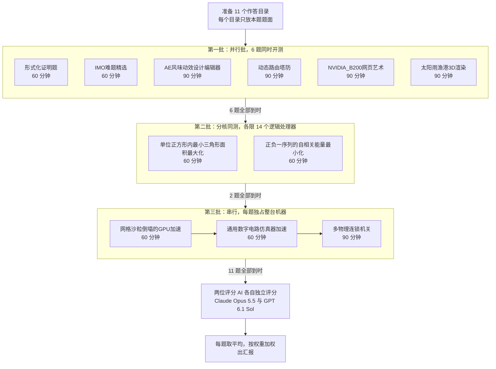
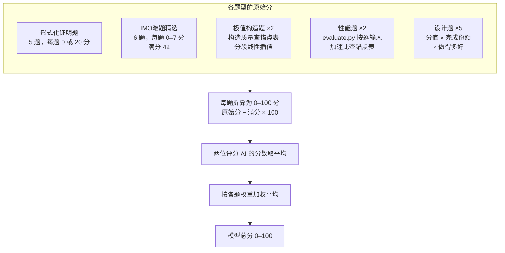
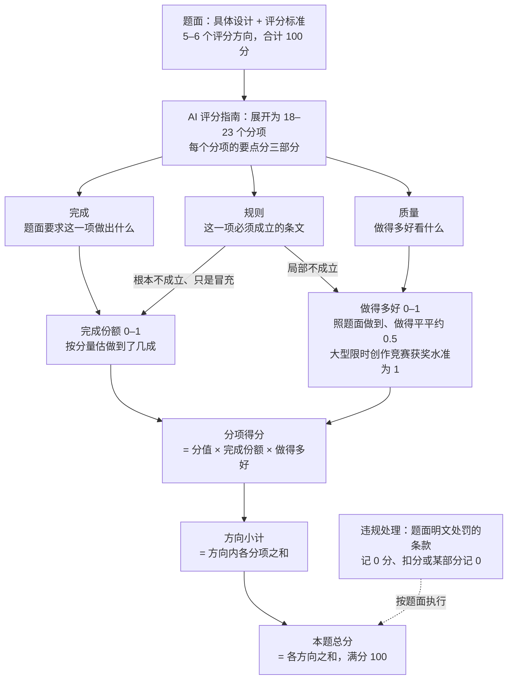

<div align="center">

# AI OneShot Hexathlon

**AI 编程智能体的单次限时六项全能评测**


<br><br>

一次机会，限时作答，无人答疑：11 道题、6 个类别，看 AI 编程智能体能否独立交付完整、正确、出色的作品。

<br>

| 题目 | 类别 | 限时 | 评分 | 计分 |
|:---:|:---:|:---:|:---:|:---:|
| **11** 道 | **6** 类 | **60 / 90** 分钟 | **2** 位评分 AI 独立打分 | **0–100** 分，加权平均 |

</div>

---

## 目录

- [项目简介](#项目简介)
- [题目总览](#题目总览)
- [题目与考点](#题目与考点)
- [测试形式](#测试形式)
- [打分机制](#打分机制)
- [仓库结构](#仓库结构)
- [设计原则](#设计原则)

## 项目简介

AI OneShot Hexathlon 是一套给 AI 编程智能体做的单次限时评测。受测模型通过自己的智能体工具，在 60 或 90 分钟内独立完成一道题：期间没有人回答问题，到时直接中止，也没有第二次机会。11 道题分属深度推理、算法竞赛、复杂交互应用、游戏设计与开发、物理建模与仿真、视觉设计与渲染 6 个类别，从 Lean 形式化证明、竞赛数学、极值构造、性能优化，一直到整件网页作品的设计与开发。每道题由两位评分 AI 按题面的评分标准各自打分、取平均，折算成 0–100 分后按权重汇总为模型总分。

## 题目总览

| 类别 | 题目 | 限时 | 交付物 | 权重 |
|---|---|:---:|---|---:|
| 深度推理 | [形式化证明题](深度推理/形式化证明题.md) | 60 分钟 | `Problem1.lean`–`Problem5.lean` | 8.75% |
| 深度推理 | [IMO难题精选](深度推理/IMO难题精选.md) | 60 分钟 | `answer.md` | 8.75% |
| 算法竞赛 | [单位正方形内最小三角形面积最大化](算法竞赛/极值构造/单位正方形内最小三角形面积最大化.md) | 60 分钟 | `answer.md` | 4.375% |
| 算法竞赛 | [正负一序列的自相关能量最小化](算法竞赛/极值构造/正负一序列的自相关能量最小化.md) | 60 分钟 | `answer.md` | 4.375% |
| 算法竞赛 | [网格沙粒倒塌的GPU加速](算法竞赛/性能工程/网格沙粒倒塌的GPU加速.md) | 60 分钟 | `solution.cu` | 4.375% |
| 算法竞赛 | [通用数字电路仿真器加速](算法竞赛/性能工程/通用数字电路仿真器加速.md) | 60 分钟 | `solution.cpp` | 4.375% |
| 复杂交互应用 | [AE风味动效设计编辑器](复杂交互应用/AE风味动效设计编辑器.md) | 90 分钟 | 网页项目，入口 `index.html` | 15% |
| 游戏设计与开发 | [动态路由塔防](游戏设计与开发/动态路由塔防.md) | 90 分钟 | 网页项目，入口 `index.html` | 15% |
| 物理建模与仿真 | [多物理连锁机关](物理建模与仿真/多物理连锁机关.md) | 90 分钟 | 网页项目，入口 `index.html` | 15% |
| 视觉设计与渲染 | [NVIDIA_B200网页艺术](视觉设计与渲染/NVIDIA_B200网页艺术.md) | 90 分钟 | 网页，入口 `index.html` | 10% |
| 视觉设计与渲染 | [太阳雨渔港3D渲染](视觉设计与渲染/太阳雨渔港3D渲染.md) | 90 分钟 | 网页项目，入口 `index.html` | 10% |
| **合计** | **11 题** | | | **100%** |

权重先分到类别，类别内各题平分：

| 类别 | 权重 | 占比（每格 1%） | 类别内各题 |
|---|---:|---|---|
| 视觉设计与渲染 | 20% | `████████████████████` | NVIDIA_B200网页艺术 10% · 太阳雨渔港3D渲染 10% |
| 深度推理 | 17.5% | `█████████████████▌` | 形式化证明题 8.75% · IMO难题精选 8.75% |
| 算法竞赛 | 17.5% | `█████████████████▌` | 四题各 4.375% |
| 复杂交互应用 | 15% | `███████████████` | AE风味动效设计编辑器 15% |
| 游戏设计与开发 | 15% | `███████████████` | 动态路由塔防 15% |
| 物理建模与仿真 | 15% | `███████████████` | 多物理连锁机关 15% |

## 题目与考点

每道题一张卡片：要做什么、考点在哪里、怎样计分。题面原文见各类别文件夹。

### 🧠 深度推理

考纯粹的数学推理深度与严谨性：一题要让 Lean 4 内核逐步认可证明，一题要在不用任何计算工具的情况下写出竞赛级的完整证明。两题都是 60 分钟内面对多道难题，先做哪道、何时放弃，本身也是考点。

#### 形式化证明题
> 用 Lean 4 + Mathlib 写出能通过编译和公理检查的形式化证明，能证几道是几道。

| 限时 | 交付物 | 权重 | 计分 |
|---|---|---|---|
| 60 分钟 | `Problem1.lean`–`Problem5.lean` | 8.75% | 每题 0 或 20 分，全部要求都满足才得分 |

**要做什么**：五道题按难度 1–5 级排列，每题给出中文表述和一条固定的 Lean 命题，只能把 `sorry` 换成证明，定理名和命题一字不改。方向依次是多项式分析、组合数论、整数点与线性不等式组、线性代数、图论，难度从经典结论一路升到研究文献中的定理。本机装有预编译好的 Mathlib，可以随时编译检查、搜索 Mathlib 源码，但不能联网。

**考点**
- 形式化能力：把纸面证明拆成 Lean 能接受的引理链，熟悉 Mathlib 的定义、API 和命名。
- 零容错：编译不过、留下 `sorry`、改动命题或引入额外公理，这一题就是 0 分，没有部分分。
- 不许绕过内核：不得用 `native_decide`，也不得借 `set_option`、元编程跳过检查，`#print axioms` 只能出现三条标准公理。
- 数学与代码的切换：先在草稿里理清证明，再一步步落到可编译的代码。
- 限时取舍：编译检查有成本，要判断先拿哪几道、何时放下难题。

<details><summary>评分方向</summary>

每题单独检查：单独编译无错误，只导入 Mathlib，定理名和命题与题面一致，没有 `sorry`、`admit`、新公理或 `native_decide`，`#print axioms` 只含 `propext`、`Classical.choice`、`Quot.sound`。全部满足得 20 分，否则 0 分；证明的长短和风格不影响得分。

</details>

#### IMO难题精选
> 不借助任何计算工具，为六道 IMO 难题写出完整、严谨的中文证明。

| 限时 | 交付物 | 权重 | 计分 |
|---|---|---|---|
| 60 分钟 | `answer.md` | 8.75% | 每题 0–7 分，共 42 分，折算到 100 |

**要做什么**：六道题覆盖函数方程、数论、平面几何、不等式、博弈、组合几何，难度都在 IMO 难题一档；其中一道求全部解，其余五道是证明题，有一道允许证出较弱的结论拿部分分。解答用简体中文和 LaTeX 写进 `answer.md`，每题一节，做完一题就立即写入。求全部解的既要验证所给的解，也要排除其他解；可以引用常见定理，但要写明名称和内容。全程只能靠推理：不得编写或运行任何程序验算，也不得使用计算机代数系统、数值库和定理证明器。

**考点**
- 竞赛级的数学洞察：每道题都要找到关键的构造、不变量或引理，套路做不出来。
- 证明的完整与严谨：不能用“显然”“同理”跳过关键步骤，分情况讨论要讨论全。
- 纯推理：没有程序和数学软件兜底，验算、试例全靠草稿。
- 书面表达：把推理写成评阅人能逐步核对的证明。
- 时间分配：60 分钟六道难题，先挑能拿分的题，把会做的写稳。

<details><summary>评分方向</summary>

两位评分 AI 对照参考答案，逐题给 0–7 分的整数分：完整正确给满分，与参考答案不同的正确解法同样给满分；不完整的按完成程度给部分分，只有答案没有证明或证明有缺漏的相应扣分。写了多种做法而没注明以哪份为准的，按得分最低的一份计。

</details>

### ⚡ 算法竞赛

考在硬指标下做工程化的搜索与优化：两道极值构造题比构造的质量，两道性能题比相对基线的加速比。分数按题面公式精确算出，越接近已知最优或性能极限，同样的进步得分越多。

#### 单位正方形内最小三角形面积最大化
> 在单位正方形里放 30 个点，让其中任意三点构成的最小三角形面积尽可能大。

| 限时 | 交付物 | 权重 | 计分 |
|---|---|---|---|
| 60 分钟 | `answer.md`（30 行坐标） | 4.375% | 按与已知最好构造值之比，在锚点表上插值 |

**要做什么**：给出 30 个点的坐标，评测按所写的十进制值精确计算全部 4060 个三点组合的最小面积 $\Delta$，越大越好。坐标的写法有严格格式，点必须落在 $[0,1]^2$ 内，格式不符或越界整题无效。可以在本机自由编写、编译和运行搜索程序；本题与另一道极值构造题同时进行，各限 14 个逻辑处理器，共用一块 GPU。

**考点**
- 搜索策略：目标是“最小值的最大化”，不光滑、局部最优极多，普通梯度和随机重启很快到平台。
- 逼近前沿：越往上越需要高效退火、对称结构搜索和高精度的局部精修。
- 精确性：按书面十进制值精确判定，舍入后共线或越界都会前功尽弃。
- 算力受限：在 14 个逻辑处理器、60 分钟里权衡并行广搜和单点精修。
- 换思路：某个方向停滞时能否及时转向。

<details><summary>评分方向</summary>

无效提交得 0 分。有效时计算 $r=\Delta/\Delta^*$（$\Delta^*$ 为已知最好的构造值），在凸锚点表上分段线性插值：越接近 1 每段斜率越大，达到或超过已知最好值得 100 分。

</details>

#### 正负一序列的自相关能量最小化
> 构造一条长 251 的 ±1 序列，让它的非周期自相关能量尽可能小。

| 限时 | 交付物 | 权重 | 计分 |
|---|---|---|---|
| 60 分钟 | `answer.md`（一行 251 个 `+`/`-`） | 4.375% | 按能量值在锚点表上插值 |

**要做什么**：对序列 $s\in\{-1,+1\}^{251}$，能量 $E(s)$ 是各阶非周期自相关 $C_k(s)$ 的平方和，越小越好。提交只有一行 251 个字符，评测按定义精确算出 $E$，格式不符整题无效。可以在本机自由编写、编译和运行搜索程序；与另一道极值构造题同时进行，各限 14 个逻辑处理器。

**考点**
- 崎岖的搜索空间：$2^{251}$ 种序列，地形极其崎岖，常规爬山和退火很快停在中等水平。
- 增量计算：翻转一位后快速更新能量，决定每秒能评估多少邻居。
- 搜索的层次：结构约束、禁忌搜索、防循环与强化策略，越往后越考验算法功底。
- 多核并行：在 14 个逻辑处理器上有效组织多条搜索链。
- 限时工程：60 分钟里写出、调好并跑足一个高性能搜索器。

<details><summary>评分方向</summary>

无效提交得 0 分。有效时直接用整数能量 $E$ 在凸锚点表上分段线性插值：$E$ 越小得分越高，越接近已知最好值每段斜率越大，达到或低于已知最好值得 100 分。

</details>

#### 网格沙粒倒塌的GPU加速
> 用 CUDA 在 RTX 4080 上，把 4096×4096 网格的沙堆倒塌过程尽快算到稳定状态。

| 限时 | 交付物 | 权重 | 计分 |
|---|---|---|---|
| 60 分钟 | `solution.cu` | 4.375% | 8 个性能输入相对弱基线的加速比，按对数锚点插值后取平均 |

**要做什么**：格子里的沙粒达到 4 粒就倒塌，向四邻各送一粒，反复进行直到全部稳定；稳定状态唯一，结果必须逐格与标准答案一致。提交实现 `init()` 和 `solve()`，初始网格已在显存里，全部计算必须在 `solve()` 中由 GPU 完成，主机只能读回少量控制信息。性能输入为 $L=4096$、总沙粒不超过 $2^{23}$，分布各不相同，测试输入要自己构造；作答时独占整台机器。

**考点**
- GPU 并行算法：倒塌在时间和空间上高度不均，朴素的逐轮全网格扫描大量空转。
- 访存与同步：分块、合并访存，减少全局同步和内核启动的开销。
- 精确正确：任一正确性输入出错整题 0 分，提速不能以牺牲正确为代价。
- 平台约束：Windows 下单个内核超过约 2 秒会触发驱动重置；不能用 Driver API 和第三方库。
- 规则边界：`init()` 只许分配和清零，不能偷做预计算，也不能在 CPU 上算格子。

<details><summary>评分方向</summary>

编译失败、任一正确性输入出错或违反规则，整题 0 分。否则 8 个性能输入各自按加速比 $s=W/C$（$W$ 为同场运行的弱基线耗时）在对数尺度上插值：$s$ 为 1、2、4、8、16、32 时得 0、2、10、30、60、100 分，本题取 8 个输入的平均。

</details>

#### 通用数字电路仿真器加速
> 在 CPU 上把一个 50 万门的同步时序电路，对 4096 组随机激励各仿真 512 个周期，越快越好。

| 限时 | 交付物 | 权重 | 计分 |
|---|---|---|---|
| 60 分钟 | `solution.cpp` | 4.375% | 8 个性能输入相对弱基线的加速比，按对数锚点插值后取平均 |

**要做什么**：电路由八种逻辑门（含 MUX）和 8192 个触发器组成，门不一定按依赖顺序给出；每组激励由给定的伪随机数生成，输出用异或摘要压成一个 64 位数。提交实现 `simulate()`，只能用 CPU，可以用 OpenMP、编译器内建函数和 AVX2 指令。评测时进程限定在 8 个性能核、16 个线程上；性能输入是种类多、难度大的完整规模电路，测试输入要自己构造。

**考点**
- 位级并行：组织多组独立激励同时计算，把 64 位字和 SIMD 用满。
- 电路预处理：排序、化简与布局，让 50 万个门的求值顺序对缓存友好。
- 多线程与内存：全部状态远超缓存容量，数据布局和线程分工决定上限。
- 精确正确：摘要逐位与标准答案一致，任一正确性输入出错整题 0 分。
- 通用性：对任意合法电路都要正确，不能针对具体输入硬编码。

<details><summary>评分方向</summary>

计分方式与沙粒题相同，锚点为 $s$ 为 1、4、8、12、20、32、48 时得 0、3、15、30、52、75、100 分，本题取 8 个输入的平均。编译失败、任一正确性输入出错或违反规则，整题 0 分。

</details>

### 🎬 复杂交互应用

考构建大型专业工具的能力：几十项功能深度耦合，组合使用时都要正确，几个视图始终一致，并在十几万图层的规模下保持高性能。

#### AE风味动效设计编辑器
> 在浏览器里做一款对标专业合成软件的动效设计编辑器，并用它自己做出一段 5 秒的炫技示例动画。

| 限时 | 交付物 | 权重 | 计分 |
|---|---|---|---|
| 90 分钟 | 网页项目（`index.html`） | 15% | 6 个方向、23 个分项；性能按实测耗时公式计分 |

**要做什么**：编辑器要支持多合成，形状、文字、空对象和预合成图层，五项变换、锚点与父子层级，关键帧与线性、贝塞尔、定格插值，时间轴、曲线编辑器（值曲线与速度曲线）和画布上的运动路径。此外还有形状变形、修剪路径、蒙版与轨道遮罩、预合成与时间重映射、文字动画器、运动模糊、撤销重做、工程文件和视频导出。界面有规定的布局和“墨蓝灰底色 + 熔岩橙代表时间 + 冰蓝代表选择”的视觉规范，关键帧形状、动画开关等状态都有明确的标示。打开时自动载入一段 5 秒示例：圆点蓄力、爆发成几何图形、慢动作变形、汇成光带扫出标题、再收回圆点，全部要用编辑器里可编辑的图层和关键帧做成。

**考点**
- 功能耦合：在带动画的父级之下、嵌套合成和时间重映射之中，于任意时刻编辑，被抓住的点仍留在光标下。
- 一致性：画布、时间轴、曲线编辑器、属性面板始终同步，撤销重做、保存打开、导出前后结果不变。
- 动画数学：时间插值与空间路径互不干扰，嵌套时间精确取值、不对齐到帧，运动模糊按画面上的实际运动产生。
- 规模性能：6.5 万图层的批量编辑、13 万图层的复制与撤销、带蒙版和运动模糊的 600 帧导出，都按实测耗时计分。
- 专业审美：编辑器要像一台精密仪器，示例动画要有预备、过冲、错落和清楚的焦点。
- 限时取舍：90 分钟面对远超可完成量的功能清单。

<details><summary>评分方向</summary>

| 评分方向 | 分值 | 包含的分项 |
|---|---|---|
| 关键帧与时间轴 | 19 | 关键帧与插值、关键帧选择与编辑、时间轴与播放、曲线编辑器、运动路径 |
| 图层与合成 | 24 | 合成与图层、画布变换与父级、形状变形与修剪路径、蒙版与轨道遮罩、预合成与时间重映射、文字动画器、运动模糊 |
| 一致性与导出 | 20 | 四个视图同步、复杂情形下的编辑、撤销重做与工程文件、导出与预览一致 |
| 界面设计 | 15 | 布局与视觉风格、面板与状态标示、命令与输入、整齐可读与过渡 |
| 性能 | 10 | 六个固定规模的计时任务，按实测耗时在对数公式上计分 |
| 示例动画 | 12 | 节拍与构成、动效质量 |

违规：页面无法打开或白屏，总分 0 分；页面加载时控制台报错，扣 3 分。

</details>

### 🎮 游戏设计与开发

考把一套环环相扣的规则系统做成完整的游戏：寻路、战斗、经济、美术和信息呈现同时成立，大量单位同场时判定依然正确、画面依然清楚。

#### 动态路由塔防
> 做一款三维塔防《网络安全攻防战》：隔离交换节点逼敌人改道，塔会被打掉，路线随战局实时重算。

| 限时 | 交付物 | 权重 | 计分 |
|---|---|---|---|
| 90 分钟 | 网页项目（`index.html`） | 15% | 6 个方向、20 个分项，合计 100 分 |

**要做什么**：战场是网络空间里一块悬浮的三维网格，恶意程序沿链路自动寻路冲向“中枢”；在交换节点上部署塔或插入隔离器会截断链路、逼敌人改道，节点上的塔被摧毁后链路重新打开。题面设计好了三张光场各异的地图（明亮的分段内网 14 波、暮色的骨干流域 15 波、墨黑的气隙深层 16 波），八种有生命值、可升级的塔，八种各有反制手段的敌人和三个会改变地形的 Boss，还有四种道具、算力与情报两种资源，以及“明文、可疑、隔离、清除”的状态链。任何操作都不能把入口或敌人切成孤岛，部署前要能预览改道后的路线。美术是“立体网络图”：磨砂玻璃地块、透光的守方几何体、吸光的敌方暗色实体。

**考点**
- 动态寻路与改道：通行随部署、摧毁、撬锁和 Boss 能力随时变化，场上敌人从当前位置重新寻路，不瞬移、不卡住、不穿墙。
- 禁止封死与预览一致：操作前就能判断会不会切出孤岛，预览与实际一致，同一时刻的多个变化也要正确结算。
- 多系统结算：阻挡、互相攻击、加密、护盾、状态链和配合效果交织，结果都要与游戏内说明一致。
- 关卡与经济：隔离方案要在入口之间形成取舍，改道有代价，不能有几乎零成本反复改道的打法。
- 3D 美术与可读性：单位和特效很多、加速时，路线、节点状态、生命和状态依然一眼看清。
- 运行稳健：暂停、放慢、加速、切走标签页和重新开始时，判定不乱、不残留。

<details><summary>评分方向</summary>

| 评分方向 | 分值 | 包含的分项 |
|---|---|---|
| 寻路与改道 | 22 | 通行与路线、改道过程、预览与禁止封死 |
| 单位与战斗 | 22 | 塔与道具、敌人与 Boss、交战与状态 |
| 关卡与经济 | 14 | 地图、波次与难度、资源与代价 |
| 美术 | 16 | 场景与光照、造型与动画、特效、风格与完成度 |
| 信息与操作 | 18 | 地形与路线信息、战斗与局势信息、反馈与过渡、操作、说明与文案 |
| 运行质量 | 8 | 时钟与重开、流畅与报错 |

违规：页面无法打开或白屏、照搬现有游戏，总分 0 分。

</details>

### ⚙️ 物理建模与仿真

考从零实现多种物理机制并让它们正确耦合：不准用任何物理引擎，刚体、绳索、弹簧、流体和光学在同一个实时仿真里相互作用，同时还要画面出色、规模够大。

#### 多物理连锁机关
> 在网页里从零写一套二维物理仿真，做出 10 环连锁的动力装置《一道光谱》：一次敲击，最后让晨光在白墙上投出光谱。

| 限时 | 交付物 | 权重 | 计分 |
|---|---|---|---|
| 90 分钟 | 网页项目（`index.html`） | 15% | 5 个方向、19 个分项，合计 100 分 |

**要做什么**：白色展厅里的机关由 10 个环节组成：五球摆、折轨滚道、方块骨牌、坠锤绞轮，在绞轮处分成水路（天池翻斗、浮塞水箱）和机械路（弹射匣、弹簧跷板）两条并行支线，最后汇入合流吊桶与晨池，拉开遮光板；晨光经水下浮镜、晃动的水面和三棱镜色散成光谱。全程用到刚体碰撞与摩擦、滚动、绳索与滑轮、弹簧与振动、流体、光学六种机制，其中有五处双向耦合。每个环节都是可单独打开的节点，有受力叠加、能量账、记纹鼓曲线、按环节分组的参数面板，以及可投放、批量加大规模的试验台。连续播放要能暂停、慢放、单步、跳到任一环，镜头自动跟随，两条支线并行时分屏。

**考点**
- 自己实现物理：碰撞检测、约束求解、数值积分和流体计算全部手写，禁用一切物理引擎和库里的同类模块。
- 真交接：每一环都必须由前一环的物理过程推动，不能用脚本、计时器或预设动画触发，也不能预先算好再回放。
- 双向耦合：翻斗与水、浮子与浮塞、跷板与滚筒、吊桶与晨池、浮镜筏与波浪，双方都受到反作用。
- 数值稳定：质量相差百倍、刚性接触加绷紧绳索加硬弹簧加液体同时作用时，不抖动、不穿透、不发散，总能量不凭空增加。
- 画面与仿真一致：极简美术馆风格的渲染，轮廓、液面和光路都严格落在仿真结果上。
- 性能与规模：全程实时流畅，液体与绳链的精度和投放数量能一直调到不再流畅为止。

<details><summary>评分方向</summary>

| 评分方向 | 分值 | 包含的分项 |
|---|---|---|
| 连锁运转 | 12 | 环节交接与分叉汇合、起止与复现、参数传递 |
| 物理正确 | 30 | 各机制的现象、双向耦合与联动、液体耦合、传力与能量、数值稳定 |
| 画面 | 20 | 美术与材质、液体光与关键时刻、运镜与远近、画面精度 |
| 界面与数据显示 | 18 | 播放控制与总图，节点、试验台与参数面板，数据显示，界面设计 |
| 仿真性能 | 20 | 读数与实时、连锁流畅与精细、节点规模上限 |

违规：页面无法打开或白屏、使用物理引擎，总分 0 分；有交接由脚本触发，或预先计算整段再回放，相应部分记 0 分。

</details>

### 🎨 视觉设计与渲染

考实时图形的技术上限与视觉设计的审美：一题是滚动驱动、效果密集的网页艺术，一题是精细的三渲二微缩场景和随风、云、雨变化的氛围。

#### NVIDIA_B200网页艺术
> 以 NVIDIA B200 为题材，做一件纵向长滚动、中段横向滚动的网页艺术作品：一粒光从光刻机走到整座 AI 工厂。

| 限时 | 交付物 | 权重 | 计分 |
|---|---|---|---|
| 90 分钟 | 网页（`index.html`） | 10% | 6 个方向、18 个分项，合计 100 分 |

**要做什么**：全页跟着一粒琥珀金色的光走过九章：光刻开场（约 20 万微粒组成的名字、带体积感的光束、透镜折射），从晶体管一路退到整颗硅片的一镜到底，可拆解、可剖切的双芯片剖析视图，横向段里的算力信息图和不少于 100 万粒子的显存洪流，可交互的 FP4 精度对比矩阵，从单卡拉远到 24×48 机柜的机房，四个明场应用场景，最后回到写满的晶圆收尾。章与章之间要靠元素本身的形变衔接，不许叠化、擦除、翻页；纵横切换的两处“转弯”要求滚动速度和方向连续，看不出页面何时被固定。风格是“暗场与图版”：三维段像显微镜暗场里的精密仪器，平面段像工程图版。

**考点**
- 高难度实时效果：体积光、折射与焦散、百万粒子绕流、辉光遮挡、景深与运动模糊，处在同一空间、彼此一致。
- 转场形变：文字、三维物体和粒子相互转化，停在中途也看得出哪部分在变成哪部分。
- 滚动驱动与可逆：快速滚动、拖滚动条、导航跳转、页面中部刷新、反向滚动时，画面完整、无残留、无错位。
- 交互深度：剖析视图的拆解与剖切选取、精度矩阵的实时量化重算、机柜推近，都能用键盘操作、随时打断。
- 平面设计与艺术表现：排版、信息图和三维图注同属一套视觉语言，避开发布会式的套路。
- 工程约束：控制 WebGL 上下文数量和着色器首次编译的卡顿。

<details><summary>评分方向</summary>

| 评分方向 | 分值 | 包含的分项 |
|---|---|---|
| 美术风格 | 12 | 风格与视觉语言、色彩分工、动效性格 |
| 平面设计 | 20 | 排版与字体、信息图与动态图形、三维与平面的组合 |
| 三维造型与渲染 | 20 | 造型与细节、光照与材质、粒子雾与画质 |
| 叙事与转场 | 20 | 光粒主线与编排、衔接与形变、镜头与尺度 |
| 交互 | 18 | 剖析视图、精度对比与全页精度、机房应用场景与光标、反馈键盘与打断 |
| 滚动与导航 | 10 | 滚动与转弯、跳转刷新与导航 |

流畅度和帧率不计入评分。违规：页面无法打开或白屏，总分 0 分；使用外部素材、缺少“非官方页面”声明，各扣 5 分。

</details>

#### 太阳雨渔港3D渲染
> 用 Three.js 做一件三渲二风格的微缩三维模型：太阳雨中的日式小渔港堤岸，可以自由旋转、缩放细看。

| 限时 | 交付物 | 权重 | 计分 |
|---|---|---|---|
| 90 分钟 | 网页项目（`index.html`） | 10% | 6 个方向、19 个分项，合计 100 分 |

**要做什么**：正方形底座上一半是灰白混凝土的 L 形码头，一半是港湾水域，侧壁露出岸壁和半透明的水体剖面；码头转角泊着三四艘船，往后是防波堤和红白灯塔，远角是有鸟居和石狐的山坡。场景里有几十样指定的物件：透过玻璃能看清的驾驶舱（雷达屏、冒着热气的搪瓷杯、护身符），半拉起卷帘门的渔协仓库，落地窗的候船室，以及乐器箱、透明雨伞等“人刚离开的痕迹”，但不出现人物和 UI。动态分三层：一直在进行的细小动态（水面、色块化倒影、滴水、雨链），阵风、云遮日和雨势起伏带来的成片变化（彩虹、灯塔自亮），以及海鸥、港猫、过往渔船的涌浪等偶发事件；镜头推近海鸥和猫时，它们还会有反应。

**考点**
- 建模工作量：几十样物件推近都认得出、有细节，摆放不悬空、不穿插。
- 三渲二画风：卡通着色、纤细连贯的轮廓线、色块化的水面倒影，所有物体画风统一。
- 光照一致：高调低对比的太阳雨光线，光柱、高光、投影来自同一个太阳，云遮时一起变化，彩虹在背光一侧。
- 动态编排：风、云、雨各按自己的节奏起伏，阵风和涌浪沿路径先后传递，事件之间留出安静的间隔。
- 合理的细节：雨只落在露天处，涟漪只在水面，船浮在水上，缆绳两端连对。
- 镜头约束：自由拖拽缩放，但不钻到底座下、不穿进船体建筑、不把场景移出画面。

<details><summary>评分方向</summary>

| 评分方向 | 分值 | 包含的分项 |
|---|---|---|
| 构图与纵深 | 10 | 底座与布局、纵深层次与初始视角 |
| 造型与陈设 | 19 | 岸壁水下与消波块、堤岸系泊与生活痕迹、船只与驾驶舱、码头道具、港口建筑与室内 |
| 三渲二画风 | 18 | 着色与画风统一、轮廓线与画面清晰、材质与水面画法 |
| 色彩与光影 | 16 | 配色与冷暖、光照与天空、光柱与闪光 |
| 动态 | 30 | 常驻的细小动态、阵风、云光与雨势、生灵与偶发事件 |
| 镜头与运行 | 7 | 镜头操作、加载与报错 |

流畅度和帧率不计入评分。违规：场景无法打开或白屏，总分 0 分；画面中出现人物、出现 UI 界面元素，各扣 5 分。

</details>

## 测试形式

> **一次会话，一段限时，没有第二次机会。** 受测模型拿到题面后独立作答，期间没有人回答问题，也不给提示。时间一到作答立即中止，留在目录里的就是最终提交。

### 单次限时作答

- 受测模型用自己的智能体工具运行，例如 Claude Code 或 Codex，推理强度默认 `xhigh`。每道题开一个新会话，从拿到题面起计时。
- 限时：两道深度推理题和四道算法竞赛题各 **60 分钟**；AE 编辑器、塔防、物理、两道视觉题这五道设计题各 **90 分钟**。
- 没有人回应模型的提问。模型做完后可以停下，但停下不等于交卷：下一次时间提醒会在同一会话里把它叫醒，由它决定要不要继续完善。
- 每道题面都写明这是 AI 模型能力竞赛，要求用足全部时间，把结果做到最好。

### 隔离的作答环境

- 受测会话运行在一个单独的普通 Windows 账户下，这个账户读不到评分资料。每轮开测前，先清空该账户里智能体工具的会话历史和记忆。
- 每道题有独立的作答目录，开测时里面只有这道题的题面。模型只能在这个目录里读写文件，不能访问其他路径，包括同一模型其他题目的目录；编译器、解释器、浏览器等必需工具要用到的安装路径和临时目录除外。
- 所有题都在同一台机器上测试：Windows 11，Intel Core i7-14700KF，NVIDIA GeForce RTX 4080，64 GB 内存。

### 时间提醒、交付版本与到时中止

| 机制 | 做法 |
|---|---|
| ⏰ 时间提醒 | 每 10 分钟提醒一次已用时间和剩余时间，同时提醒模型重读题面。模型工作时，提醒在调用工具前后送达，长时间思考或运行耗时命令时会延后；模型已经停下时，提醒会把它叫醒 |
| 📌 交付版本 | 每完成一个可用的阶段，模型可以把整个作品复制成一个进度节点，即作答目录下的一个单独文件夹，再在 `交付版本.txt` 里写一行这个文件夹的相对路径，评分就以它为准。没有标记或标记无效时，以到时那一刻作答目录里的文件为准 |
| ⛔ 到时中止 | 时间一到，作答直接中止，模型启动的命令、本地服务器、浏览器等也一并结束，不留收尾时间。此后作答目录里的文件不再改动 |

### 三个测试批次



| 批次 | 题目 | 方式 | 为什么这样分 |
|---|---|---|---|
| ① 并行批 | 形式化证明题、IMO难题精选、AE 编辑器、塔防、NVIDIA、渔港 | 6 题同时开测 | 这几题作答时机器负载轻。AE 编辑器和塔防的性能在评分阶段独占机器时再测，两道视觉题不评流畅度和帧率 |
| ② 分核同测 | 两道极值构造题 | 两题同时进行，各分到 14 个逻辑处理器（4 个性能核的 8 个线程 + 6 个能效核），强制绑核，GPU 两题共用 | 两题都要靠搜索用满算力。两边分到的处理器一样多，既公平又省时间 |
| ③ 串行独占 | 网格沙粒、电路仿真、多物理连锁机关 | 三题依次进行，每题独占整台机器 | 作答过程中要反复测速，其他负载会干扰计时；物理题的实时仿真同样需要整台机器 |

一批全部到时后，先清理残留的程序，再开始下一批。11 道题全部到时后才开始评分。

### 工具与联网规定

所有题通用的规定：

- 🚫 **不得开启子代理**（subagent），也不得使用任何多代理或并行协作功能，全程独立作答。
- 🚫 **不得访问 GitHub 上的任何仓库**，网页、`git`、`gh` 命令行和 API 都不行。
- 🚫 不得访问作答目录以外的文件路径（见上文）。
- ✅ 结束作答前，必须对照题面逐项检查一遍。

联网和工具的规定按类别不同，以各题面的“规定”一节为准：

| 类别 | 联网 | 可以用什么 | 其他限制 |
|---|---|---|---|
| 深度推理 · 形式化证明题 | ❌ 不能联网，也不能调用其他 AI 模型或服务 | 用预装的 Lean 4 + Mathlib 编译检查，也可以用本机已装的其他程序 | 不能安装新的软件或库，不能改动 Lean 的安装目录 |
| 深度推理 · IMO难题精选 | ❌ 同上 | 只能读题面，写 `answer.md` 和草稿文件 | 只能靠推理：不得编写或运行任何程序、脚本或命令，也不得使用计算机代数系统、数值计算库、定理证明器或在线数学服务 |
| 算法竞赛 · 极值构造（2 题） | ❌ 同上，也不能下载或安装软件包 | 可以编写、编译、运行任何程序，可以用本机已装的软件和库 | 程序只能在分到的 14 个逻辑处理器上运行 |
| 算法竞赛 · 性能工程（2 题） | ❌ 同上 | 开发期间可以编译、运行、测试，也可以写任何辅助程序；测试输入要自己构造 | 最终提交的源文件还要遵守题面规则：只能用规定的库；沙粒题的计算全部在 GPU 上完成，电路题只能用 CPU；不得读写文件、联网或启动进程，不得针对输入硬编码，不得干扰计时 |
| 五道网页题（复杂交互、游戏、物理、视觉） | 题面未作限制（GitHub 除外） | 测试网页时，优先用智能体工具自带的内置浏览器，其次用本机的 Chrome，再次用 Edge；同时作答的四道网页题各用一个指定的本地服务器端口 | 素材都要自己制作；NVIDIA 题不得使用 NVIDIA 官方的标志、图片和视频；物理题不得使用任何物理引擎或物理仿真库，可以用渲染库和通用的向量、矩阵运算库 |

### 评分员怎么评

- **两位独立评分**：每道题由两位评分 AI 各评一次，分别是在 Claude Code 中运行的 Claude Opus 5.5 和在 Codex 中运行的 GPT 6.1 Sol，推理强度都是 `xhigh`。两位互不查看对方的工作目录、结果和评分表。评分员在另一个账户下运行，与受测账户分开；每个评分任务都开一个新的无界面会话。评分员知道受测的是哪个模型，不做盲审。
- **评分依据**：评分员先读题面和这道题的 `AI评分指南.md`。指南是题面评分标准的展开，两者不一致时以题面为准。评分对象是受测模型标记的交付版本。提交是只读的，需要编译或运行时，先复制到评分员自己的工作目录。
- **无窗口浏览器**：打开网页、测试交互、观察画面，一律用无窗口（headless）的 Chrome，靠截图看画面，不占用桌面。判断流畅度前，先确认 WebGL 用的是 GPU，而不是软件渲染。
- **从简评分**：按指南的要点逐项看清实际表现，定下分数即可。不深究项目细节，不逐行审查代码，同一个分项不反复测试取证。性能只测一次：先抽查一两处作品自带的性能读数，可靠就直接采用；不可靠的酌情少给性能分，在副本里修好读数后再测。
- **评分顺序**：先同时评 4 道轻量题（两道证明题、两道极值构造题）和 2 道视觉题。两道视觉题评完后，AE 编辑器、塔防、沙粒、电路、物理五题逐题评分，每题独占机器，保证性能测量不受干扰。评分不限时，每 10 分钟提醒一次。

<details>
<summary><b>评分表与结果文件里有什么</b></summary>

- **评分表**：每题每位评分员一份，开评时复制到作答目录。表中填写各分项得分，设计题还要填“完成份额”“做得多好”两个系数；另有方向小计、违规是否触发、本表总分，以及一段 50 字左右的简评。简评要一针见血地写出最能拉开差距的亮点或致命短板，不许端水。评分表只记分数，理由不写在表里。
- **结果文件**（JSON）：逐分项列出分数、两个系数和一两句理由，另有总分与满分、关键数值（如加速比、Δ、E）、触发的违规条款及依据，以及给出题人的备注。
- **校验**：结果文件通过自动校验才计分，要求题目和评分员身份对得上，覆盖指南的全部分项，分数和满分都是有效数字且不超出范围。遇到偶发故障，可以重评一次；重评后仍然失败的，这道题只按另一位评分员的分数计。

</details>

## 打分机制

### 总分怎样合成

每道题先折算成 0–100 分（原始分 ÷ 满分 × 100），两位评分员的分数取平均，再按权重加权：

$$
S_t=\frac{S_t^{\text{Opus}}+S_t^{\text{Sol}}}{2},\qquad
\text{模型总分}=\sum_{t=1}^{11} w_t\,S_t,\qquad \sum_{t=1}^{11} w_t=100\%
$$

权重先分到类别：视觉设计与渲染 20%，深度推理、算法竞赛各 17.5%，复杂交互应用、游戏设计与开发、物理建模与仿真各 15%。类别内的各题平分类别权重，所以每道算法竞赛题是 4.375%。类别得分是该类别各题得分的加权平均。

> **精度**：分项、单题和总分等具体分值都保留一位小数。权重用精确值，例如 8.75%、4.375%，不做舍入。



### 各题型的计分方式

| 题型 | 题目 | 计分方式 | 整题记 0 分的情形 |
|---|---|---|---|
| 形式化证明 | 形式化证明题 | 5 题 × 20 分，每题只有 0 分和 20 分两档 | 没有，各题互不影响 |
| 纸面证明 | IMO难题精选 | 6 题 × 0–7 整数分，满分 42，乘以 100/42 折算 | 没有，各题互不影响 |
| 极值构造 | 两道极值构造题 | 构造质量查锚点表，分段线性插值 | 提交无效 |
| 性能工程 | 沙粒、电路 | 8 个性能输入各按加速比查锚点表，取平均 | 编译失败、任一正确性输入失败、违反题面规则 |
| 设计题 | AE、塔防、物理、NVIDIA、渔港 | 18–23 个分项，每项按分值 × 完成份额 × 做得多好计分 | 按各题的违规条款 |

**形式化证明题**：一题的文件同时满足以下各条才得 20 分，否则得 0 分，没有部分分：单独编译没有错误（警告不影响）；只导入 Mathlib 及其依赖库中的模块；定理名和命题与题面一致，没有用新的记号、实例、宏等改变命题含义；没有 `sorry`、`admit`、新声明的公理或 `native_decide`，也没有绕过内核检查；`#print axioms` 的结果里只有 `propext`、`Classical.choice`、`Quot.sound`。证明的长短和写法不影响得分。

**IMO难题精选**：按正确性、完整性和严谨性给分。解法与参考答案不同的，只要正确完整，同样给满分；解答不完整的，按完成程度给部分分；只有答案没有证明，或者证明有缺漏的，相应扣分。一题写了多种做法却没注明以哪一份为准的，按得分最低的一份评分。只评 `answer.md`，草稿不计分。

**极值构造题**：提交无效时（文件不存在、格式不符、点数不对或点不在正方形内）记 0 分。有效的提交以已知最好的构造值作为满分基准，按锚点表分段线性插值。越接近已知最好的值，每段斜率越大，同样的进步得分越多；超过已知最好的值记 100 分。锚点按方法的层次来定：常规的梯度下降、爬山或退火只能拿到低段，结构化搜索才能进入中高段，最高几档对应接近纪录的水平。

<details>
<summary>例：单位正方形内最小三角形面积最大化的锚点表</summary>

比率 $r=\Delta/\Delta^\ast$，其中 $\Delta^\ast$ 是已知最好的构造值：

| $r$ | 0.05 | 0.20 | 0.35 | 0.50 | 0.65 | 0.80 | 0.90 | 0.95 | 0.99 | 1.00 |
|---|---|---|---|---|---|---|---|---|---|---|
| 得分 | 0 | 8 | 20 | 34 | 49 | 65 | 77 | 84 | 94 | 100 |

另一道题直接在整数能量 $E$ 上设锚点，做法相同。

</details>

**性能工程题**：在同一次评测中，弱基线、强基线（两者都是参考实现）和提交在 8 个隐藏性能输入上各运行一次，运行条件完全相同，都是同一组 16 个逻辑处理器、高优先级、同样的环境变量。只计核心函数那一次调用的墙钟时间。输入 $i$ 上的加速比 $s_i=W_i/C_i$，按锚点在对数尺度上插值：

$$
\text{得分}_i=p_k+(p_{k+1}-p_k)\,\frac{\ln(s_i/a_k)}{\ln(a_{k+1}/a_k)},\qquad
\text{本题得分}=\frac18\sum_{i=1}^{8}\text{得分}_i
$$

| 沙粒 $s_i$ | 1 | 2 | 4 | 8 | 16 | 32 |
|---|---|---|---|---|---|---|
| 得分 | 0 | 2 | 10 | 30 | 60 | 100 |

| 电路 $s_i$ | 1 | 4 | 8 | 12 | 20 | 32 | 48 |
|---|---|---|---|---|---|---|---|
| 得分 | 0 | 3 | 15 | 30 | 52 | 75 | 100 |

不快于弱基线的输入得 0 分，达到最高锚点的得 100 分。提交在某个输入上运行失败的，只有这个输入记 0 分。另有 7 个隐藏正确性输入，不计时，但任一失败整题记 0 分。强基线只作参考，不影响得分。内存或显存占用过多、导致系统紧张或运行异常的，酌情扣分。

### 设计题：完成 × 质量



五道设计题各有 5–6 个相对独立的评分方向，评分指南把它们展开成 18–23 个分项，合计 100 分。每个分项的要点分三部分：

| 要点 | 写什么 | 作用在哪个系数上 |
|---|---|---|
| **完成** | 题面要求这一项做出什么 | 完成份额 |
| **规则** | 这一项必须成立的条文，没有就不写 | 局部不成立：降低“做得多好”；根本不成立、只是冒充：不计入完成份额 |
| **质量** | 做得好不好看哪些方面 | 做得多好 |

$$\text{得分}=\text{分值}\times\text{完成份额}\times\text{做得多好}$$

- **完成份额**（0–1）：对照“完成”估计做到了几成，按分量估，不按条数数。照题面做了、只是粗糙的，算做到；有其名、缺其实的，只算一部分；没做，或者用题面点名的简单手段冒充的，不算。
- **做得多好**（0–1）：只看已经做到的部分。题面要求之外加做的内容，计入所属分项的“做得多好”，不补完成份额。两个锚点：照题面做到、做得平平，约为 **0.5**；达到大型限时创作竞赛（设计、游戏、开发类）获奖作品的水准，为 **1**。
- 同一件事只在一个分项里记一次，也只影响一个系数：整块没做，只降完成份额；做了但规则不成立，或者做对了但粗糙，只降做得多好。
- 例外：AE 编辑器的“性能”方向不用这两个系数，每个计时任务按题面公式 $\text{分值}\times\ln(t_0/t)/\ln(t_0/t_1)$ 计分，其中 $t_1$ 是满分用时，$t_0$ 是零分用时。

**小例子**：一个 8 分的分项，题面要求做出四种效果。

| 作品 | 情况 | 完成份额 | 做得多好 | 得分 |
|---|---|:---:|:---:|:---:|
| 参照 | 四种都照题面做到，做得平平 | 1.0 | 0.5 | 4.0 |
| 做得多但粗糙 | 四种都做了，每种都很粗糙 | 1.0 | 0.35 | 2.8 |
| 做得少但精 | 只做了约一半的分量，做到的部分很出色 | 0.5 | 0.8 | 3.2 |
| 字面做到但敷衍 | 四种都“有”，但都缺了题面写明的样子或运作方式 | 0.3 | 0.3 | 0.7 |

粗糙不会降低完成份额，但会把“做得多好”压到平平以下；做得少的，做得再精也补不回缺掉的份额；只有名目、没有实质的，两个系数都低。想拿高分，要既做全，又做到竞赛获奖的水准。

<details>
<summary>五道设计题的评分方向与分值</summary>

| 题目 | 方向数 / 分项数 | 评分方向（分值） |
|---|:---:|---|
| AE风味动效设计编辑器 | 6 / 23 | 关键帧与时间轴 19 · 图层与合成 24 · 一致性与导出 20 · 界面设计 15 · 性能 10 · 示例动画 12 |
| 动态路由塔防 | 6 / 20 | 寻路与改道 22 · 单位与战斗 22 · 关卡与经济 14 · 美术 16 · 信息与操作 18 · 运行质量 8 |
| 多物理连锁机关 | 5 / 19 | 连锁运转 12 · 物理正确 30 · 画面 20 · 界面与数据显示 18 · 仿真性能 20 |
| NVIDIA_B200网页艺术 | 6 / 18 | 美术风格 12 · 平面设计 20 · 三维造型与渲染 20 · 叙事与转场 20 · 交互 18 · 滚动与导航 10 |
| 太阳雨渔港3D渲染 | 6 / 19 | 构图与纵深 10 · 造型与陈设 19 · 三渲二画风 18 · 色彩与光影 16 · 动态 30 · 镜头与运行 7 |

</details>

### 违规处理

- **只按题面写明的条款处理，不另设扣分。** 评分员认定违规时，必须引用题面违规条款（或记 0 分、判为无效的条款）的原文并写明依据，再按条款记 0 分或从总分中扣分。
- 分项里的规则不成立，只体现在这个分项的两个系数上，不在总分上重复扣分。
- 题面“规定”一节的执行情况（限时、联网、GitHub、子代理、作答目录等）不在评分员的评分范围内，由出题人另行处理。

<details>
<summary>各设计题的违规条款</summary>

| 题目 | 条款 |
|---|---|
| 五题共同 | 页面（场景）无法打开或白屏：总分记 0 分 |
| AE 编辑器 | 页面加载时控制台报错：总分扣 3 分 |
| 塔防 | 照搬现有游戏：总分记 0 分 |
| 物理 | 使用物理引擎或物理仿真库：总分记 0 分；有交接由脚本、预设动画或计时器直接触发：“连锁运转”方向中的环节交接与分叉汇合、参数传递两部分记 0 分；预先计算整段过程再回放：环节交接与分叉汇合部分以及“仿真性能”方向记 0 分 |
| NVIDIA | 使用外部素材：总分扣 5 分；缺少“本页为概念设计作品，非 NVIDIA 官方页面”的声明：总分扣 5 分 |
| 渔港 | 画面中出现人物：总分扣 5 分；画面中出现 UI 界面元素：总分扣 5 分 |

</details>

## 仓库结构

题面按类别放在各文件夹里，评分资料集中在 `Grading/`，说明见 [`Grading/README.md`](Grading/README.md)。

```text
AI-OneShot-Hexathlon/
├─ README.md
├─ 深度推理/                                   题面：每题一个 .md
│  ├─ 形式化证明题.md
│  └─ IMO难题精选.md
├─ 算法竞赛/
│  ├─ 极值构造/
│  │  ├─ 单位正方形内最小三角形面积最大化.md
│  │  └─ 正负一序列的自相关能量最小化.md
│  └─ 性能工程/
│     ├─ 网格沙粒倒塌的GPU加速.md
│     └─ 通用数字电路仿真器加速.md
├─ 复杂交互应用/
│  └─ AE风味动效设计编辑器.md
├─ 游戏设计与开发/
│  └─ 动态路由塔防.md
├─ 物理建模与仿真/
│  └─ 多物理连锁机关.md
├─ 视觉设计与渲染/
│  ├─ NVIDIA_B200网页艺术.md
│  └─ 太阳雨渔港3D渲染.md
├─ Grading/                                    评分资料，受测模型作答期间读不到
│  ├─ README.md                                评分分工、计分与总分
│  ├─ 深度推理/
│  │  ├─ 形式化证明题/                         AI评分指南、参考答案、评分表 ×2
│  │  └─ IMO难题精选/                          AI评分指南、参考答案、评分表 ×2
│  ├─ 算法竞赛/
│  │  ├─ 极值构造/
│  │  │  ├─ 单位正方形内最小三角形面积最大化/  AI评分指南、check_answer.py、评分表 ×2
│  │  │  └─ 正负一序列的自相关能量最小化/      同上
│  │  └─ 性能工程/                             README.md、evaluate.py、gen_correctness.py
│  │     ├─ 网格沙粒倒塌的GPU加速/             AI评分指南、评测数据与基线、评分表 ×2
│  │     └─ 通用数字电路仿真器加速/            同上
│  ├─ 复杂交互应用/AE风味动效设计编辑器/       AI评分指南、评分表 ×2
│  ├─ 游戏设计与开发/动态路由塔防/             同上
│  ├─ 物理建模与仿真/多物理连锁机关/           同上
│  └─ 视觉设计与渲染/
│     ├─ NVIDIA_B200网页艺术/                  同上
│     └─ 太阳雨渔港3D渲染/                     同上
└─ 调研/                                       出题与评分设计的调研记录
```

## 设计原则

1. **单次限时，高压作答**：一次机会，60 或 90 分钟，无人答疑，到时直接中止。模型要自己安排节奏，随时留好一个可交付的版本。
2. **工作量大到做不完**：题面的工作量有意超出限时，比的是在有限时间里先做什么、做到多完整、做得多好。
3. **耦合是难度的核心**：设计题的各部分互相牵动。例如塔防的一次改道要同时牵动路线、敌人、塔和资源，连锁机关的每一环都要由前一环的物理过程触发。单独做好某一块不够，要放在一起同时成立。
4. **题面写具体设计，不写实现手段**：出题人把作品本身设计到底，场景、单位、规则、界面都逐项写具体；怎么实现由模型自己决定，题面只提醒运行环境里的坑。
5. **评分照应题面**：评分分项的“完成”“规则”“质量”三部分与题面的设计内容在结构上相互照应，评分指南只在题面评分标准的基础上稍作展开；能精确计算的部分交给脚本。
6. **不靠偷懒得分**：用题面点名的简单手段冒充的，不算完成；偷偷减少对象、跳帧来维持流畅的，不算流畅；预先算好整段过程再回放的，按违规处理。
