<p align="center">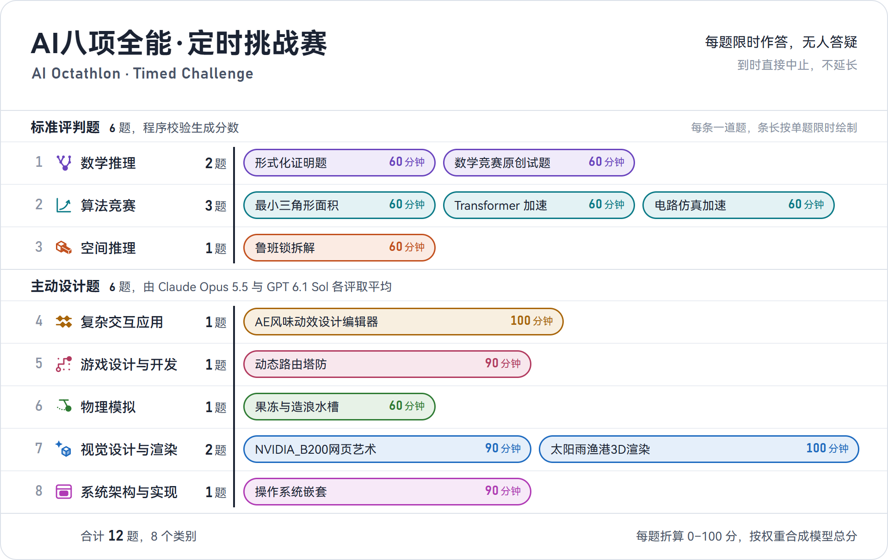</p>

<p align="center">当前正式赛程为 12 道题、8 个类别：AI 编程智能体在 60–100 分钟内独立作答，到时直接中止。</p>

---

## 目录

- [项目简介](#项目简介)
- [题目总览](#题目总览)
- [题目与考点](#题目与考点)
- [测试形式](#测试形式)
- [打分机制](#打分机制)
- [仓库结构](#仓库结构)
- [设计原则](#设计原则)

## 项目简介

- **是什么**：给 AI 编程智能体做的限时评测。题目从 Lean 形式化证明、竞赛数学、极值构造、性能优化、鲁班锁拆解，一直到整件网页作品和桌面系统的设计与开发。
- **测谁**：模型连同它自己的智能体工具一起测，例如 Claude Code、Codex，推理强度默认 `xhigh`。
- **怎么测**：每题开一个新会话，独立作答 60–100 分钟。没有人回答问题，时间一到直接中止。
- **两类题**：主动设计题 6 道，交付能直接运行的网页作品或桌面项目；标准评判题 6 道，交付证明、构造、源代码或拆解路线。
- **谁来评**：主动设计题由 Claude Opus 5.5 和 GPT 6.1 Sol 各评一次、取平均；标准评判题由程序校验生成分数。
- **总分**：每题折算成 0–100 分，按权重加权得到模型总分。

<p align="center">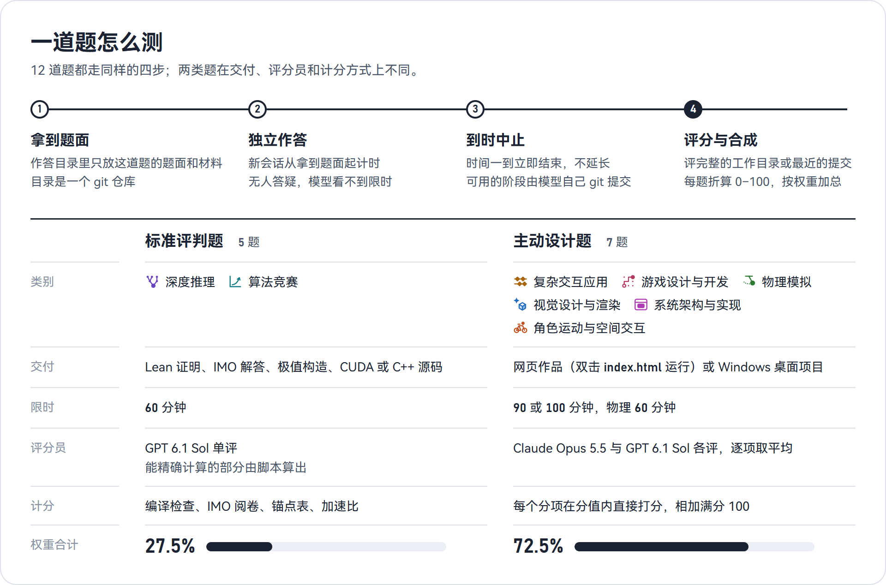</p>

## 题目总览

数学推理、算法竞赛、空间推理的 6 道是标准评判题，其余 5 个类别的 6 道是主动设计题。点题名可看题面原文。

| 类别 | 题目 | 限时 | 交付物 | 权重 |
|---|---|:---:|---|---:|
| 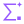 数学推理 | [形式化证明题](数学推理/形式化证明题.md) | 60 分钟 | `Problem1.lean`–`Problem8.lean` | 7.5% |
|  数学推理 | [数学竞赛原创试题](数学推理/数学竞赛原创试题.md) | 60 分钟 | `答案\第01题.md`–`第18题.md`：每题一个文件 | 7.5% |
|  算法竞赛 | [单位正方形内最小三角形面积最大化](算法竞赛/极值构造/单位正方形内最小三角形面积最大化.md) | 60 分钟 | `answer.md`：30 个点的坐标 | 5% |
|  算法竞赛 | [Transformer前向推理的GPU加速](算法竞赛/性能工程/Transformer前向推理的GPU加速.md) | 60 分钟 | `solution.cu` | 5% |
|  算法竞赛 | [通用数字电路仿真器加速](算法竞赛/性能工程/通用数字电路仿真器加速.md) | 60 分钟 | `solution.cpp` | 5% |
|  空间推理 | [鲁班锁拆解](空间推理/鲁班锁拆解.md) | 60 分钟 | `答案\第01题.json`–`第08题.json`：每题一棵拆解树 | 10% |
|  复杂交互应用 | [AE风味动效设计编辑器](复杂交互应用/AE风味动效设计编辑器.md) | 100 分钟 | 网页项目，入口 `index.html` | 10% |
|  游戏设计与开发 | [动态路由塔防](游戏设计与开发/动态路由塔防.md) | 90 分钟 | 网页项目，入口 `index.html` | 12.5% |
|  物理模拟 | [果冻冲击与造浪水槽](物理模拟/果冻冲击与造浪水槽.md) | 60 分钟 | 网页项目，入口 `index.html` | 10% |
|  视觉设计与渲染 | [NVIDIA_B200网页艺术](视觉设计与渲染/NVIDIA_B200网页艺术.md) | 90 分钟 | 网页，入口 `index.html` | 7.5% |
|  视觉设计与渲染 | [太阳雨渔港3D渲染](视觉设计与渲染/太阳雨渔港3D渲染.md) | 100 分钟 | 网页项目，入口 `index.html` | 7.5% |
|  系统架构与实现 | [操作系统嵌套](系统架构与实现/操作系统嵌套.md) | 90 分钟 | Windows 桌面项目，单一启动入口 | 12.5% |
| **合计** | **12 题** | | | **100%** |

五道网页题都要在 Chrome 里直接双击 `index.html` 就能完整运行，不经过网页服务器；操作系统嵌套用 Electron 45.2.1 或其他可嵌入 Chromium 的承载环境，从单一入口启动。权重先分到类别，类别内各题平分（算法竞赛三题各 5%）：

<p align="center">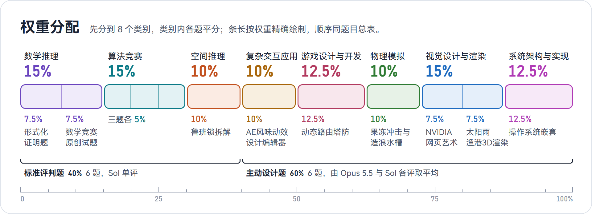</p>

## 题目与考点

每道题一张卡片：一句定位、基本信息和几条考点，评分细节收在折叠块里。

###  数学推理

考数学推理的深度与严谨。一题让 Lean 内核逐步核验证明，一题不借助任何计算工具写出竞赛解答。

<p align="center"></p>

#### [形式化证明题](数学推理/形式化证明题.md)

> 用 Lean 4 + Mathlib 为八道经典定理或研究论文中的定理写出形式化证明，能证几道算几道。

| 限时 | 交付物 | 权重 | 计分 |
|---|---|---|---|
| 60 分钟 | `Problem1.lean`–`Problem8.lean` | 7.5% | 8 题，每题 0 或 12.5 分，满分 100 |

**考点**
- 形式化：把纸面证明拆成 Lean 能接受的引理链，熟悉 Mathlib 的定义、API 和命名。
- 零容错：编译不过或留下 `sorry`，这一题就是 0 分，没有部分分。
- 取舍与专注：八题方向各不相同，先挑有把握的，证完一道再做下一道。

<details><summary>评分方向</summary>

- 每个文件单独编译，没有错误，也没有 `sorry` 警告，并且有题面要求的主定理，就得 12.5 分，否则 0 分。
- 证明的长短和写法不影响得分，各题互不影响。

</details>

#### [数学竞赛原创试题](数学推理/数学竞赛原创试题.md)

> 不借助任何计算工具，为十八道原创竞赛题写出符合数学竞赛作答规格的中文解答。

| 限时 | 交付物 | 权重 | 计分 |
|---|---|---|---|
| 60 分钟 | `答案\第01题.md`–`第18题.md` | 7.5% | 每题 0–7 分，满分 126，折算到 100 |

**考点**
- 原创：本项目新命制的题，代数、数论、几何各三道，组合五道，另有四道改编自研究型数学样题（分析、表示论、代数几何），没有现成解答可以回忆。
- 先求后证：求全部解的要排除其他解，求最值的要给出构造并证明不能更优。
- 纯推理：不得编写或运行程序验算，也不得用计算机代数系统、数值库和定理证明器。
- 书面表达：按数学竞赛的阅卷标准写全关键步骤，其余推导不必无限细化。
- 逐题落笔：题号大致从易到难排列。不要尝试一次做完全部题目，也不要一次输出多道题的答案；每解完一题就立即写进它的答案文件，一题攻不下先写下已有进展，再做下一题。

<details><summary>评分方向</summary>

- GPT 6.1 Sol 对照参考答案和每题的评分要点，按 IMO 阅卷惯例给 0–7 的整数分。
- 与参考答案不同的解法，正确完整同样满分；不完整的按完成程度给部分分。
- 只有答案没有证明、关键步骤缺失或论证有漏洞的相应扣分；写得简练但阅卷认可的不扣；常见已知定理可以直接引用，要写明名称和内容。
- 一题写了多种做法又没注明以哪份为准的，按得分最低的一份计。
- 只评 `答案\` 文件夹里的答案文件，草稿不计分；18 题合计 126 分，乘以 100/126 折算。

</details>

###  算法竞赛

考硬指标下的搜索与优化工程。极值构造题比构造质量，以参考构造值为满分线；两道性能题比速度，与基线同场运行比加速比。

<p align="center">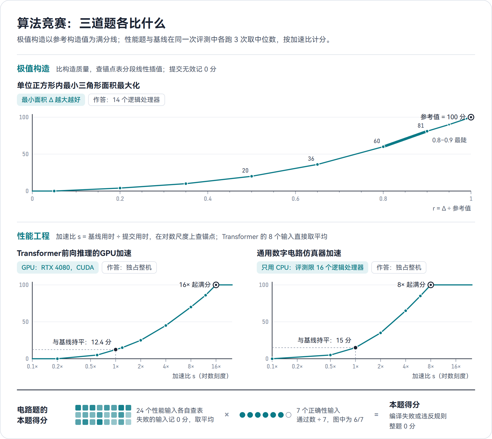</p>

#### [单位正方形内最小三角形面积最大化](算法竞赛/极值构造/单位正方形内最小三角形面积最大化.md)

> 在单位正方形内放一组点，让任意三点构成的最小三角形面积尽可能大。

| 限时 | 交付物 | 权重 | 计分 |
|---|---|---|---|
| 60 分钟 | `answer.md`（每行一个点的坐标） | 5% | 按与参考构造值之比查锚点表 |

**考点**
- 搜索策略：目标是“最小值的最大化”，不光滑、局部最优多，常规方法很快到平台。
- 精确性：按书面十进制值精确计算面积、判断越界，舍入后有一个点越界，整份提交无效。
- 算力分配：在分到的 14 个逻辑处理器和一块 GPU 上组织搜索。
- 及时转向：一个方向停滞时，判断何时换思路。

<details><summary>评分方向</summary>

- 文件缺失、点数不对、有点不在正方形内或读不出坐标，记 0 分；格式上的小出入从宽。
- 有效时算 r = Δ ÷ Δ\*（Δ\* 是固定的参考构造值，取 2026 年 9 月的已知最好值），在锚点表上分段线性插值。
- r ≤ 0.05 得 0 分，r ≥ 1 得 100 分；斜率从低段到中高段逐段加大，0.8–0.9 最陡，逼近参考值的最后几段不额外加权。

</details>

#### [Transformer前向推理的GPU加速](算法竞赛/性能工程/Transformer前向推理的GPU加速.md)

> 用 CUDA 在 RTX 4080 上实现 Transformer 的前向计算，结果在容差内，越快越好。

| 限时 | 交付物 | 权重 | 计分 |
|---|---|---|---|
| 60 分钟 | `solution.cu` | 5% | 8 个公开 shape 的输入按加速比查锚点表取平均 |

**考点**
- GPU 上的矩阵运算：矩阵乘、softmax、层归一化都要自己写，内核的吞吐决定上限。
- 精度与容差：内部精度可以自选，结果必须落在容差内。
- 显存和平台约束：超长序列放不进 $S\times S$ 的中间结果，GPU 计算也要拆成多次提交，一次跑完可能触发驱动重置甚至蓝屏。
- 按 shape 调优：8 个 shape 差别很大，分块、布局和精度都可以按 shape 分别选；作答目录里给了评分用的输入、标准答案和核对工具，题面列出基线用时，基线代码不公开。

<details><summary>评分方向</summary>

- 编译失败或违反题面规则（如在 CPU 上算张量、调用 Driver API），整题 0 分。
- 基线是出题人写的通用优化解法，与提交在同一次评测、相同条件下各跑 3 次取中位数；加速比 s = 基线用时 ÷ 提交用时。
- 每个输入按 s 在对数尺度上查锚点：0.2× 及以下得 0 分，与基线持平约得 12 分，16× 起满分；答案超出容差或运行失败的输入记 0 分。
- 本题得分 = 8 个输入得分的平均。
- 由 `evaluate.py` 计算，在全部评分的最后独占机器串行测量。

</details>

#### [通用数字电路仿真器加速](算法竞赛/性能工程/通用数字电路仿真器加速.md)

> 在 CPU 上仿真一个大规模同步时序电路，对大量随机激励逐周期算出输出摘要，越快越好。

| 限时 | 交付物 | 权重 | 计分 |
|---|---|---|---|
| 60 分钟 | `solution.cpp` | 5% | 24 个公开电路的输入按加速比查锚点表取平均，再乘正确性系数 |

**考点**
- 位级并行：把多组独立激励打包进 64 位字和 AVX2 向量同时计算。
- 电路预处理：门不按依赖顺序给出，排序、化简和布局决定求值效率。
- 多线程与缓存：激励组数和电路规模都大，怎样分批、布局和分工决定上限。
- 按类调优：8 类电路差别很大，排序、化简和执行方式都可以按类别分别选；作答目录里给了评分用的输入、标准答案和核对工具，题面列出基线用时，基线代码不公开。
- 正确：摘要逐位一致；7 个正确性输入仍然隐藏，规模极小的电路也要算对。

<details><summary>评分方向</summary>

- 只能用 CPU，可用 OpenMP 和指令内在函数；编译失败或违反题面规则，整题 0 分。
- 流程与 Transformer 题相同，锚点不同：0.1× 及以下得 0 分，与基线持平得 15 分，8× 起满分。
- 本题得分 = 24 个输入得分的平均 × 通过的正确性输入数 ÷ 7。

</details>

###  空间推理

考三维空间推理：只凭零件的精确结构推演平移和相互阻挡，写出完整的拆解路线，不借助程序搜索。

<p align="center">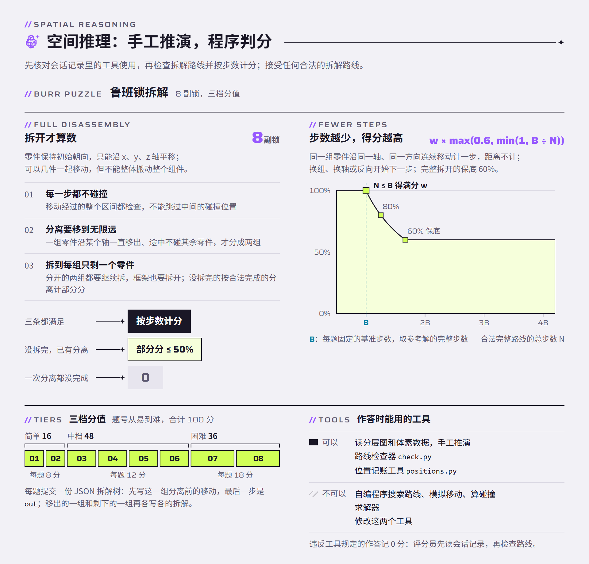</p>

#### [鲁班锁拆解](空间推理/鲁班锁拆解.md)

> 给出八副已经装好的鲁班锁，根据零件的精确结构和初始位置，把每副锁完整拆成独立零件，步数尽量少。

| 限时 | 交付物 | 权重 | 计分 |
|---|---|---|---|
| 60 分钟 | `答案\第01题.json`–`第08题.json` | 10% | 8 题分三档，每题按步数得 w × min(1, B/N)，满分 100 |

**考点**
- 读结构：从分层图和体素数据想清每个零件的形状、位置和彼此的卡扣。
- 推演阻挡：零件保持初始朝向，只能沿 x、y、z 轴平移，每一步移动经过的整个区间都不能碰撞。
- 完整拆解：一组零件移到无限远才算分成两组，两组都要继续拆到单个零件，框架也要拆开；只找到首次分离不算。
- 步数最少：同一组零件沿同一轴、同一方向连续移动计一步，距离不计；步数越少得分越高。
- 只靠推理：可以运行题目给的路线检查器和位置记账工具，不得自编程序搜索路线、模拟移动或计算碰撞，也不得用任何求解器。

<details><summary>评分方向</summary>

- GPT 6.1 Sol 先读会话记录，确认工具使用合规：自编程序搜索、模拟、算碰撞，用求解器或改动这两个工具的，整份作答记 0 分。
- 再用评分端的检查器验证整棵拆解树并计步，接受任何合法路线；没有完整合法解的题记 0 分。
- 每题得分 = w × min(1, B/N)：N 是合法完整路线的总步数，B 是该题固定的基准步数，取参考解的完整步数（01—08 依次为 8、10、14、12、14、15、42、27）；步数比 B 少也只得满分。
- 分值 w：简单档 01、02 各 8 分，中档 03–06 各 12 分，困难档 07、08 各 18 分。

</details>

###  复杂交互应用

考搭建一款大型专业工具：几十项功能任意组合时结果仍正确、各视图始终一致。

<p align="center">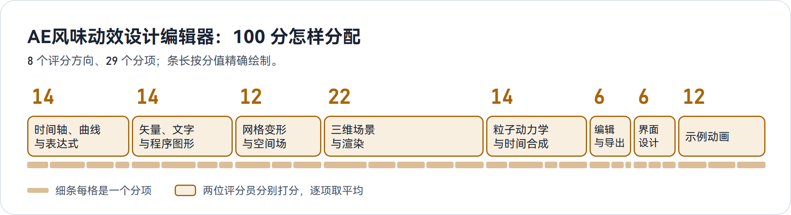</p>

#### [AE风味动效设计编辑器](复杂交互应用/AE风味动效设计编辑器.md)
> 制作可编辑的三维动效设计工具，把程序几何、网格变形、光影、粒子和时间效果接成真实链路，再用它完成一段 15 秒、带配乐的专业视觉动效。

| 限时 | 交付物 | 权重 | 计分 |
|:---:|---|:---:|---|
| 100 分钟 | 网页项目，双击 `index.html` 即可运行 | 10% | 8 个方向、29 个分项 |

**考点**

- **程序化几何**：路径、文字、操作器和节点组产生可继续用于实体、变形、发射与碰撞的输出。
- **三维与光影**：真实挤出、孔洞、倒角、参数化实体和几何变形，配合材质、环境反射、灯光、阴影与景深。
- **粒子与时间**：变形几何驱动三维粒子、碰撞事件和拖尾；多实例、时间置换与运动采样保持正确状态。
- **可编辑性**：画布、时间轴、曲线、节点与属性同步，父级和投影下操作准确，撤销、保存与导出保持结果。
- **15 秒示例**：规定技巧与两条完整链路，内容、配色、构图和镜头自行设计，主要元素连续承接并完整收束。

<details><summary>分项与计分</summary>

| 评分方向 | 分值 | 分项（分值） |
|---|:---:|---|
| 时间轴、曲线与表达式 | 14 | 关键帧与属性写入 3，曲线、路径与时间轴 5，表达式与跨时刻引用 4，预览与播放 2 |
| 矢量、文字与程序化图形 | 14 | 矢量路径与操作器 4，节点求值与几何输出 5，文字与逐字动画 3，参数化实例 2 |
| 网格变形与空间场 | 12 | 网格与变形控制 5，局部刚性与叠放 3，空间场与几何传递 4 |
| 三维场景与渲染 | 22 | 实体、孔洞与倒角 6，材质与环境反射 4，灯光与阴影 4，摄像机与景深 4，空间合成与编辑 4 |
| 粒子动力学与时间合成 | 14 | 发射与生命周期 3，力场、碰撞与事件 5，拖尾与粒子呈现 2，时间效果与运动采样 4 |
| 编辑、工程与导出 | 6 | 变换、层级与预合成 3，撤销重做与文件恢复 2，成片与逐帧导出 1 |
| 界面设计 | 6 | 界面构思与视觉层次 2，工作区与可视化反馈 2，交互状态与可读性 2 |
| 示例动画设计 | 12 | 技巧覆盖与可编辑性 4，视觉设计与渲染质量 4，动作、镜头与声画节奏 4 |

- 29 个分项由两位评分员分别打分。
- 渲染帧率与大工程速度不计分，动作、镜头和状态连续性按对应分项评价。

</details>

###  游戏设计与开发

考三维游戏的美术和设计思路：题面给定网络安全世界观和核心玩法，造型、配色和具体设计由模型定，场景、动画、特效和界面都要做出尽可能好的效果。

<p align="center">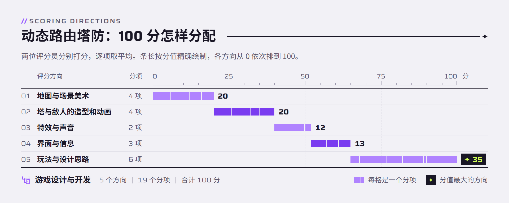</p>

#### [动态路由塔防](游戏设计与开发/动态路由塔防.md)
> 做一款三维塔防《网络安全攻防战》：隔离网络节点逼敌人改道，部分敌人会攻击塔，塔被摧毁后设备旁路直通，路线随之改变。

| 限时 | 交付物 | 权重 | 计分 |
|:---:|---|:---:|---|
| 90 分钟 | 网页项目，双击 `index.html` 即可运行 | 12.5% | 5 个方向、19 个分项 |

**考点**
- **地图与场景**：实时 3D 战场有地形高低、阴影、材质和环境动态；路线、部署位置、节点、障碍和出入口一眼分开，三张地图的场景构成和氛围明显不同。
- **造型与动画**：塔、敌人和 Boss 精细建模，推近有细节，剪影各不相同，塔升级后外观改变；移动、转向、攻击、受击和退场都是连续动作。
- **特效与声音**：每种攻击有自己的弹道和命中特效，治疗、摧毁、节点开合、改道和 Boss 登场都有相称的表现；音乐和音效自己制作。
- **界面与信息**：关卡选择、战斗界面、说明页和结算画面是同一套视觉语言，图标自己绘制；敌人和特效很多时，路线、节点状态和生命依然看得清。
- **改道与攻塔**：隔离节点后场上敌人从当前位置重新寻路，不瞬移、不穿过不可通行的位置，确认前能预览路线变化；蠕虫、洪泛团和勒索者会攻击并摧毁塔，修复进程专职治疗，塔被摧毁后路线随之改变。
- **设计思路**：路线长度、火力覆盖、塔的生存和资源投入形成取舍，三张地图产生不同的布防思路。
- **实战演示**：三段演示总时长不超过 60 秒，操作看得见、速度与正常人相当，战况势均力敌、有来有回；作品提供 `window.videoExport` 逐帧导出这三段。

<details><summary>分项与计分</summary>

| 评分方向 | 分值 | 分项（分值） |
|---|:---:|---|
| 地图与场景美术 | 20 | 地图色彩与层次 6，场景建模、材质与光影 6，场地类别辨识 4，环境动态与背景 4 |
| 塔与敌人的造型和动画 | 20 | 塔的建模 6，敌人与 Boss 的建模 6，塔、敌人、地图的视觉区分 3，连续动画 5 |
| 特效与声音 | 12 | 特效 10，声音 2 |
| 界面与信息 | 13 | 界面美术 5，局势信息 4，操作与说明 4 |
| 玩法与设计思路 | 35 | 寻路与改道 3，塔与敌人的交战 9，关卡与流程 5，实战演示 7，视频导出 1，设计思路 10 |

</details>

###  物理模拟

考三维物理模拟作品：可以用现成物理库，选哪个由模型自己决定。软体、刚体和流体的相互作用要有说服力，动态连贯，画面清晰。

<p align="center">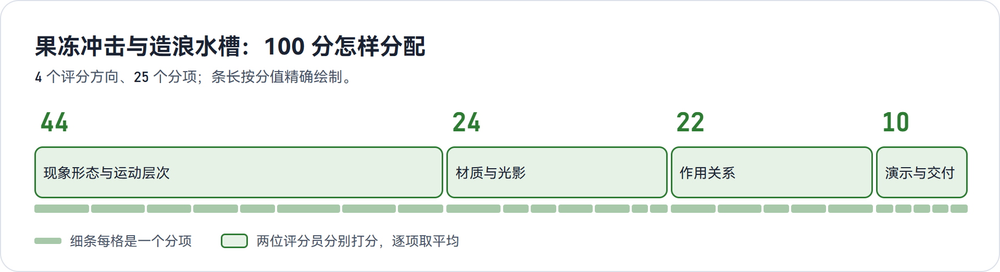</p>

#### [果冻冲击与造浪水槽](物理模拟/果冻冲击与造浪水槽.md)
> 在网页里做两个三维物理模拟场景：重球冲击果冻台，以及同尺寸多密度球在透明造浪水槽中的浮沉与运动。

| 限时 | 交付物 | 权重 | 计分 |
|:---:|---|:---:|---|
| 60 分钟 | 网页项目，双击 `index.html` 即可运行 | 10% | 4 个方向、25 个分项 |

**考点**
- **选库**：可以用现成物理库，用哪个、用在哪些部分由模型自己决定；库随作品交付、离线可用，仿真和画面都在浏览器里算出。
- **软体冲击**：接触处先凹陷，形变向整体传播，回弹和振荡有先后，不能只是整体缩放；果冻的反作用改变重球的运动。正中、偏心和多球连续冲击三种模式都要做。
- **流体与浮沉**：同尺寸不同密度的球分化出上浮、悬浮和沉底，造浪装置带来持续波浪，水面、水中、水底同时有动态；默认实验在最后一颗球入水 1 秒后启动造浪，持续 5 秒后停止。
- **视觉表现力（评分重点）**：形变、波浪和不同深度的运动层次，果冻、玻璃和水体的材质与光影；两个场景风格统一，主要动态来自实际模拟，不是预设动画。
- **视频导出**：作品提供 `window.videoExport`，逐帧显示正中、多球、偏心冲击和水槽完整流程；仿真时刻由 `i / fps` 决定，画面随窗口大小适配，只显示场景，由调用方截图。

<details><summary>分项与计分</summary>

| 评分方向 | 分值 | 分项（分值） |
|---|:---:|---|
| 现象形态与运动层次 | 44 | 局部压陷 6，整体形变 6，形变传播 5，回弹层次 5，入水扰动 4，波浪形态 7，分层运动对比 6，余波收敛 5 |
| 材质与光影 | 24 | 果冻透光 6，重球材质 3，玻璃外观 3，水体质感 4，光照塑形 4，风格一致 2，取景与辨识 2 |
| 作用关系 | 22 | 重球接触反应 5，密度与浮沉 5，造浪源响应 3，水流推动响应 4，刚体接触响应 5 |
| 演示与交付 | 10 | 阶段衔接 2，演示控制 2，参数作用 2，视频导出 2，音效 2 |

</details>

###  视觉设计与渲染

考实时图形的技术与审美：一题是滚动驱动的网页艺术，一题是三渲二的微缩三维场景。两题的流畅度和帧率都不计分。

<p align="center">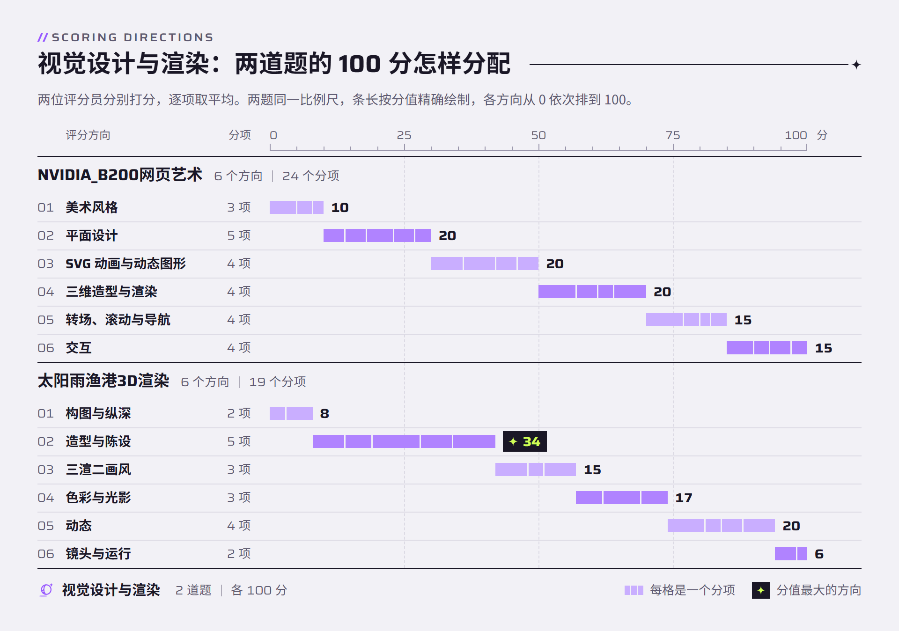</p>

#### [NVIDIA_B200网页艺术](视觉设计与渲染/NVIDIA_B200网页艺术.md)
> 以 NVIDIA B200 为题材，制作一件可滚动、可交互的网页艺术作品。从完整封装进入结构、显存与数值，再拉远到多卡系统，最后回到整颗 GPU。

| 限时 | 交付物 | 权重 | 计分 |
|:---:|---|:---:|---|
| 90 分钟 | 网页，双击 `index.html` 即可运行 | 7.5% | 6 个方向、24 个分项 |

**考点**

- **整页设计**：排版、SVG、实时三维与交互形成完整作品，美术风格和具体构图自行设计。
- **动态图形**：八章均有规定的 SVG 动态内容，覆盖结构重组、线稿对齐、位格与数轴变化、矩阵乘加和多卡汇总。
- **三维探索**：封装、八个多层显存、平台、服务器与机柜保留细节；支持部件再展开、实心剖切及拉开接缝，材质与后期根据真实空间生成。
- **连续转场**：保留七处章间衔接及三处三维／SVG 连续转换，主体和数据可追踪，中途可停、反向可退。
- **真实交互**：矩阵量化与八 GPU 分片汇总实际计算，全页精度同时影响 02、04、06、08 四章，操作可以打断。

<details><summary>分项与计分</summary>

| 评分方向 | 分值 | 分项（分值） |
|---|:---:|---|
| 美术风格 | 10 | 整页构思与辨识度 5，色彩与信息区分 3，动效风格与细节 2 |
| 平面设计 | 20 | 版面组织 4，文字与数字层级 4，信息图与规格对照 5，标注与状态反馈 4，三维与平面的组合 3 |
| SVG 动画与动态图形 | 20 | 结构与过程图形 6，数据流与计算表达 6，数值变化与状态联动 4，动画编排与细节 4 |
| 三维造型与渲染 | 20 | 封装模型与分层拆解 7，局部结构与可观察细节 4，系统模型 3，材质、灯光与画质 6 |
| 转场、滚动与导航 | 15 | 七处章间衔接 7，镜头与观看尺度 3，纵横滚动与操作衔接 2，导航与状态恢复 3 |
| 交互 | 15 | 模型探索 5，精度与数据实验 3，多卡协同与联动 4，操作反馈与可打断性 3 |

- 按实际完成质量评分，具体配色、字体和视觉效果自行设计。渲染帧率与性能不计分。

</details>

#### [太阳雨渔港3D渲染](视觉设计与渲染/太阳雨渔港3D渲染.md)
> 用 Three.js 做一件三渲二风格的微缩三维模型：太阳雨中的日式小渔港堤岸，没有人物和界面，可以自由旋转、缩放细看。

| 限时 | 交付物 | 权重 | 计分 |
|:---:|---|:---:|---|
| 100 分钟 | 网页项目，双击 `index.html` 即可运行 | 7.5% | 6 个方向、19 个分项 |

**考点**
- **建模工作量**：几十样物件推近都认得出、有细节，船舱和室内透过门窗看得清。
- **三渲二画风**：卡通着色、纤细轮廓线、色块化的水面倒影，所有物体和效果画风统一。
- **光与色**：高调低对比的太阳雨光线，青白主调配少量暖金高光。
- **动态编排**：风、云、雨和偶发事件各有节奏，变化沿路径先后传递，同一时刻最多一件明显的事。
- **镜头**：拖拽、旋转、缩放跟手，拉远看全底座，推近看清岸壁剖面、水下、船舱和室内。

<details><summary>分项与计分</summary>

| 评分方向 | 分值 | 分项（分值） |
|---|:---:|---|
| 构图与纵深 | 8 | 底座与布局 3，纵深层次与初始视角 5 |
| 造型与陈设 | 34 | 岸壁、水下与消波块 6，堤岸、系泊与生活痕迹 5，船只与驾驶舱 9，码头道具 6，港口建筑与室内 8 |
| 三渲二画风 | 15 | 着色与画风统一 6，轮廓线与画面清晰 3，材质与水面画法 6 |
| 色彩与光影 | 17 | 配色与冷暖 5，光照与天空 7，光柱与闪光 5 |
| 动态 | 20 | 常驻的细小动态 7，阵风 3，云、光与雨势 4，海鸥、猫与船 6 |
| 镜头与运行 | 6 | 镜头操作 4，加载与报错 2 |

</details>

###  系统架构与实现

考一套实际运转的递归系统：子系统的内核本身就是被调度、被计费、可修改的程序，消息、文件、窗口和数据都跨层成立，在快照恢复和独立分叉后依然成立。

<p align="center">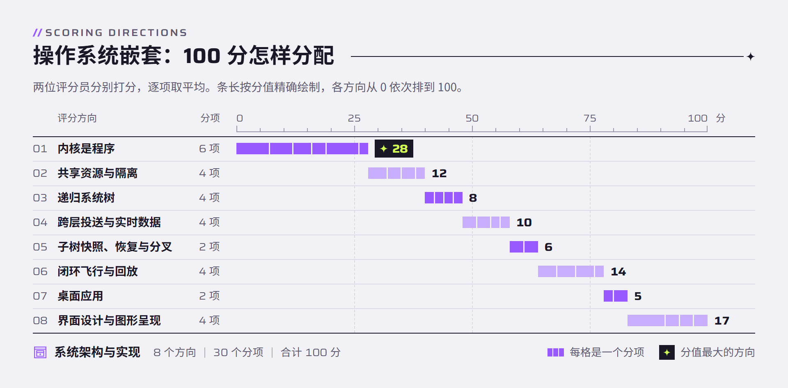</p>

#### [操作系统嵌套](系统架构与实现/操作系统嵌套.md)
> 做一个桌面端的嵌套图形操作系统：系统里还能启动系统，形成至少四层的系统树；子系统的内核是父系统里被调度、可修改的程序。根系统电子表格的数据实时画成子系统图表，子系统播放三维直升机起飞和坠机的演出，也能交互排演飞行，图表和播放器都能把可交互的窗口投送到祖先桌面。

| 限时 | 交付物 | 权重 | 计分 |
|:---:|---|:---:|---|
| 90 分钟 | Windows 桌面项目（Electron 45.2.1 或其他可嵌入 Chromium 的承载环境），单一启动入口 | 12.5% | 8 个方向、37 个分项 |

**考点**
- **内核是程序**：子系统的内核是存放在父系统里的程序，由父系统调度并计费；调度、消息、文件和窗口管理都由它实现，改源文件重启后行为就变，写坏只影响这棵子树。
- **共享资源与隔离**：程序、应用服务、内核和子系统共同竞争逐级拨付的执行预算和内存、存储配额，工作量按规模计费；失控程序只影响自己的配额范围。
- **递归系统树**：每层都能创建和管理直属子系统，至少四层、同一父系统下多个实例；暂停祖先时整棵子树停下，兄弟子树继续可用。
- **跨层窗口投送**：播放器和图表可以投送到任一祖先桌面，源窗口保留，计算仍归源系统，显示和输入经接口往返，三维场景也以副本跨层。
- **实时数据连接**：任意深度的图表订阅根系统表格的选区，每次公式重算完收到一个版本的完整值；目标子树暂停时更新在范围外暂存，继续后按序处理。
- **快照、恢复与分叉**：整棵子树保存后接着运行，相同的后续输入和拨付得到相同的结果；恢复不回滚范围外的系统，分叉子树各自独立。
- **闭环飞行**：直升机靠被调度的飞控进程保持飞行，预算不足时控制周期变长，机体抖动发散直至坠毁；评审也会自己写飞控；记录可以跳转回放，从同一位置走出不同后续。
- **各层桌面与应用**：每层都是 Windows 布局的完整桌面，视觉风格自己设计，根系统默认壁纸是自制的风景照；根系统有文件管理器、电子表格、桌面小组件、任务管理器、设置和联网的真实 Chromium 浏览器。
- **三维直升机**：紫黄配色、机身印数字 24，默认演出 15 秒内演完启动、起飞、飞行、失控、撞击与余波；实时绘制，场景是独立资源，由播放器载入，可以暂停、跳转、逐帧和调速。
- **整桌面录制**：作品提供启动参数、`automation.json`、`window.bench` 和稳定的控件标识；录制方按熟练使用者的速度把各层桌面和应用逛一遍，再做表格到图表、窗口投送和跨层传文件，最后完整播放一次三维动画，成片一分钟左右，作品不用做自动演示或视频导出。

<details><summary>分项与计分</summary>

| 评分方向 | 分值 | 分项（分值） |
|---|:---:|---|
| 内核是程序 | 28 | 调度与进程表 7，系统调用与消息 5，内核开销进入预算 4，文件系统 3，窗口管理 4，应用程序化 3，编译器自举 2 |
| 共享资源与隔离 | 12 | 共享预算与逐级拨付 4，按规模计量与续行 3，内存与存储配额 3，失控程序的隔离 2 |
| 递归系统树 | 8 | 递归创建与直属管理 2，祖先运行状态与故障范围 2，实例上下文与局部时间 2，多级操作归属与文件传递 2 |
| 跨层投送与实时数据 | 10 | 可复制的跨层显示边界 3，经消息处理的输入往返 2，投送生命周期与多视图 1，工作簿的一致版本发布 2，数据连接与暂停积压 1，图表映射与交互 1 |
| 子树快照、恢复与分叉 | 6 | 完整子树状态与确定续行 3，恢复范围与跨界关系 2，分叉独立与快照文件重开 1 |
| 闭环飞行与回放 | 14 | 飞控是被调度的程序 4，预算与时序改变飞行结果 4，记录、跳转与分叉续演 4，接触与部件结果 2 |
| 桌面应用 | 5 | 电子表格 1，Chromium 浏览器 1，三维场景播放器 1，常用工具、小组件与设置 1，启动与操作入口 1 |
| 界面设计与图形呈现 | 17 | 各层桌面的视觉与信息 8，常规窗口与网页遮挡 3，直升机造型与三维画面 3，默认演出的动作与衔接 3 |

- 流畅度和帧率不计分；执行额度与逻辑时间的正确性按系统功能判断，不看机器上的实际运行速度。

</details>

## 测试形式

### 谁在运转测评

| 角色 | 是什么 | 做什么 |
|---|---|---|
| 宿主 | 每个受测会话一个常驻进程 | 启动智能体，发开场提示，送达提醒，一轮结束后立即续做，到时中止；到时后保留，只由指挥关闭 |
| 监督进程 | 一个不含 AI 的常驻进程 | 每 2 秒巡检截止和提醒时刻，到时兜底，派发评分；把到时、失败、评分全部结束和新出现的异常通知指挥 |
| 指挥会话 | 一个 AI 会话，按操作手册行事 | 收到通知才行动：准备作答目录，逐批启动，处理故障和续做，评分结束后关闭会话，最后汇报 |
| 评分员 | 每道题先建一个读透题面和指南的底座会话（设计题 Claude、6.1Sol 各一个，标准评判题只有 6.1Sol），每个评分任务从底座分叉出新会话；Claude 是无界面的 Claude Code，6.1Sol 是无界面的 Codex | 按评分指南打分，见下文 [评分员怎么评](#评分员怎么评) |

### 一场作答怎样进行

| 项目 | 做法 |
|---|---|
| 会话 | 每道题开一个新会话，从会话启动起计时 |
| 时间信息 | 题面、开场提示、续做提示和提醒都不写限时和剩余时间 |
| 开场提示 | 说明题面位置、工作目录、交付物、git 提交、评分版本和结束进程的规则，并说明无人答疑、格式从宽；主动设计题另说明网页作品可以用浏览器 MCP 检查、桌面项目通过调试端口检查，要对照题面反复完善 |
| 答疑 | 除了系统故障说明，宿主只发下面这几句固定的话 |
| 保存进度 | 作答目录是 git 仓库，开场时只有题面这一次提交；模型每完成一个可用阶段就提交一次 |
| 到时中止 | 宿主打断正在进行的一轮，结束模型启动的命令、服务器和浏览器；作答目录里留下的就是提交 |
| 兜底 | 到时 60 秒后，宿主仍报告模型在运行的，监督进程结束这个会话的整棵进程树 |

<p align="center">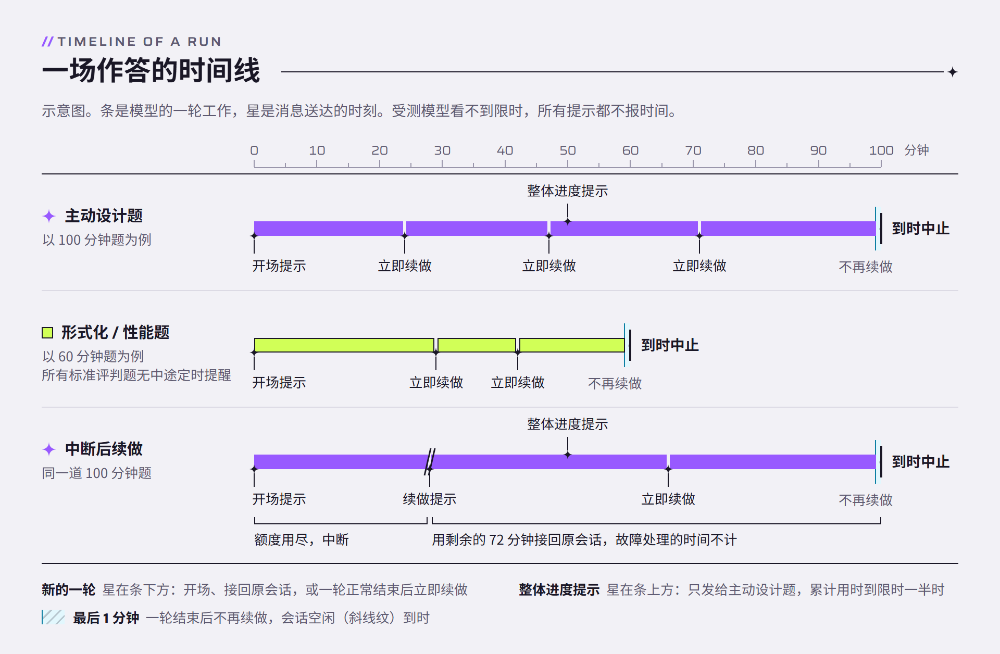</p>

### 提醒与立即续做

| 消息 | 发给 | 时机 | 原文 |
|---|---|---|---|
| 立即续做 | 两类题 | 一轮正常结束、剩余多于 10 分钟时，几秒内发起下一轮 | 主动设计题：“对照完整设计内容逐一检查，提升作品质量。”<br>标准评判题：“继续按照题面解题。” |
| 整体进度提示 | 六道主动设计题 | 完整限时的一半：物理第 30 分钟，塔防、NVIDIA 和操作系统嵌套第 45 分钟，AE 和渔港第 50 分钟 | 每题一句专属提示，以“【提醒】优先推进整体进度和能拿到分数的内容，兼顾题面评分标准的各个方向”开头，要求先让整件作品跑通，再深化细节 |
| 提交提醒 | 两类题 | 每段作答剩余 10 分钟时，一次 | 主动设计题：“【提醒】建议完成收尾，把可用的版本用 git 提交。”<br>标准评判题：“【提醒】推荐立刻用 git 提交可用版本，然后继续推进。”，Transformer 题改为“【提醒】建议优先跑通已有策略，立刻用 git 提交可用版本，然后继续推进。” |

- **怎样送达：** 会话在运行时，提醒在模型下一次调用工具时插入（Claude Code 经钩子，Codex 经 `turn/steer`）；会话空闲时，宿主用它发起新的一轮。
- **不报时间：** 所有消息都不含具体时间。
- **最后 10 分钟：** 一轮结束后宿主不再续做，会话就此空闲到时。

<details>
<summary><b>提醒的去重与补发</b></summary>

- 每种提醒每段只发一次；整体进度提示按整题累计用时计算，续做时已发过的不重发。
- 中断期间漏发的整体进度提示，在续做开始时补发；续做段一开始就不多于 10 分钟的，不补发它，立即发提交提醒。
- 同时积压几条定时提醒时，只送最新的一条。

</details>

### 故障与续做

| 情况 | 处理 |
|---|---|
| API 错误、额度用尽、宿主崩溃 | 关闭该会话，剩余时间 = 本段限时 − 已用时间，向上取整到分钟；用剩余时间接回原会话，不从头重测 |
| 接回后的第一条消息 | 说明会话因系统故障中断、此前进度已保留，并重申开场的规则，不报剩余时间 |
| 接不回原会话 | 在原作答目录开新会话，告知系统故障和最近一次提交 |
| 同一题第三次故障 | 不再续时，记为“异常（已续时）” |
| 到时之后的故障、到时兜底强制结束 | 不续时 |
| 其他批正在独占作答 | 等那一批到时并清理后再续，不打破独占 |
| 启动失败 | 排查后再启动一次；第二次仍失败，记为启动失败 |

### 隔离的作答环境

<p align="center">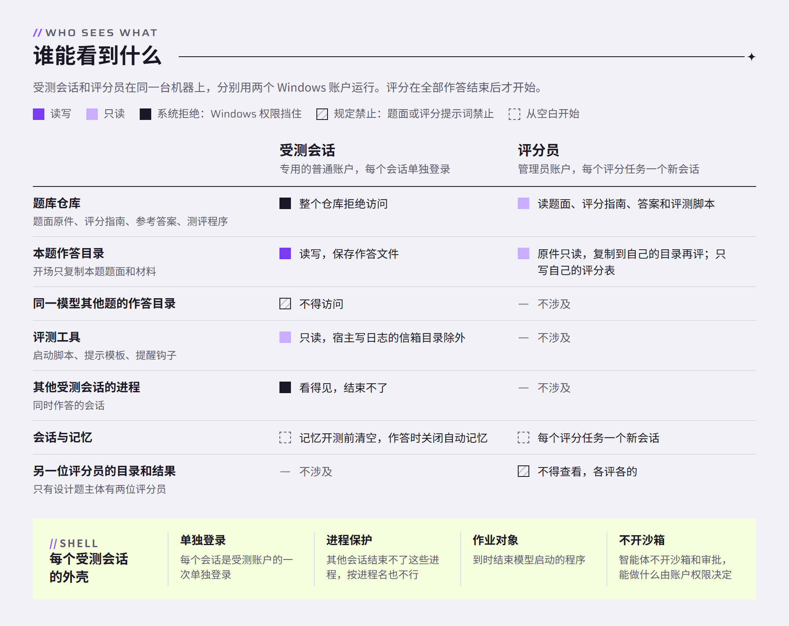</p>

- **账户：** 受测会话用一个专用的普通 Windows 账户运行，不在管理员组。题库仓库对这个账户整体拒绝访问，包括题面原件、评分资料和测评程序。
- **会话之间：** 每个会话是这个账户的一次单独登录，会话进程的权限收紧到这次登录，会话之间不能结束彼此的进程。
- **作业对象：** 每个会话的全部进程放在一个 Windows 作业对象里。到时一并结束子进程；极值构造题用它把进程绑在分到的逻辑处理器上。
- **智能体权限：** 智能体不开沙箱和审批（Claude Code 用 `bypassPermissions`，Codex 用 `approvalPolicy=never`），能做什么由账户权限决定。
- **历史与记忆：** 每轮开测前，受测账户里智能体的会话历史和记忆都已清空，作答时关闭自动记忆。会话日志在会话关闭后移到受测账户读不到的位置。
- **浏览器 MCP：** 所有受测会话都接入同一个浏览器 MCP（chrome-devtools-mcp），用本机无窗口 Chrome 和显卡，每次使用独立的临时用户数据目录。
- **机器：** 作答和评分都在同一台机器上：Windows 11，Intel Core i7-14700KF（8 个性能核 + 12 个能效核，28 个逻辑处理器），NVIDIA GeForce RTX 4080（16 GB），64 GB 内存。

### 两个测试批次

<p align="center">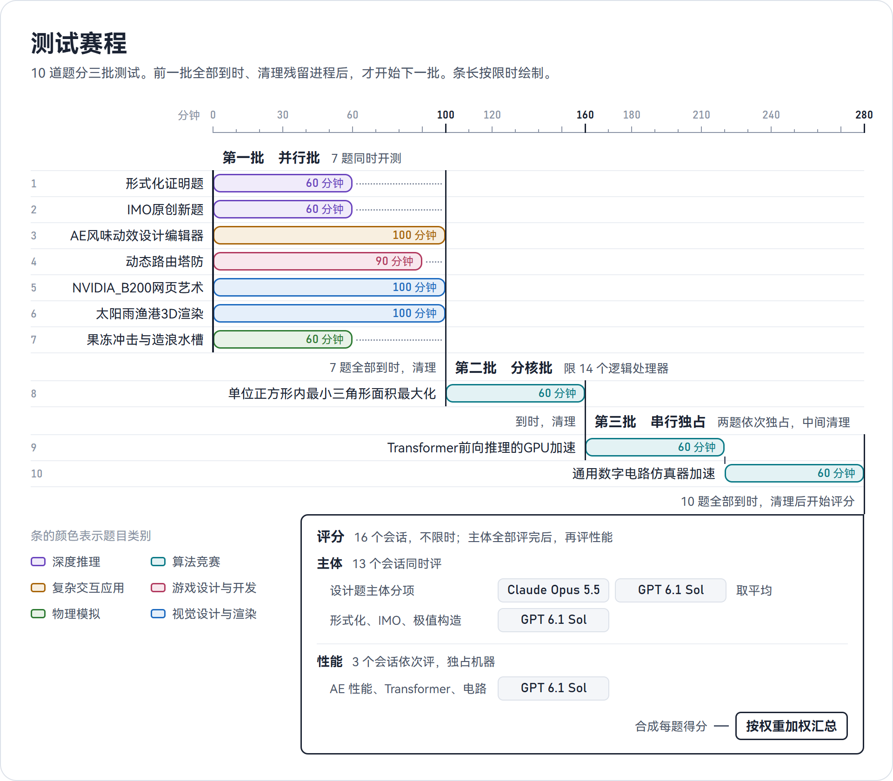</p>

| 批次 | 题目 | 方式 | 为什么这样分 |
|---|---|---|---|
| ① 并行批 | 形式化证明题、数学竞赛原创试题、AE 编辑器、塔防、NVIDIA、渔港、单位正方形、物理、操作系统嵌套、鲁班锁 | 10 题同时作答；单位正方形绑定 14 个逻辑处理器（4 个性能核的 8 个线程 + 6 个能效核） | 作答时不需要独占机器。AE、塔防、物理、操作系统嵌套和两道视觉题不评流畅度和帧率；单位正方形靠搜索用满算力，各模型分到的处理器一样多 |
| ② 串行独占 | Transformer、电路仿真 | 依次作答，每题独占整台机器 | 作答时要反复测速，其他负载会干扰计时 |

- **批间清理：** 一批全部到时后，先结束受测账户的残留进程（保留各会话的宿主），再启动下一批。
- **占机互斥：** 机器上还有不能同时进行的题在作答时不启动；串行独占期间，不运行占用 CPU、GPU 的工作。
- **评分：** 12 道题全部到时并清理后才开始评分。

### 工具与联网规定

<p align="center">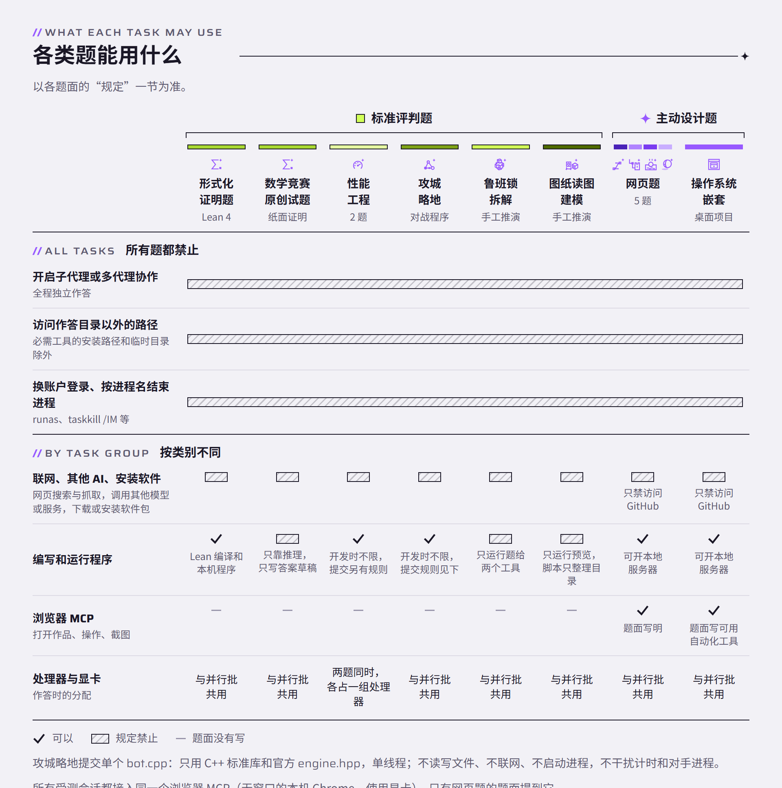</p>

作品本身还要满足的要求，以各题面为准：

| 题 | 作品或最终提交的要求 |
|---|---|
| 性能工程 | 只用题面规定的库；Transformer 的计算全部在 GPU 上，电路只用 CPU；不读写文件、不联网、不启动进程；不干扰计时 |
| AE、塔防、NVIDIA、渔港 | 素材都自己制作 |
| AE 编辑器 | 画布预览和导出用 WebGL 2 在显卡上渲染 |
| 物理 | 可以用现成物理库和渲染库，选哪个由模型决定；库随项目交付、离线可用 |
| NVIDIA | 不用 NVIDIA 官方的标志、图片和视频 |
| 渔港 | 用 Three.js 制作 |
| 鲁班锁 | 零件只沿坐标轴平移、不旋转；每题提交一份 JSON 拆解树，格式见题面 |
| 操作系统嵌套 | 可以用现成的 Chromium 内核和库，不套用现成的完整桌面系统或浏览器成品界面；图形素材自己制作，不直接复制 Windows 的图标、壁纸或界面贴图；断网时各层系统和本地应用仍可运行，只有根系统浏览器联网 |

### 评分员怎么评

| 项目 | 做法 |
|---|---|
| 评分员 | Claude Code 里的 Claude Opus 5.5，Codex 里的 GPT 6.1 Sol，都从这道题的底座会话分叉；推理强度：数学竞赛原创试题和形式化证明题用 `xhigh`，其余都用 `high` |
| 会话 | 管理员账户下，每个评分任务开一个新会话；评分员知道受测模型是谁 |
| 顺序 | 16 个主体会话同时评；全部结束后，2 个性能会话按题目表顺序一次一个，独占机器 |
| 评分版本 | 工作目录完整可用，评工作目录；停在半途，评最近一次提交；从没提交过，评工作目录 |
| 网页作品 | 用本机无窗口 Chrome，经 DevTools 协议操作和截图，以 `file:///` 打开 `index.html` |
| 打不开时 | 不能以本地文件方式完整运行的，起本地网页服务器照常评 |
| 桌面作品 | 操作系统嵌套按启动说明和 `automation.json` 启动，数据目录放在评分员自己的工作目录，经 DevTools 协议操作和截图；只开作品自身的窗口，不控制或截取桌面 |
| 鲁班锁 | 先读受测会话记录，确认只运行了题目给的两个工具，再用评分端检查器验证拆解树并计步 |
| 提交格式 | 文件名、位置或格式略有出入的，找到对应内容照常评分 |
| 从简 | 按指南要点看实际表现定分；主体段不测性能，性能段中 Transformer 和电路每个输入各跑 3 次取中位数 |
| 交付 | 填写作答目录里的评分表，写结果文件；总分由程序从分项加总 |

## 打分机制

每道题先折算成 0–100 分，再按权重加权成模型总分。各题的评分方向和分值见上面的题目卡片，本章只讲机制。

<p align="center">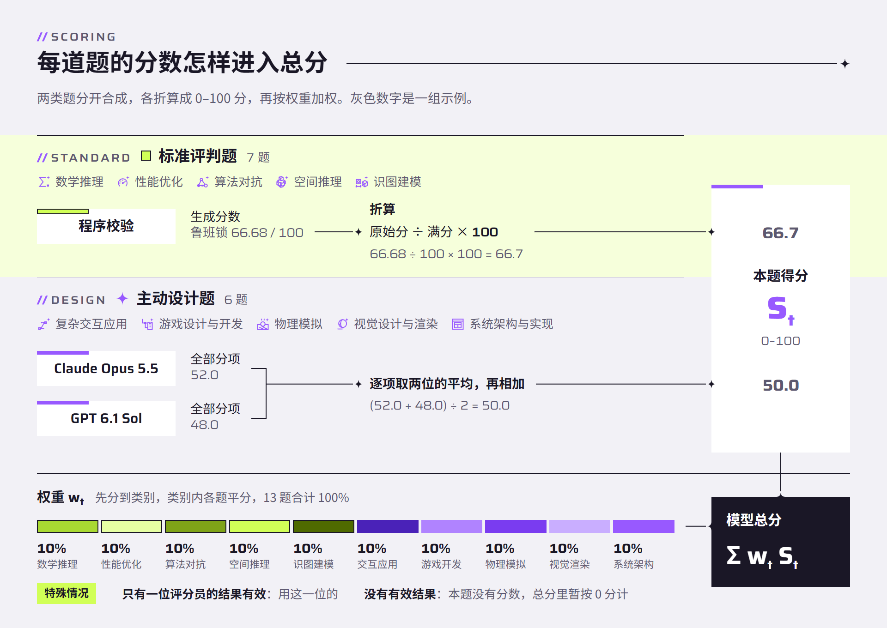</p>

### 总分怎样合成

| | 标准评判题（6 题） | 主动设计题（6 题） |
|---|---|---|
| **谁评** | 程序校验生成分数 | 各分项：Claude Opus 5.5 和 GPT 6.1 Sol 各评一次 |
| **怎样打分** | 形式化证明、极值构造、性能题和鲁班锁按计分定义记分；数学竞赛题按 IMO 阅卷惯例给 0–7 分 | 每个分项在分值内直接打分，根据这一点完成的质量考虑；不分档、不扣分、不清零 |
| **分项怎样合成** | 直接用程序校验给出的分数 | 逐项取两位的平均，相加 |
| **折算** | 原始分 ÷ 满分 × 100 | 合成分 ÷ 满分 100 × 100 |

$$
\text{模型总分}=\sum_{t=1}^{12} w_t\,S_t,\qquad \sum_{t=1}^{12} w_t=100\%
$$

- $S_t$ 是第 $t$ 题折算后的 0–100 分，$w_t$ 是它的权重。
- 类别得分是类别内各题按权重的平均。

<details>
<summary>评分失败与精度</summary>

- 设计题只有一位主体评分员的结果有效时，主体分项用这一位的。
- 评分失败的段最多重试一次。重试后仍缺少某个必需段的题没有本题得分，不按剩余分项放大，模型总分里暂按 0 分计，并标为暂定。
- 分项、单题和总分保留一位小数；权重用精确值，不舍入。

</details>

### 各题型的计分方式

<p align="center">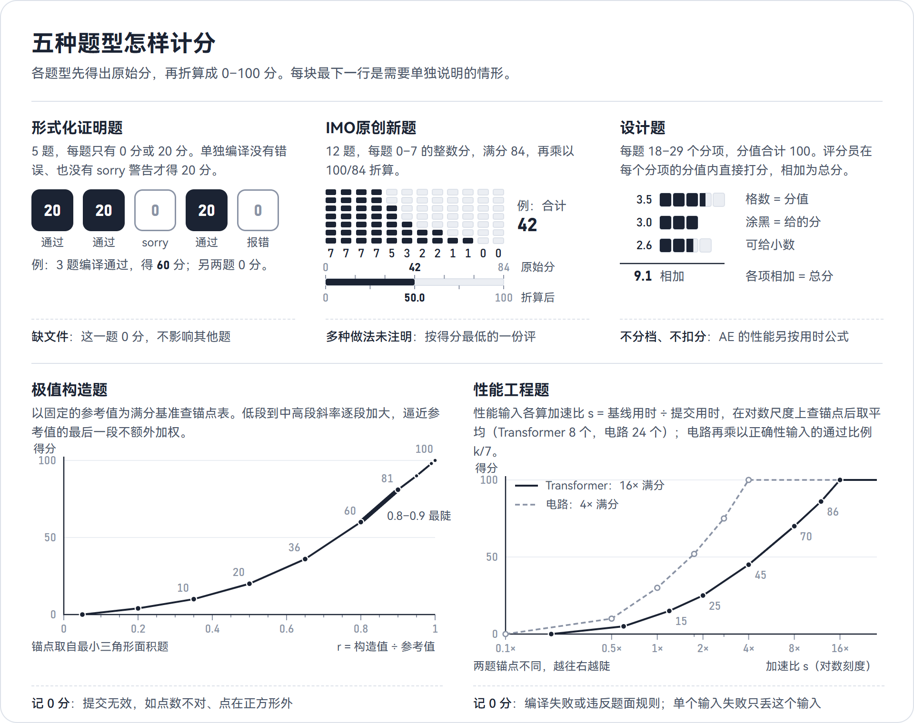</p>

<details>
<summary>极值构造题：锚点表</summary>

单位正方形内最小三角形面积最大化，$r=\Delta/\Delta^\ast$，$\Delta^\ast$ 是 $n=30$ 固定的参考构造值（2026 年 9 月的已知最好值）：

| $r$ | 0.05 | 0.20 | 0.35 | 0.50 | 0.65 | 0.80 | 0.90 | 0.95 | 0.99 | 1.00 |
|---|---|---|---|---|---|---|---|---|---|---|
| 得分 | 0 | 4 | 10 | 20 | 36 | 60 | 81 | 90 | 98 | 100 |

</details>

<details>
<summary>性能工程题：加速比与锚点</summary>

- 基线和提交的运行条件相同：同一组 16 个逻辑处理器、高优先级、同样的环境变量；只计核心函数那一次调用的墙钟时间。
- $R_i$、$C_i$ 是输入 $i$ 上基线和提交的用时，$s_i=R_i/C_i$；$k$ 是电路题通过的正确性输入个数。

$$
\text{得分}_i=p_m+(p_{m+1}-p_m)\,\frac{\ln(s_i/a_m)}{\ln(a_{m+1}/a_m)},\qquad
\text{Transformer}=\frac{1}{8}\sum_{i=1}^{8}\text{得分}_i,\qquad
\text{电路}=\frac{k}{7}\cdot\frac{1}{24}\sum_{i=1}^{24}\text{得分}_i
$$

| Transformer $s_i$ | 0.2 | 0.6 | 1.2 | 2 | 4 | 8 | 12 | 16 |
|---|---|---|---|---|---|---|---|---|
| 得分 | 0 | 5 | 15 | 25 | 45 | 70 | 86 | 100 |

| 电路 $s_i$ | 0.1 | 0.5 | 1 | 2 | 4 | 6 | 8 |
|---|---|---|---|---|---|---|---|
| 得分 | 0 | 5 | 15 | 35 | 65 | 85 | 100 |

</details>

<details>
<summary>鲁班锁拆解：步数计分</summary>

$N_i$ 是第 $i$ 题合法完整路线的总步数，$B_i$ 是这一题固定的基准步数（取参考解的完整步数），$w_i$ 是分值：

$$
\text{得分}_i=w_i\cdot\min\!\left(1,\ \frac{B_i}{N_i}\right),\qquad
\text{鲁班锁}=\sum_{i=1}^{8}\text{得分}_i
$$

| 档次 | 简单 | 中档 | 困难 |
|---|---|---|---|
| 题号 | 01、02 | 03–06 | 07、08 |
| 每题分值 $w_i$ | 8 | 12 | 18 |

没有完整合法解的题记 0 分。

</details>

### 设计题计分

<p align="center">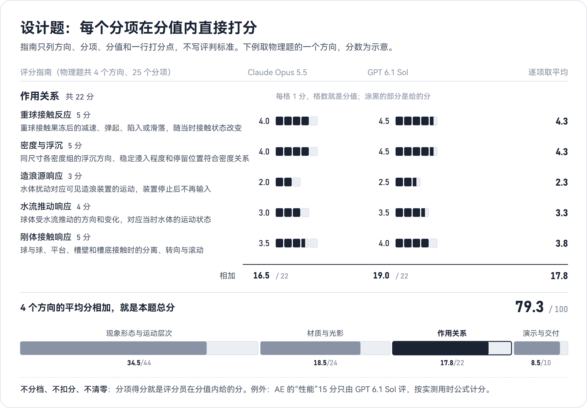</p>

指南每题 4–8 个方向、19–37 个分项，只写分值和一行打分点，分值合计 100；评分员在分值内给分，根据这一点完成的质量考虑，满分代表这一点质量优秀，可给小数，保留一位。

## 仓库结构

- 题面按类别放在文件夹里，每题一份 `.md`；正式赛程为 8 类。开测时只把这一道题的题面复制进它的作答目录，数学竞赛原创试题另带 18 道题的文件夹（在作答目录里名为 `题目`），鲁班锁拆解另带八副锁的数据和两个工具（文件夹沿用原名 `鲁班锁拆解`），Transformer 和电路题另带 `数据` 文件夹（评测程序、核对工具、输入和标准答案）。
- `Grading/` 是评分材料：评分指南、空白评分表、参考答案、隐藏测试数据和评测脚本。
- 运行测评的调度程序和受测模型的作答目录都在测试机本地，不在本仓库中。

```text
AI-High-Pressure-Challenge/
├─ README.md
├─ 数学推理/           题面按类别分文件夹，每题一个 .md
│  ├─ 形式化证明题.md
│  ├─ 数学竞赛原创试题.md
│  └─ 数学竞赛原创试题/     18 道题，每题一个文件
├─ 算法竞赛/
│  ├─ 极值构造/
│  │  └─ 单位正方形内最小三角形面积最大化.md
│  └─ 性能工程/
│     ├─ Transformer前向推理的GPU加速.md
│     ├─ Transformer前向推理的GPU加速/  评测程序 grader.cu、核对工具 check.py（输入和标准答案在评分目录）
│     ├─ 通用数字电路仿真器加速.md
│     └─ 通用数字电路仿真器加速/      评测程序 grader.cpp、核对工具 check.py（输入和标准答案在评分目录）
├─ 空间推理/
│  ├─ 鲁班锁拆解.md
│  └─ 鲁班锁拆解/        八副锁的分层图和体素数据，工具/ 下有路线检查器 check.py、位置记账工具 positions.py
├─ 复杂交互应用/
│  └─ AE风味动效设计编辑器.md
├─ 游戏设计与开发/
│  └─ 动态路由塔防.md
├─ 物理模拟/
│  └─ 果冻冲击与造浪水槽.md
├─ 视觉设计与渲染/
│  ├─ NVIDIA_B200网页艺术.md
│  └─ 太阳雨渔港3D渲染.md
├─ 系统架构与实现/
│  └─ 操作系统嵌套.md
├─ Grading/            评分材料
│  ├─ README.md        评分分工、计分与总分
│  └─ <类别>/<题名>/   每题一个文件夹，与题面一一对应
├─ 调研/               出题和测评设计的调研记录
├─ 参考/               NVIDIA 题出题时参考的设计稿
└─ assets/readme/      README 配图和类别图标，src/ 是配图源文件
```

`Grading/` 下每道题的文件夹里有什么（说明见 [`Grading/README.md`](Grading/README.md)）：

| 题目 | 文件 |
|---|---|
| 每道题 | `AI评分指南.md`：评分要点；`评分表_6.1Sol.md`：6.1Sol 的空白评分表 |
| 六道主动设计题 | 另有 `评分表_Opus5.5.md` |
| 形式化证明题 | `参考答案.md`，以及 `参考证明/` 下八份完整的 Lean 证明 |
| 数学竞赛原创试题 | `参考答案.md`：标准解答和每题的 7 分评分要点 |
| 极值构造题 | `check_answer.py`：校验格式，精确计算目标值 |
| 两道性能工程题 | 基线、输入生成器、评测程序，性能输入和标准答案（Transformer 的数据不进仓库，用生成器重建）；电路题另有 7 个正确性输入；上一级目录有两题共用的 `evaluate.py` |
| 鲁班锁拆解 | `参考答案.md`：分档依据和参考路线的步数；`标准解答/` 下八题的参考路线；`check.py`、`grade.py`：检查拆解树、计步和计分；`references.json`：每题的题源、档次、分值、参考步数和基准步数 B（取参考步数）；`test_grading.py`：评分脚本的测试 |

## 设计原则

### 出题

- **工作量有意超出限时**：设计题的内容多到限时内做不完。比的是先做什么、做到多完整、质量多高。
- **AE 的难度核心是耦合**：各部分互相牵动，单独做好一块不够，放在一起也要同时成立。
- **题面写做什么，不写怎么做**：题面交代主题、内容和要求；算法、库和代码结构留给模型。明显更合适的技术直接写成要求，例如 AE 编辑器的合成画面用 WebGL 2；运行环境里的坑照实提醒。
- **按强模型的读法写题面**：只写设计意图和作品的具体内容。能推出来的数值、系统做对了自然会有的结果、描述主观感受的词都不写；分值低的功能一两句话带过。
- **难度靠实测校准**：不信 AI 对用时和难度的估计，要估难度就让模型实际做一遍。数学竞赛题是新命制的原创题，按实测的单题用时从候选题中选出最耗时的 12 道，再从同一候选池追加 1 道组合题，从所有没用上的候选题（含 `调研/数学竞赛新题` 的两轮新题）里挑 GPT 6.1 Sol 无工具盲做用时最长的两道，又加入四道改编自研究型数学样题的新题、撤下一道，共 18 道，参考正式测评的得分和盲做用时按难度排序。

### 作答

- **题面平实，不施压**：题面和注入的提示只写普通说明，不写“能力竞赛”“与其他模型比较”之类的话。零分和扣分条款只写在评分指南里，题面只告诉模型评分对提交格式很宽容。
- **两类题分开对待**：主动设计题要求对照题面把完成度做高，个别小 bug 对分数影响不大；标准评判题只要求按题面解题。
- **鼓励用满时间**：作答目录是 git 仓库，有提交过的版本兜底，大改也不怕。时间还多时模型提前结束一轮，宿主会马上让它继续。

### 评分

- **评分照应题面**：评分指南按题面的评分标准列出方向和分项。设计题的评分方向相互独立，同一件事只在一个分项里记一次。
- **能算的交给工具**：Lean 编译、极值构造的目标值、性能题的加速比、鲁班锁路线的合法性和步数都由工具精确算出。评分员只判断需要判断的部分。
- **区分度放在强模型的区间**：极值构造和性能题用锚点表分段插值，斜率从低段到中高段逐段加大。常规方法只能拿到低段分数，做到中高水平的作品会明显领先。
