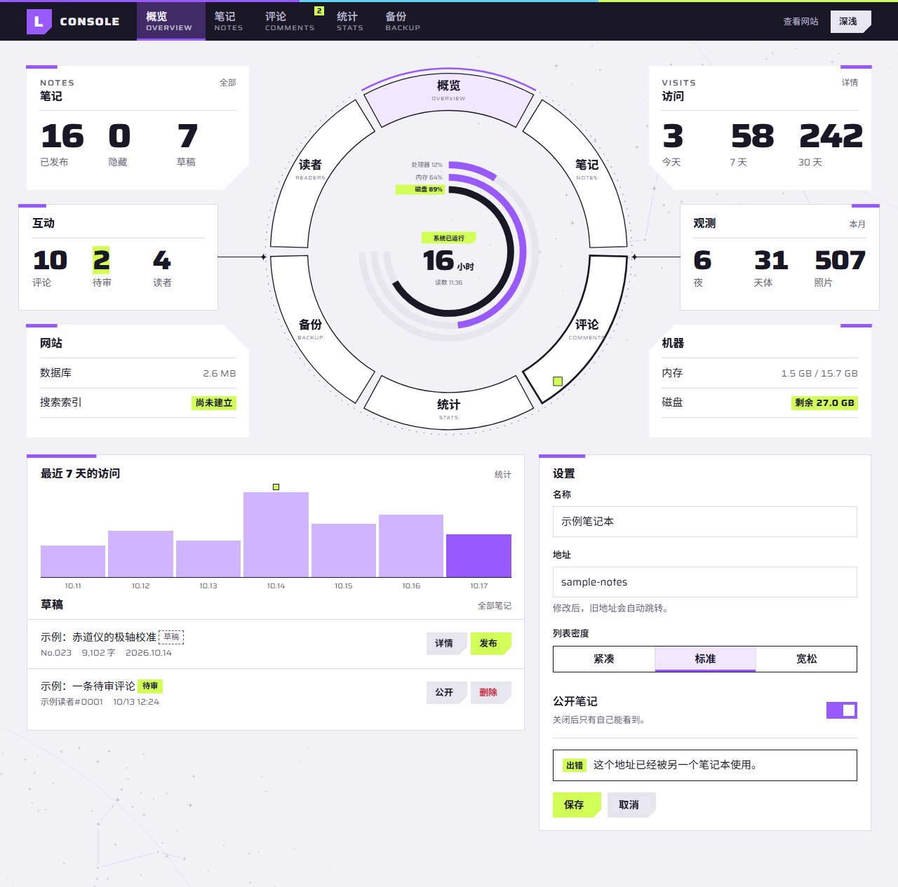
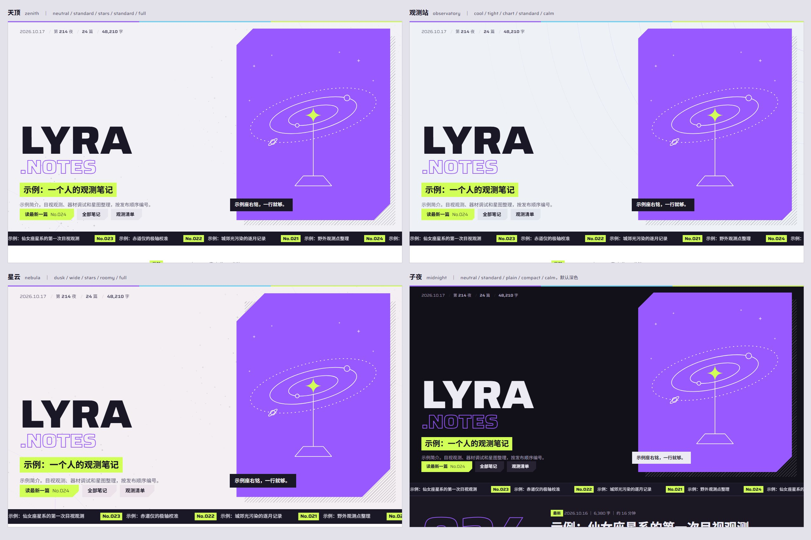
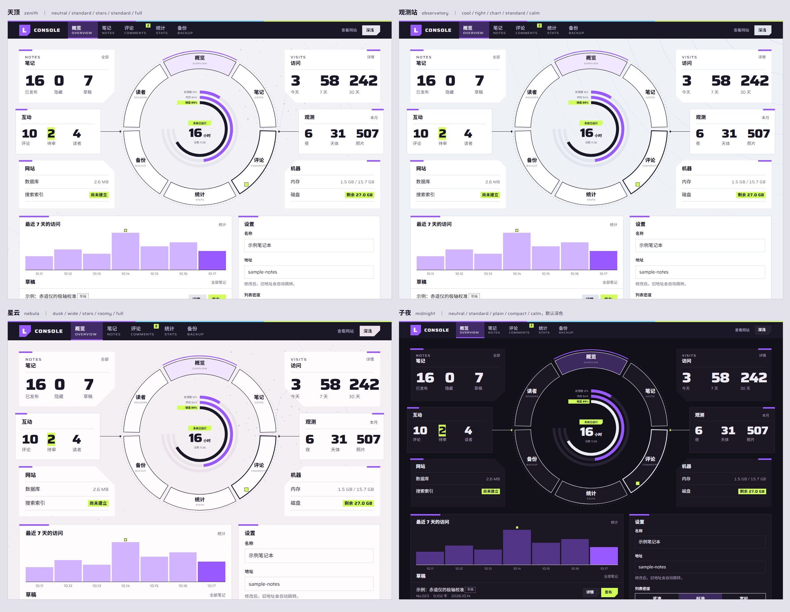

# stellar-ui

An agent skill for building desktop web UI with a restrained star-atlas look: cool lavender paper, night-sky ink, a complementary pair of theme colours (violet `#9859FF` for brand and structure, acid lime `#D1FF57` for energy and highlight), every star a four-point star, cut corners on pressable things, wide Latin labels over bold Chinese, hairlines, and a faint star chart in two corners.

一个让 AI 写出"星辰风味"桌面网页的 skill：淡紫灰的纸配夜空色的字，主色是一对互补色——紫色搭起品牌和结构（字标、分节标记、看板页签、图表、你在哪），荧光绿点亮主要操作和高光（最佳成绩、提醒、星星的光点）；中性色为主，有色部分按紫 6、荧光绿 3、星光青 1 分配。星星一律画成四角星；能点的按钮切掉一个角，标题上面放一行拉宽的英文小字、下面是粗体中文，列表每一行都有编号，背景只有两角淡淡的一小片星图，动画短而干脆。只做桌面网页。

基本规则每个产品都一样，外观可以按产品换：底色、切角大小、背景纹理、疏密、动画多少五项都能调，另有四组现成的搭配，免得每个用它的产品都长得一样（见 `references/variation.md`）。两种主题色固定不变。

## 安装

这是一个标准的 [Agent Skills](https://agentskills.io) 包（根目录 `SKILL.md`），不绑定某一家的 agent。把整个文件夹放到 agent 读取 skill 的位置即可，文件夹名用 `stellar-ui`：

| agent | 放在哪 |
| --- | --- |
| Claude Code | `~/.claude/skills/stellar-ui/`（所有项目可用），或 `<项目>/.claude/skills/stellar-ui/` |
| OpenAI Codex | `~/.agents/skills/stellar-ui/`，或 `<项目>/.agents/skills/stellar-ui/`；装好后重启，可以用 `$stellar-ui` 点名调用。`agents/openai.yaml` 提供了 Codex 界面里的名字、简介和颜色 |
| 只读规则文件的工具（`AGENTS.md`、`.cursorrules`、`GEMINI.md` 等） | 把文件夹放进项目，例如 `vendor/stellar-ui/`，在规则文件里加一行：`做界面时，先读 vendor/stellar-ui/SKILL.md，按里面的步骤和规则做；需要的文件都在同一目录。` |
| 网页对话（没有安装目录） | 把 `SKILL.md`、`references/tokens.md` 和 `references/web.md` 作为附件上传，让它照着做 |

## 结构

agent 只在被触发时读 `SKILL.md`；其余文件按需打开，不会一次全塞进上下文。

```text
stellar-ui-skill/
├── SKILL.md                  入口：气质、选页面类型、定变体、照着做、字体、部件速查、规则、交付清单、文件地图
├── agents/openai.yaml        Codex 界面里的名字、简介、颜色（其他 agent 忽略）
├── references/               按需读的细节
│   ├── tokens.md             色值与对比度、两种主题色的分工、深色主题、字体、字号
│   ├── components.md         每个部件的写法、含义和禁忌
│   ├── patterns.md           三种页面类型的版式，对话框、侧面板、提示、空状态、加载
│   ├── motion.md             动效：原则、三条曲线、编排、完整清单、进出、状态变化、减少动效
│   ├── variation.md          变体：不能变的固定规则、五个可变维度、四组预设、不照抄模板、新部件怎么推
│   ├── rules.md              做与不做，每条的理由
│   ├── glossary.md           术语表：内部叫法的意思，以及对人该怎么说
│   ├── web.md                接入网页：引用套件、字体自托管、框架和组件库、验收
│   └── research.md           设计来源：结构借鉴自哪里、星辰意象取了什么
├── assets/                   可直接拷进项目的东西
│   ├── tokens.json           token：颜色、字体、字号、间距、切角、线宽、动效、变体
│   ├── stellar.css           网页套件：全部变量和 st- 部件，不依赖框架
│   ├── fx.js                 乱码后落定、深浅切换、视差、侧面板与对话框进出、提示条、删行、完成反馈
│   ├── dial.js               控制台的星盘
│   ├── variant.js            开页前按地址或 data-st-* 设好变体和主题
│   ├── stars/                星图底纹 SVG 和生成脚本
│   └── fonts/                Saira 可变字体和许可证
├── templates/                可运行的参考实现
│   ├── showcase.html         页面类型一：展示页（字标、光谱条、索引）
│   ├── reading.html          页面类型二：阅读页（长文、目录、相关笔记）
│   ├── console.html          页面类型三：控制台（星盘、看板、图表、侧面板）
│   ├── motion.html           动效样张：每个动效一格，可重放
│   ├── specimen.html         全部部件的样张
│   └── antipatterns.html     做与不做的对照页
└── examples/web/             截图，不用跑就能看
```

agent 的工作顺序：读 `SKILL.md` → 读 `references/variation.md` 定变体和主视觉 → 读 `references/web.md` 接入套件 → 按页面类型参考 `references/patterns.md` 和模板 → 用 `SKILL.md` 末尾的清单自查。

## 预览

截图都在 `examples/web/`，宽 1280，整页截取。

| 页面 | 浅色 | 深色 |
| --- | --- | --- |
| 展示页 | `showcase-light.jpg` | `showcase-dark.jpg` |
| 阅读页 | `reading-light.jpg` | `reading-dark.jpg` |
| 控制台 | `console-light.jpg` | `console-dark.jpg` |
| 部件样张 | `specimen-light.jpg` | `specimen-dark.jpg` |
| 动效样张 | `motion-light.jpg` | `motion-dark.jpg` |
| 反例对照 | `antipatterns.jpg` | — |



### 同一套规则，四种外观

同一个页面，四组预设：`zenith` 天顶（默认）、`observatory` 观测站（偏蓝灰的纸、小切角、星图圆弧底纹、去掉入场动效）、`nebula` 星云（偏暮色的纸、大切角、宽松）、`midnight` 子夜（默认深色、无底纹、紧凑）。两种主题色、编号、切角、宽体字段、细线这些固定规则没变，纸色、切角大小、底纹和密度变了。





五个维度怎么选、怎么写变体卡，见 `references/variation.md`。

## 在浏览器里跑模板

模板用了 ES module，浏览器不允许从 `file://` 加载，所以要在**本目录**起一个静态服务器（不要在 `templates/` 里起，模板要引用上一级的 `assets/`）：

```sh
npx http-server -p 8766          # 有 Node 就用这个
python3 -m http.server 8766      # 或者 Python；Windows 上用 py -m http.server 8766
```

> Windows 上如果 `python` 敲下去什么都没发生，那是应用商店的占位程序，并没有装 Python，换用上面的 `npx` 或 `py`。端口被占用时，换一个端口号。

然后打开：

| 地址 | 看什么 |
| --- | --- |
| `http://localhost:8766/templates/motion.html` | 动效样张：三条曲线、打开页面、回应操作、进出与状态变化、入场时间轴；顶部"全部重放" |
| `http://localhost:8766/templates/showcase.html` | 展示页：光谱条扫过、字标推入、马克笔划过、指针视差 |
| `http://localhost:8766/templates/console.html` | 控制台：看板通电、星盘组装、读数乱码落定、指向星盘的段；点"详情"推出侧面板，点"删除"弹出确认框，点"保存"看处理中到完成 |
| `http://localhost:8766/templates/reading.html` | 阅读页 |
| `http://localhost:8766/templates/specimen.html` | 全部部件，指向状态也摆出来了 |
| `http://localhost:8766/templates/antipatterns.html` | 反例和正例并排 |

每页都有深浅切换按钮。所有模板都认这些地址参数：

- `?theme=light|dark`：这一次打开用浅色或深色
- `?variant=zenith|observatory|nebula|midnight`：套用一组预设
- `?paper=neutral|cool|dusk`、`&cut=tight|standard|wide`、`&ground=stars|chart|hatch|plain`、`&density=compact|standard|roomy`、`&motion=full|calm`：单独换某一项，可以和 `variant` 一起用

`console.html` 还认 `?drawer=1`（打开侧面板）和 `?dialog=1`（打开确认框）。

如果动效一格都不动：系统开了"减少动态效果"（Windows：设置 → 辅助功能 → 视觉效果 → 动画效果；macOS：辅助功能 → 显示 → 减弱动态效果），动效样张顶部会出现提示，这是期望的行为。想临时看效果，可以在 Chrome 开发者工具的 Rendering 面板里把 `prefers-reduced-motion` 模拟成 `no-preference`。想看清曲线和先后顺序，可以在 Animations 面板里把播放速度调到 25% 或 10%。

## 换一片星空

背景的两片星图是脚本画的，同一个种子永远画出同一张图：

```sh
cd assets/stars
node draw-stars.mjs
```

改脚本底部的 `seed`（随机种子）、`count`（星数）、`circles`（赤纬圈半径）和 `chains`（星座连线从哪里起、连几颗星），就能得到自己的一片。每片星图写出三份：`stars-a.svg`（单色，线和星在一起）、`stars-a-lines.svg`（线，页面里是淡紫）和 `stars-a-glints.svg`（四角星，页面里是淡墨，深色里是淡荧光绿）。

## 许可

`assets/fonts/Saira.ttf` 是 [Saira](https://github.com/Omnibus-Type/Saira)，SIL Open Font License 1.1（见同目录 `Saira-OFL.txt`）。结构借鉴自 hhikr 的 endfield-ui-skill（见 `references/research.md`）。示例中的名字和数字都是虚构的。
