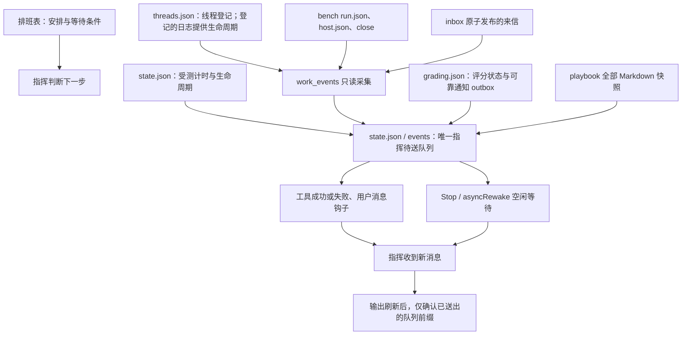

# 通讯体系重做（Sol）

实施日期：2026-10-31，北京时间。最终验证快照：01:41:15。

已完成只读调研、离线重构、生产切换和验证；本轮新增的“压缩后注入全部 playbook”也已上线。最终生产检查为 **99 passed, 80 subtests passed**。主会话于 01:35 通过 Stop 收到真实端到端实验消息，并向本线程回执确认。

## 一、UESTC_RPG 实际怎样通讯

### 1. 消息路径

| 方向 | 落盘与送达 | 空闲时怎样继续 |
|---|---|---|
| Claude 主会话 → Codex 主线 | 新建 `.collab/notes/codex/*.md`；`uestc-steer.cjs` 在 PostToolUse 中核对当前 transcript 的 session_meta.id，送入当前轮 additionalContext，输出成功后归档 | `codex_app_steer.py` 从会话记录读取最近生命周期；忙时写 steer，闲时执行 `codex queue` 开新轮 |
| Codex → Claude 主会话 | 新建 `.collab/notes/claude/*.md`；后台 `inbox_wait.sh` 收集并输出，Claude 的后台任务完成通知带回主会话 | 主会话以 run_in_background 挂一次性等待者，收到后重挂；不靠巡逻发现普通来信 |
| 作者留言 → Claude 主会话 | 同一个 Claude 收件箱，guard 或等待者通过共用的 inbox.py 短锁领取 | 作者留言立刻返回；普通信第一封后合并约 10 秒 |

共同原则是先落盘、按事件发信、工具边界及时注入、空闲另有等待者。施工状态以施工队列为准，任务单承载细节；来信不承担整份状态表的职责。会话 ID 和 transcript 识别防止子代理领取主线消息，锁与归档约束并发领取，长消息不硬截成半封信。

此次只读依据：

- [WF-COMMS](E:/Project/UESTC_RPG/docs/workflow/WF-COMMS-交接与通信.md) §4–5，以及 [WF-ENTRY](E:/Project/UESTC_RPG/docs/workflow/WF-ENTRY-角色入口卡.md)。
- [.collab README](E:/Project/UESTC_RPG/.collab/README.md)、[工具索引](E:/Project/UESTC_RPG/.collab/tools/README.md)、[HANDOVER](E:/Project/UESTC_RPG/.collab/HANDOVER.md)。
- [inbox_wait.sh](E:/Project/UESTC_RPG/.collab/tools/watch/inbox_wait.sh)、[inbox.py](E:/Project/UESTC_RPG/.collab/tools/inbox.py)、[uestc-steer.cjs](E:/Project/UESTC_RPG/.collab/tools/hooks/uestc-steer.cjs)、[codex_app_steer.py](E:/Project/UESTC_RPG/.collab/tools/agents/codex_app_steer.py)。
- 项目 CLAUDE.md、AGENTS.md，以及管理员 `.claude/settings.json`、`.codex/hooks.json`、`.codex/config.toml` 的实际登记。项目 `.claude/` 当时只有工作树目录，相关 guard/steer 钩子登记在账户级配置。

事实边界：UESTC_RPG 的 HANDOVER 明写 10 月 27 日后台全停。本次确认的是实现与运行约定，没有为了调研重启它的等待者、巡逻或其他进程；其普通信还带约 10 秒合并窗口，不能称为所有场景零延迟。

### 2. 借鉴与取舍

借鉴持久收件、工具边界送达、空闲等待、稳定身份和单一状态来源。没有复制它的施工队列、观察台、全部规则注入框架或 Bash 等待脚本。本项目保留现有 Python 监督和 Claude asyncRewake，把漏掉的工作来源接入同一条队列，减少入口。

## 二、新架构与权威来源



| 信息或消息类型 | 唯一事实来源 | 产生与行动 |
|---|---|---|
| 安排、暂停、不排测、正式记录认定 | `playbook/排班表.md` | 指挥按表判断；代码不再从完整题库反推缺题或评分授权 |
| 受测截止、失败、关闭、归档、观察不明：session | `state.json` 的计时记录；host.json 只提供宿主观察 | 监督把状态改变和通知一起保存；消息给出日志、事实和处理规则 |
| 工作线程结束或异常：thread | `steer/threads.json` 的 run ID、PID/创建时间、指定日志与结果路径 | 每轮只采集一条终态通知，指挥读取结果或处理失败；中途待决定用 notify |
| bench 到时和终态：bench | `E:/Test/_bench/mailbox/<名字>/run.json`、host.json、close | 只读观察，通知到时及完成/失败，不控制 bench 进程 |
| 评分完成、失败、超时待查：grading | `grading.json` | 保留必要的持久 outbox 搬运确认，转入中心队列后才清生产者 outbox |
| 评分员来信：letter | 原子发布的 `inbox/*.md` | 内容与文件名生成稳定键；转成队列项，输出确认后归档 |
| 临时待办：message | `timer.py notify <唯一ID> <消息文件>` | 同一事项复用 ID，重复发布不再入队 |
| 基础设施异常：patrol/system | 具体磁盘观察、评分队列或错误来源 | 只报新发现；不重复报失败任务、暂停项目或正常状态 |
| 指挥规则恢复：playbook | `playbook/` 当前全部 `.md` 文件 | 按文件名排序快照，分段进入同一队列，仅确认送出的段 |

中心队列按顺序编号，稳定生产者键保存在 `event_keys`，已确认游标为 `event_ack`。线程、bench、重复 notify 和来信重扫不会重复生产同一事项。评分跨文件通知继续使用 outbox/ack，这是防止崩溃丢通知的事务边界，不是双权威或兼容入口。

两种消费者共享同一个 OS 状态锁：工作中由 PostToolUse、PostToolUseFailure、UserPromptSubmit 送达；空闲时 Stop 后台等待，每两秒检查并在有消息时以退出码 2 唤醒。无新消息不输出整表、正常巡逻或 25 分钟假心跳。Stop 设置较长的 2,147,483 秒预算，正常工具活动后会由新的 Stop 等待者接替；会话关闭后仍未送出的消息保留在磁盘，后续认领或恢复继续接收。

“送达确认”指钩子输出成功刷新，不冒充指挥已经完成业务处理。输出与 Claude 接收不能形成一个跨进程原子事务：若恰好在刷新成功与持久确认之间崩溃，可能重放相同事件编号；指挥按编号只处理一次。常规重复发布、并发争抢和重启恢复路径均已验证。

## 三、降噪与保留宿主的安全修复

- 删除完整题库减去当前 tasks 得出“剩余题”的推导，删除基于最近启动型号的自动排测建议。status 和启动输出只指向排班表，暂停、等待用户、已归档正式记录不会再变成催测。
- 正常提醒仍按既有文案投递受测会话，回执不再送到指挥；巡逻只检查新增基础设施问题，不报“无异常”，不包计时表，不重复附“下一步”。
- host.json 读失败时优先使用已登记宿主身份，不退回已退出的启动器冒充宿主。持续读失败或陈旧状态只产生一次待查事件，不能授权强杀保留宿主。
- 到时宽限后，只有新鲜状态明确 busy 才进行兜底，根 PID 必须是本轮已经核验的进程身份；旧启动器 PID 被重用不能带入无关进程树。
- 监督心跳陈旧而原进程身份仍在时只通知核对，不因一次长调度步骤自动杀监督。部署重启仍按 PID、创建时间和命令行人工核验后执行精确 PID 操作。

## 四、压缩后的全文注入

Claude Code 官方规定 `additionalContext`、`systemMessage`、`initialUserMessage` 和纯 stdout 各有 10,000 字符上限；超限会存入会话目录，并以路径和最多前 2,000 字符预览替代，平台不会自动要求模型读取全文，也没有提高该上限的配置。因此不能把约 1.3 万字一次输出后当成已经全文注入。[官方 Hooks 输出约定](https://code.claude.com/docs/en/hooks#json-output)

实现采用每段正文最多 8,000 个 UTF-16 码元、整次上下文最多 9,000 个码元的预算；余量留给事件编号和入口说明。Emoji 等非 BMP 字符按两个码元计。文件全文不 strip、不截断，长文件允许跨段；每段明确批次位置。

适用范围是已认领主会话的 compact、resume、clear、startup；新指挥首次 claim 也补齐。开发会话、其他会话不会领取指挥的完整规则和事件。每次恢复重新读取当前文档，并替换尚未送完的旧规则批次；以后新增 `.md` 自动包含。

SessionStart 先送一批，后续工具钩子或 Stop 继续送；只确认已经刷出的队列前缀。读取失败保留 `playbook_refresh` 请求并自动重试，错误只报一次；输出失败保留未确认段。没有“超过 8000 字只给路径”的分支。

01:41 快照：7 个文档正文共 **12,924 字符**，连同文件标题与分段说明形成两段，分别 **8,038、5,084 个 UTF-16 码元**。本次上线向现有主会话补送的事件 #334、#335 已确认，待送段为 0、待读取为否。后续文档变更按下次恢复时的快照送出。

## 五、删除与修改范围

删除的旧实现包括：`next_step` 的全题库推导、`all_timed_out`、`scheduled`、commander 独立 letters/archive 送达分支、MAX_WAIT/HEARTBEAT 的周期唤醒、旧 Cron 提示拦截，以及巡逻的缺题催测、重复评分失败催办、日志计数和全表进度包装。Codex 原来的运行状态解析收敛到 work_events；不再在共享工作目录复用本轮 run.log/final.txt。

`patrol_log_size` 从运行状态移除；线程登记中的旧 started 字符串迁为 started_at，并补齐每轮 run ID、日志、结果和进程创建身份。已有历史线程和已结束 bench 建立初始基线，避免一次性重报全部历史；近期 patrol-research、cn-fonts 的完成记录则补送。

| 文件 | 主要改动 |
|---|---|
| `orchestrator/work_events.py`（新增） | 线程、bench、来信的只读采集与来源故障隔离 |
| `run_state.py` | 稳定消息键、前缀确认、来信归档恢复、bench 路径 |
| `commander.py` | 精简送达、持续空闲等待、完整 playbook 快照与续送 |
| `supervisor.py` | 统一采集、停止发送正常回执与巡逻、监督身份检查 |
| `codex_thread.py` | 独立每轮日志和结果、先登记再等线程号、旧轮终态先入队再续派 |
| `session_runtime.py` | 宿主读取不明不杀、使用已登记宿主、兜底核验根身份 |
| `patrol.py` | 删除推测性催办，仅通知新基础设施异常 |
| `grading.py` | 通知分类及证据路径，完成汇总不再自动刷整份分数表 |
| `timer.py` | notify、收件与规则状态、发布期间的导入锁 |
| `tests/test_automation.py` | 更新旧断言，加入通讯与全文续送回归；切换时按方法合并当前线上文件 |
| `.claude/settings.local.json` | 加入 PostToolUseFailure，延长 Stop 等待预算 |
| `playbook/0–4`、`Agent使用说明.md`、`指挥启动提示词.txt` | 同步安排优先级、事件操作和全文恢复；去掉周期兜底流程 |
| 根 README.md | 更新通讯和到时兜底说明，只合并对应段落 |
| `E:/Test/_bench/bench.py` | 新实测登记宿主 PID/创建时间，文档说明自动通知；未改变实测规则 |

运行态变动另有 state.json、steer/threads.json 和 code.lock。排班表由指挥继续维护，本次没有覆盖；reminders.json 没有发布覆盖，Grading、题面和分值没有修改。AE 并行返工的提醒、分项和分值均保留线上版本；测试按方法合并，没有把旧离线整份文件覆盖回去。

没有删掉整份原有源文件；被取代函数和分支直接移除，没有旧入口转调。离线副本、发布脚本和切换前快照留在本线程 scratchpad，不在生产导入路径。测试临时目录的清理改走回收站。未提交 Git。

## 六、切换与验证

### 1. 发布与运行保护

第一阶段 01:28:55 切换；全文注入阶段 01:38:18 切换。每个文件完整写入私有临时文件后原子替换，`code.lock` 使指挥钩子在导入阶段等待整代代码发布完成，不在长时间收件期间持锁。共享状态锁保护运行记录和队列更新。

每次均先运行 timer status 并核对 supervisor.json、Windows 命令行和创建时间，再只执行 `taskkill /PID <核验PID> /F`，不加 /T：

- 旧监督 51560，created=1793379904.706585 → 新监督 49348。
- 第二阶段旧监督 49348，created=1793381371.8824978 → 当前监督 **75260**，created=1793381924.2424412。

后续实际钩子拉起新监督，最终 PID、创建时间、命令行和心跳全部一致。旧周期性兜底 Cron `9df43f23` 已由指挥于 01:39:08 删除，工具回执为 `Cancelled job 9df43f23.`。发布事务保留已有 tasks、archive 的计时事实；主会话此后正常做出的关闭等操作不属于本次迁移改写。

没有改 H:/AI_OneShot_Model/.oneshot 的任何部件，没有 launch、close、clean 受测会话，没有结束受测宿主、bench、cn-fonts 或评分试评进程。cn-fonts 自然完成。未读取密码文件，未读取或改写 AIAgent 会话历史、记忆和答案目录。

01:41:15 实测保护快照：Opus 物理宿主 PID **60504**，busy=true、failed=false，心跳约 0.12 秒前更新；start=1793380288.6461263、预算 100 分钟，截止仍为 **02:51:28.646**。

### 2. 全套测试

```powershell
python -m pytest -q orchestrator/tests/test_automation.py
```

最终生产结果：**99 passed, 80 subtests passed in 33.99s**。

覆盖原有生命周期与评分流程，以及稳定键去重、通知确认前后崩溃恢复、错误来源隔离、线程生命周期、PID 重用、bench 到时与终态、来信归档恢复、宿主不可读不杀、正常回执静默、空闲等待、等待者替换和并发投递。

全文注入测试覆盖七文档完整性与顺序、非 BMP 长文预算、新增文档自动纳入、compact/resume/clear/startup 重置、其他会话隔离、读取失败重试、输出失败保留、前缀确认、没有工具调用时由 Stop 排空后续段。

### 3. 真实端到端结果

- **真实钩子子进程**：用真实 OS 文件锁和 Python 子进程运行 rewake；不启动真实受测或评分员。没有工具调用时，完成事件使等待者以退出码 2 返回；工具钩子与等待者争抢时，总投递次数为 1。
- **真实主会话**：通知 `comms-e2e-20261031-0135` 入队为 #332；重复同 ID 发布返回“该消息 ID 已登记，不重复发送”。指挥回执原文为“已收到 comms-e2e-20261031-0135（指挥于 01:35 的 Stop 钩子收件里收到，送达正常）”。
- **真实工作来源**：patrol-research、cn-fonts 终态分别为 #326、#327；OpusIMO-ord 到时/完成为 #328/#330，SolIMO-ord 为 #329/#331。这些事件均已确认，未干预两场实测的运行或关闭。
- **真实全文补送**：现有主会话七文档以 #334/#335 两段送出并确认。最终 event_seq=event_ack=335，待送 0，playbook 待送 0，待读取否；空闲收件等待仍运行中。

验证 JSON、源文件哈希与两次切换记录保存在本线程 scratchpad 的 `最终验证记录.json`、`上线记录.json`、`全文注入上线记录.json`。

## 七、以后怎样使用

主会话首先认领 SessionStart 提供的 ID；不另建周期性唤醒：

```powershell
python orchestrator\timer.py claim "<本会话ID>"
python orchestrator\timer.py status
```

派工作线程和补消息：

```powershell
python orchestrator\codex_thread.py start "<名字>" "<项目或本项目scratchpad目录>" "<提示词文件>" --model gpt-6.1-sol --effort xhigh
python orchestrator\codex_thread.py send "<名字或线程ID>" "<消息文件>"
python orchestrator\codex_thread.py status
```

忙时消息落入 steer 信箱并在下一次工具调用送入当前轮，闲时立即 resume 新轮。每轮日志与 final.txt 在 `orchestrator/steer/runs/<run ID>/`，具体路径由 start、send 和 status 输出。完成、失败和意外退出自动送到指挥，不用盯日志或再写一封重复完成信。

中途需要指挥处理：

```powershell
python orchestrator\timer.py notify "thread:<run ID>:<事项>" "<消息文件>"
```

消息写清事实、证据路径和行动，同一事项复用 ID。评分员仍可按提示词新建 `inbox/*.tmp`，关闭文件后原子改名 `.md`；不原地改写已发布的来信。

收消息不需要执行命令：工具或用户消息钩子收新事件，结束本轮后 Stop 自动挂起等待。看全量计时、评分和线程状态时分别运行各自 status。压缩或恢复后自动接收 playbook 全文，未送完的段由后续钩子继续送出。
