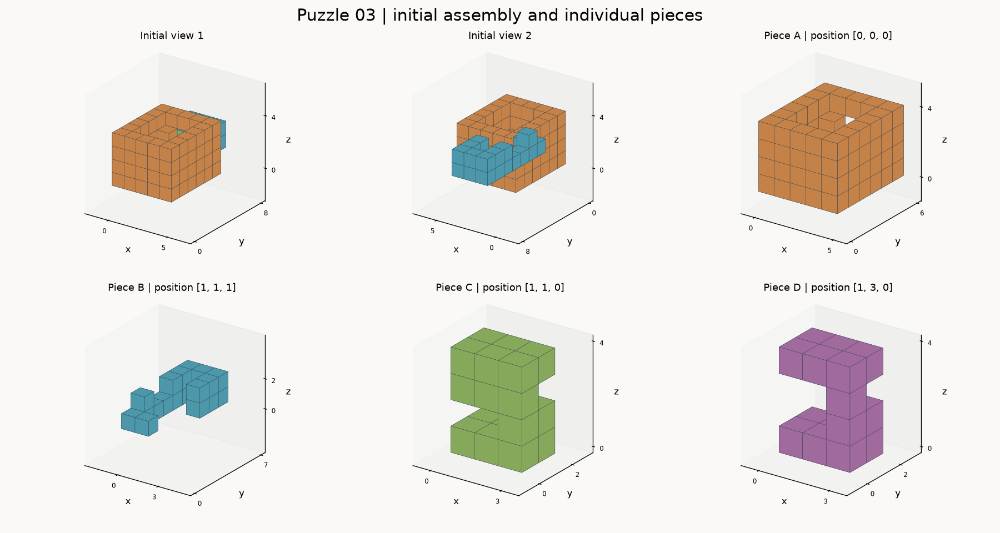

# 第03题 · 结构资料



图中两个初态视角使用同一坐标系。单件图保持初始朝向，坐标为该件局部坐标；标题列出初始位置。图像用于观察，下面的分层图与 JSON 提供精确占据关系。

## 初始装配分层图

字母表示对应零件，`.` 表示空位。横向是 x 正方向，行号按 y 正方向递增，各层按 z 正方向递增。
x = 0..4, y = 0..7；每行从 x 小到大，行按 y 从小到大。

z = 0
```text
     01234
  0  AAAAA
  1  ACCCA
  2  ACCCA
  3  ADDDA
  4  ADDDA
  5  AAAAA
  6  .....
  7  .....
```

z = 1
```text
     01234
  0  AAAAA
  1  ABBCA
  2  AB.CA
  3  AB.DA
  4  AB.DA
  5  AB.BA
  6  .B.B.
  7  .BBB.
```

z = 2
```text
     01234
  0  AAAAA
  1  ACCCA
  2  AB..A
  3  A..DA
  4  AA..A
  5  AB.BA
  6  .B.B.
  7  .BBB.
```

z = 3
```text
     01234
  0  AAAAA
  1  ACCCA
  2  ACCCA
  3  ADDDA
  4  ADDDA
  5  AAAAA
  6  .....
  7  .....
```

## 零件 A

初始位置：`[0, 0, 0]`。下列为局部坐标，`#` 表示实心单位立方体，`.` 表示空位。
x = 0..4, y = 0..5；每行从 x 小到大，行按 y 从小到大。

z = 0
```text
     01234
  0  #####
  1  #...#
  2  #...#
  3  #...#
  4  #...#
  5  #####
```

z = 1
```text
     01234
  0  #####
  1  #...#
  2  #...#
  3  #...#
  4  #...#
  5  #...#
```

z = 2
```text
     01234
  0  #####
  1  #...#
  2  #...#
  3  #...#
  4  ##..#
  5  #...#
```

z = 3
```text
     01234
  0  #####
  1  #...#
  2  #...#
  3  #...#
  4  #...#
  5  #####
```

## 零件 B

初始位置：`[1, 1, 1]`。下列为局部坐标，`#` 表示实心单位立方体，`.` 表示空位。
x = 0..2, y = 0..6；每行从 x 小到大，行按 y 从小到大。

z = 0
```text
     012
  0  ##.
  1  #..
  2  #..
  3  #..
  4  #.#
  5  #.#
  6  ###
```

z = 1
```text
     012
  0  ...
  1  #..
  2  ...
  3  ...
  4  #.#
  5  #.#
  6  ###
```

## 零件 C

初始位置：`[1, 1, 0]`。下列为局部坐标，`#` 表示实心单位立方体，`.` 表示空位。
x = 0..2, y = 0..1；每行从 x 小到大，行按 y 从小到大。

z = 0
```text
     012
  0  ###
  1  ###
```

z = 1
```text
     012
  0  ..#
  1  ..#
```

z = 2
```text
     012
  0  ###
  1  ...
```

z = 3
```text
     012
  0  ###
  1  ###
```

## 零件 D

初始位置：`[1, 3, 0]`。下列为局部坐标，`#` 表示实心单位立方体，`.` 表示空位。
x = 0..2, y = 0..1；每行从 x 小到大，行按 y 从小到大。

z = 0
```text
     012
  0  ###
  1  ###
```

z = 1
```text
     012
  0  ..#
  1  ..#
```

z = 2
```text
     012
  0  ..#
  1  ...
```

z = 3
```text
     012
  0  ###
  1  ###
```
