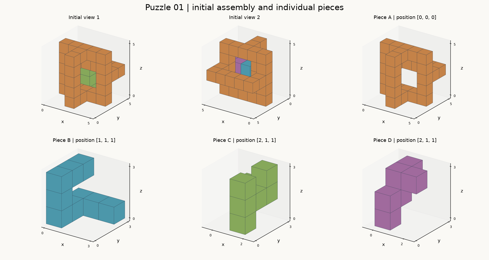

# 第01题 · 结构资料



图中两个初态视角使用同一坐标系。单件图保持初始朝向，坐标为该件局部坐标；标题列出初始位置。图像用于观察，下面的分层图与 JSON 提供精确占据关系。

## 初始装配分层图

字母表示对应零件，`.` 表示空位。横向是 x 正方向，行号按 y 正方向递增，各层按 z 正方向递增。
x = 0..4, y = 0..4；每行从 x 小到大，行按 y 从小到大。

z = 0
```text
     01234
  0  ..A..
  1  ..A..
  2  AAAAA
  3  .....
  4  .....
```

z = 1
```text
     01234
  0  ..A..
  1  .BDC.
  2  AB..A
  3  .BBB.
  4  .....
```

z = 2
```text
     01234
  0  ..A..
  1  .BDC.
  2  A.DCA
  3  A.CCA
  4  AAAAA
```

z = 3
```text
     01234
  0  ..A..
  1  .B.C.
  2  ABDDA
  3  .BDC.
  4  .....
```

z = 4
```text
     01234
  0  ..A..
  1  ..A..
  2  AAAAA
  3  .....
  4  .....
```

## 零件 A

初始位置：`[0, 0, 0]`。下列为局部坐标，`#` 表示实心单位立方体，`.` 表示空位。
x = 0..4, y = 0..4；每行从 x 小到大，行按 y 从小到大。

z = 0
```text
     01234
  0  ..#..
  1  ..#..
  2  #####
  3  .....
  4  .....
```

z = 1
```text
     01234
  0  ..#..
  1  .....
  2  #...#
  3  .....
  4  .....
```

z = 2
```text
     01234
  0  ..#..
  1  .....
  2  #...#
  3  #...#
  4  #####
```

z = 3
```text
     01234
  0  ..#..
  1  .....
  2  #...#
  3  .....
  4  .....
```

z = 4
```text
     01234
  0  ..#..
  1  ..#..
  2  #####
  3  .....
  4  .....
```

## 零件 B

初始位置：`[1, 1, 1]`。下列为局部坐标，`#` 表示实心单位立方体，`.` 表示空位。
x = 0..2, y = 0..2；每行从 x 小到大，行按 y 从小到大。

z = 0
```text
     012
  0  #..
  1  #..
  2  ###
```

z = 1
```text
     012
  0  #..
  1  ...
  2  ...
```

z = 2
```text
     012
  0  #..
  1  #..
  2  #..
```

## 零件 C

初始位置：`[2, 1, 1]`。下列为局部坐标，`#` 表示实心单位立方体，`.` 表示空位。
x = 0..1, y = 0..2；每行从 x 小到大，行按 y 从小到大。

z = 0
```text
     01
  0  .#
  1  ..
  2  ..
```

z = 1
```text
     01
  0  .#
  1  .#
  2  ##
```

z = 2
```text
     01
  0  .#
  1  ..
  2  .#
```

## 零件 D

初始位置：`[2, 1, 1]`。下列为局部坐标，`#` 表示实心单位立方体，`.` 表示空位。
x = 0..1, y = 0..2；每行从 x 小到大，行按 y 从小到大。

z = 0
```text
     01
  0  #.
  1  ..
  2  ..
```

z = 1
```text
     01
  0  #.
  1  #.
  2  ..
```

z = 2
```text
     01
  0  ..
  1  ##
  2  #.
```
