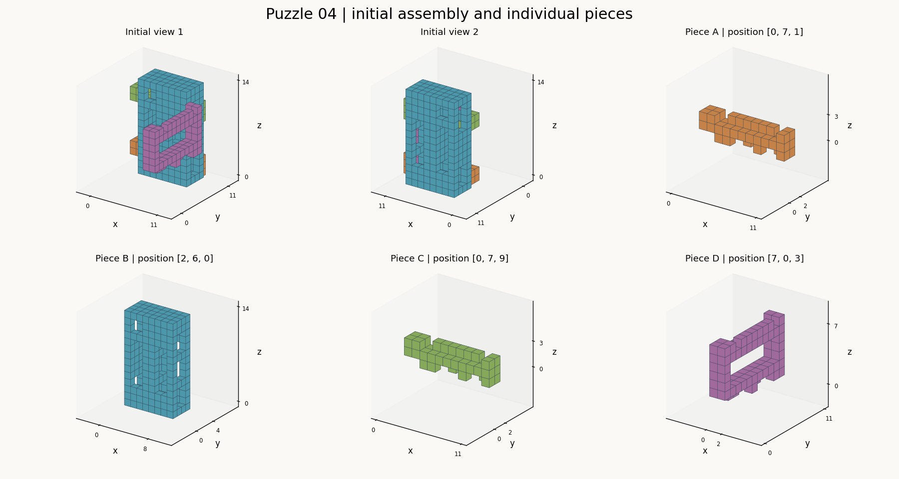

# 第04题 · 结构资料



图中两个初态视角使用同一坐标系。单件图保持初始朝向，坐标为该件局部坐标；标题列出初始位置。图像用于观察，下面的分层图与 JSON 提供精确占据关系。

## 初始装配分层图

字母表示对应零件，`.` 表示空位。横向是 x 正方向，行号按 y 正方向递增，各层按 z 正方向递增。
x = 0..10, y = 0..10；每行从 x 小到大，行按 y 从小到大。

z = 0
```text
     01234567890
  0  ...........
  1  ...........
  2  ...........
  3  ...........
  4  ...........
  5  ...........
  6  ..BBBBBBBB.
  7  ..BBBBBBBB.
  8  ..BBBBBBBB.
  9  ..BBBBBBBB.
 10  ...........
```

z = 1
```text
     01234567890
  0  ...........
  1  ...........
  2  ...........
  3  ...........
  4  ...........
  5  ...........
  6  ..BBBBBBBB.
  7  ..AA...A..A
  8  .....A...AA
  9  ..BBBBBBBB.
 10  ...........
```

z = 2
```text
     01234567890
  0  ...........
  1  ...........
  2  ...........
  3  ...........
  4  ...........
  5  ...........
  6  ..BBBBBBBB.
  7  AAAAAAAAAAA
  8  AAAAAAAAAAA
  9  ..BBBBBBBB.
 10  ...........
```

z = 3
```text
     01234567890
  0  ...........
  1  ...........
  2  .......D...
  3  .......D...
  4  ...........
  5  ........D..
  6  ..B..BB..B.
  7  AA.....D..A
  8  AA.AAAAAA.A
  9  ..B..BB.DB.
 10  .......DD..
```

z = 4
```text
     01234567890
  0  .......DD..
  1  .......DD..
  2  .......DD..
  3  .......DD..
  4  .......DD..
  5  .......DD..
  6  ..B..BBDDB.
  7  ..B..BBDDB.
  8  ..B..BBDDB.
  9  ..B..BBDDB.
 10  .......DD..
```

z = 5
```text
     01234567890
  0  .......DD..
  1  ...........
  2  ...........
  3  ...........
  4  ...........
  5  ...........
  6  ..B..BB..B.
  7  ..B..B.....
  8  ..B..B.....
  9  ..B..BB..B.
 10  .......DD..
```

z = 6
```text
     01234567890
  0  .......DD..
  1  ...........
  2  ...........
  3  ...........
  4  ...........
  5  ...........
  6  ..B..BB..B.
  7  ..B..B.....
  8  ..B..B.....
  9  ..B..BB..B.
 10  .......DD..
```

z = 7
```text
     01234567890
  0  .......DD..
  1  ...........
  2  ...........
  3  ...........
  4  ...........
  5  ...........
  6  ..B..BB..B.
  7  ..B..B.....
  8  ..B..B.....
  9  ..B..BB..B.
 10  .......DD..
```

z = 8
```text
     01234567890
  0  .......DD..
  1  .......DD..
  2  .......DD..
  3  .......DD..
  4  .......DD..
  5  .......DD..
  6  ..B..BBDDB.
  7  ..B..BBDDB.
  8  ..B..BBDDB.
  9  ..B..BBDDB.
 10  .......DD..
```

z = 9
```text
     01234567890
  0  .......DD..
  1  .......DD..
  2  ...........
  3  ........D..
  4  ........D..
  5  ........D..
  6  ..B..BB.DB.
  7  ..CC...CD.C
  8  .....C..DCC
  9  ..B..BB..B.
 10  .......DD..
```

z = 10
```text
     01234567890
  0  ...........
  1  ...........
  2  ...........
  3  ...........
  4  ...........
  5  ...........
  6  ..BBBBBBBB.
  7  CCCCCCCCCCC
  8  CCCCCCCCCCC
  9  ..BBBBBBBB.
 10  ...........
```

z = 11
```text
     01234567890
  0  ...........
  1  ...........
  2  ...........
  3  ...........
  4  ...........
  5  ...........
  6  ..B..BBBBB.
  7  CC........C
  8  CC.CCCCCC.C
  9  ..B..BBBBB.
 10  ...........
```

z = 12
```text
     01234567890
  0  ...........
  1  ...........
  2  ...........
  3  ...........
  4  ...........
  5  ...........
  6  ..B..BBBBB.
  7  ......BBBB.
  8  ......BBBB.
  9  ..B..BBBBB.
 10  ...........
```

z = 13
```text
     01234567890
  0  ...........
  1  ...........
  2  ...........
  3  ...........
  4  ...........
  5  ...........
  6  ..BBBBBBBB.
  7  ..BBBBBBBB.
  8  ..BBBBBBBB.
  9  ..BBBBBBBB.
 10  ...........
```

## 零件 A

初始位置：`[0, 7, 1]`。下列为局部坐标，`#` 表示实心单位立方体，`.` 表示空位。
x = 0..10, y = 0..1；每行从 x 小到大，行按 y 从小到大。

z = 0
```text
     01234567890
  0  ..##...#..#
  1  .....#...##
```

z = 1
```text
     01234567890
  0  ###########
  1  ###########
```

z = 2
```text
     01234567890
  0  ##........#
  1  ##.######.#
```

## 零件 B

初始位置：`[2, 6, 0]`。下列为局部坐标，`#` 表示实心单位立方体，`.` 表示空位。
x = 0..7, y = 0..3；每行从 x 小到大，行按 y 从小到大。

z = 0
```text
     01234567
  0  ########
  1  ########
  2  ########
  3  ########
```

z = 1
```text
     01234567
  0  ########
  1  ........
  2  ........
  3  ########
```

z = 2
```text
     01234567
  0  ########
  1  ........
  2  ........
  3  ########
```

z = 3
```text
     01234567
  0  #..##..#
  1  ........
  2  ........
  3  #..##..#
```

z = 4
```text
     01234567
  0  #..##..#
  1  #..##..#
  2  #..##..#
  3  #..##..#
```

z = 5
```text
     01234567
  0  #..##..#
  1  #..#....
  2  #..#....
  3  #..##..#
```

z = 6
```text
     01234567
  0  #..##..#
  1  #..#....
  2  #..#....
  3  #..##..#
```

z = 7
```text
     01234567
  0  #..##..#
  1  #..#....
  2  #..#....
  3  #..##..#
```

z = 8
```text
     01234567
  0  #..##..#
  1  #..##..#
  2  #..##..#
  3  #..##..#
```

z = 9
```text
     01234567
  0  #..##..#
  1  ........
  2  ........
  3  #..##..#
```

z = 10
```text
     01234567
  0  ########
  1  ........
  2  ........
  3  ########
```

z = 11
```text
     01234567
  0  #..#####
  1  ........
  2  ........
  3  #..#####
```

z = 12
```text
     01234567
  0  #..#####
  1  ....####
  2  ....####
  3  #..#####
```

z = 13
```text
     01234567
  0  ########
  1  ########
  2  ########
  3  ########
```

## 零件 C

初始位置：`[0, 7, 9]`。下列为局部坐标，`#` 表示实心单位立方体，`.` 表示空位。
x = 0..10, y = 0..1；每行从 x 小到大，行按 y 从小到大。

z = 0
```text
     01234567890
  0  ..##...#..#
  1  .....#...##
```

z = 1
```text
     01234567890
  0  ###########
  1  ###########
```

z = 2
```text
     01234567890
  0  ##........#
  1  ##.######.#
```

## 零件 D

初始位置：`[7, 0, 3]`。下列为局部坐标，`#` 表示实心单位立方体，`.` 表示空位。
x = 0..1, y = 0..10；每行从 x 小到大，行按 y 从小到大。

z = 0
```text
     01
  0  ..
  1  ..
  2  #.
  3  #.
  4  ..
  5  .#
  6  ..
  7  #.
  8  ..
  9  .#
 10  ##
```

z = 1
```text
     01
  0  ##
  1  ##
  2  ##
  3  ##
  4  ##
  5  ##
  6  ##
  7  ##
  8  ##
  9  ##
 10  ##
```

z = 2
```text
     01
  0  ##
  1  ..
  2  ..
  3  ..
  4  ..
  5  ..
  6  ..
  7  ..
  8  ..
  9  ..
 10  ##
```

z = 3
```text
     01
  0  ##
  1  ..
  2  ..
  3  ..
  4  ..
  5  ..
  6  ..
  7  ..
  8  ..
  9  ..
 10  ##
```

z = 4
```text
     01
  0  ##
  1  ..
  2  ..
  3  ..
  4  ..
  5  ..
  6  ..
  7  ..
  8  ..
  9  ..
 10  ##
```

z = 5
```text
     01
  0  ##
  1  ##
  2  ##
  3  ##
  4  ##
  5  ##
  6  ##
  7  ##
  8  ##
  9  ##
 10  ##
```

z = 6
```text
     01
  0  ##
  1  ##
  2  ..
  3  .#
  4  .#
  5  .#
  6  .#
  7  .#
  8  .#
  9  ..
 10  ##
```
