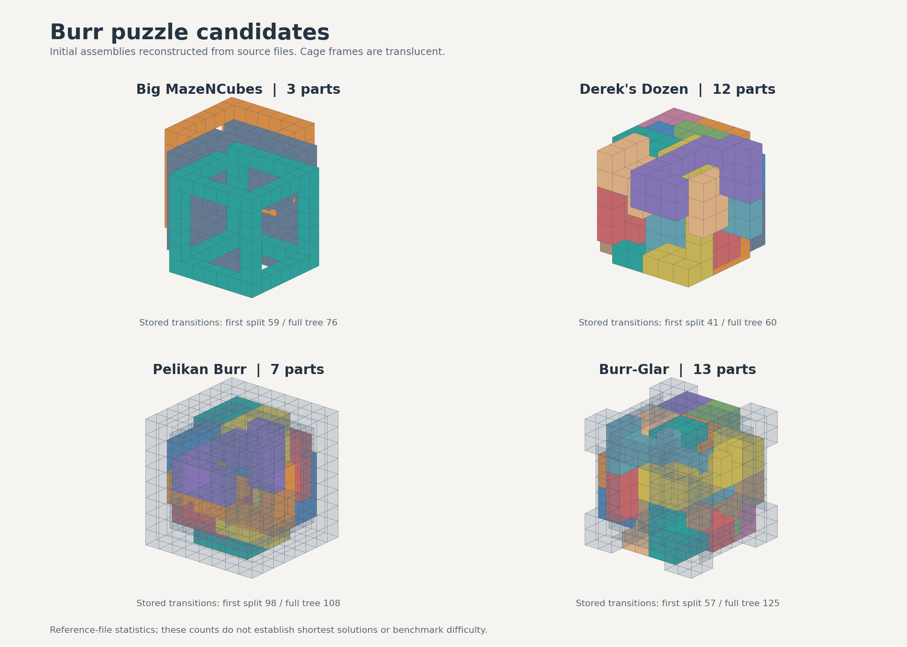

# 鲁班锁选题与可视化方案

> 历史记录：当前采用[纯推理版选题与工具规则](纯推理版选题.md)。本文保留早期讨论，涉及允许编程或作答端自动反馈的建议不再执行。

本文件保留前轮结构核对与可视化设计。当前选题建议以[高难候选与三档方案](高难候选与三档方案.md)为准。

调研日期：2026-11-03。本文用于选题与工具方案讨论，尚未形成正式题干、限时或评分指南。

本轮确定的方向：BurrTools 用于出题端整理模型、分析参考解；受测模型不调用 BurrTools。合法拆解路径均可接受，完整拆解时步数越少，得分越高。

## 1. 推荐怎样组成题集

建议先准备五道候选：Bill's Baffling Burr、Piston Puzzle、Derek's Dozen、Big MazeNCubes、Pelikan Burr。前两道提供较短的经典结构，后三道分别覆盖多件互锁、少件长路径与笼框限制。Burr-Glar 作为多件笼框题的备选，Computer's Choice Unique 10 可替换经典六件题。

这个名单是结构与资料完整度方面的推荐。题目的实际区分度需要在统一规则下试测，不能由零件数或作者标称步数直接推断。

### 1.1 经典六件题：适合作为基础与中间档

| 候选 | 已找到的材料 | 推荐用途 | 准备程度 |
|---|---|---|---|
| Bill's Baffling Burr | 六件的独立零件图与编码；资料标注 Moves 5 | 第一批较短拆解题，验证模型是否理解缺口、方向与联动 | 已核对原始资料，尚未转换为比赛结构文件 |
| Piston Puzzle / Burr B | 六件的图与编码；目录标注 Moves 9.3，Cutler 的资料标注 level 9 | 与上一题形成递进，保留传统六件形态 | 已核对目录与历史说明，尚未转换 |
| Computer's Choice Unique 10 | 六件，长度 8；目录标注 Moves 10；有装配与计算输出资料 | 作为经典题的替换候选 | 尚未核对可直接导入的 xmpuzzle 文件 |

[Bill's Baffling Burr 原始页面](https://puzzlewillbeplayed.com/6PieceBurrT/BillsBafflingBurr/)列出了零件图和编码。[六件目录](https://puzzlewillbeplayed.com/6PieceBurrT/)记录了 Piston 与 Unique 10 的材料和数值；[Cutler 的说明](https://billcutlerpuzzles.com/docs/CA6PB/examples.html)可交叉参考。

这些名称中的 level、目录的 Moves 和我们最终规定的步数可能不同。目录自己的说明也明确区分 Moves 与 Cutler 的 Level。上述数字用于筛选资料，不直接用于计分。

### 1.2 已实际解析的结构文件：适合作为主要候选

本次固定读取 BurrTools 仓库提交 `5f8b127d7722559a12f36a38c1e3a0e3ad09679f`，避免后续文件变化造成同名异题。完整来源和 SHA-256 见[候选模型核对.json](候选模型核对.json)。

| 候选 | 实际零件实例数 | 保存路线的根拆分转换数 | 保存路线的全拆树转换总数 | 推荐理由 |
|---|---:|---:|---:|---|
| Big MazeNCubes | 3 | 59 | 76 | 零件少、形态易读，但移动关系长，适合观察多步空间规划 |
| Derek's Dozen | 12 | 41 | 60 | 多件互锁，原始外形紧凑，适合测试分组移动与状态追踪 |
| Pelikan Burr | 7，含笼框 | 98 | 108 | 六根锁件与笼框相互限制，适合作为深路径候选 |
| Burr-Glar | 13，含外部框体 | 57 | 125 | 件数较多、笼框限制明显，适合作为替换或扩展题 |
| Draculas Dental Desaster | 9 | 3 | 37 | 首次拆分较短、后续仍有操作，可作较低档或查看器调试样例 |
| Cube in Cage | 6 | 4 | 16 | 原文件允许部分组件始终不分离，目标与“全部零件拆成单件”不同，暂不进入首批正式题 |

数字来自文件保存的拆解树：每个节点的直接 `state` 数量减一，全树数值为各节点之和。计数方式与上游[拆解树源码](https://github.com/burr-tools/burr-tools/blob/5f8b127d7722559a12f36a38c1e3a0e3ad09679f/src/lib/disassembly.cpp)中的 `sumMoves()` 对应。

这里必须保留三个区别：

- 根拆分是整套结构第一次分为两个子组件，可能一次分出多件。Pelikan 的保存路线首先分成 2 件与 5 件两组，98 不能直接解释成“恰好取出一个独立零件的步数”。
- 文件中的这条路线是参考路线。它不是本轮重新求出的最短解，也未证明其全拆总步数最小。
- 全拆树的最后一步包含软件表达“分离”的状态，可能使用很大的坐标标记。转换成比赛动作时，须落实为合法的实际平移，再重新计步。

上轮依据 Pelikan 文件注释提到“取出首件 98 次移动”。本轮读取完整拆解树后，采用上面更准确的根拆分与全拆树两种统计。

Burr-Glar 在目录中有同名条目，但目录与本次文件的路线数值不同，暂不将两者视为同一个已核实版本。正式采用时应以选定文件、初始构型和统一动作规则为准。

### 1.3 暂时不纳入的类型

- `12PieceSeparation`、`BrokenSticks`、`PiecesOfEight` 等示例使用非方块网格，部分只保存装配结果，没有可直接复用的拆解树。第一版保持同一种几何规则更便于比较。
- Cube in Cage 的原文件包含“可移动但不要求拆散”的分组。若使用它，需要单独写清目标。[BurrTools 分组说明](https://burrtools.sourceforge.net/gui-doc/GroupingPieces.html)解释了这一语义。
- 必须旋转、倾斜或依赖材料弹性的结构留作后续扩展。首版建议使用固定朝向、轴向平移，仍允许自由转动观察镜头。

## 2. 题目输入与参考解怎样分开

建议由出题端把 xmpuzzle 转成一份简洁的 `puzzle.json`，其中包含：

- 零件编号、每件占据的单位方块坐标；
- 指定初始装配位置与朝向；
- 笼框等部件的角色，以及是否固定；
- 本题允许的动作、拆解目标和计步方式。

原始文件中的装配初态要提取出来，拆解树与求解统计留在出题端。零件编号、颜色和朝向调整仅用于统一表示，不能冒充新的空间难题。

受测查看器只加载这份题目数据。出题和视频一侧使用相同的显示与动作引擎，再从外部载入参考解或模型提交解。BurrTools 作为模型整理、参考分析工具，不进入受测交互流程。

后续已确定：允许受测模型自行编写搜索程序，BurrTools 等现成专用求解器只用于出题端。正式规则见[题干](../../空间推理/鲁班锁拆解/鲁班锁拆解.md)，本文其余部分保留早期方案讨论。

## 3. 统一怎样算一步

建议首版采用下列口径，正式评分前须按此重新整理参考路线：

1. 一步选择一个或多个零件，让它们沿 X、Y、Z 中的一条轴，朝同一方向作相同距离的连续平移。
2. 距离为正整数个单位方块边长；移动 1 格与连续移动 4 格都算一步。
3. 更换移动零件组、坐标轴或方向，开始新的一步。相邻且零件组、轴和方向完全相同的指令合并计步。
4. 允许同组多件同步移动；不同方向或不同距离的动作分别计步。单件移动是其中的特例。
5. 位移路径全程不能与组外零件发生体积重叠，表面接触允许。沿一条轴滑过时，终点合法也要检查中途。
6. 镜头旋转、剖切、查看单件与播放速度均不计步，也不改变正式几何状态。
7. 成功分离后，将零件整理到展示位置属于画面排布，不参与解题步数；用于判定成功的移出动作仍然计入。

`move` 示例：

```json
{"pieces":["B","E"],"axis":"x","distance":2}
```

方向可以用有符号距离表达；前面的“正整数”指距离的绝对值。正式格式只需选定一种表达，并在查看器、评分器和参考解中统一。

取出零件的判定应来自几何规则。可将“沿指定轴可无碰撞继续移至远处”作为分离条件，并用有限距离实现和回放。屏幕位置与镜头远近不参与判定。

## 4. 多条解与步数评分

所有合法完成目标的路线都接受，无需与参考路线逐条一致。这正是本题的一个考点：模型可以寻找不同的拆解顺序和同步移动组合。

[Cutler 的分析](https://billcutlerpuzzles.com/docs/CA6PB/testing.html)明确区分装配构型数量与拆解方法，并列出了同一步数下的不同走法。“装配唯一”不意味着“操作序列唯一”。

建议首先试测一个容易解释的计分形式：若同一动作规则下已确认的最短完整拆解步数为 `M`，提交合法解为 `N`，单题得分为：

```text
得分 = 100 × M / N
```

例如最短为 40 步，提交 40、50、80 步分别得到 100、80、50 分。各题再按题集权重合成。是否另设“首次分离”的部分分，待试测后确定。

这个公式需要真正可用的 `M`。BurrTools 文件中的全拆树并不自动证明全拆总步数最短：先让第一组更快分开，也可能使后续拆解变长。因此后续工作应当在统一计步规则下验证最短路，不能直接把本轮 76、60、108、125 写成最优值。

如果最终只能得到已知参考长度，就应明确使用“参考基准”。遇到更短的合法提交，更新同版本统一基准并重算全部提交，不能把新路线判错或将它当成异常。这里的处理是计分建议，尚未确定正式公式。

模型可以试移、撤销和复位。评分统计最终提交路线的规范化长度，探索过程中做过多少次尝试不计入 `N`。

## 5. 可视化推荐做成什么

建议做一个我们统一提供的离线网页查看器，使用本地随包的 Three.js。受测模型观察和操作，评分侧执行提交，视频侧回放，都使用同一套几何与动作规则。

### 5.1 观察结构

主画面显示真实装配，保留固定的世界坐标轴和零件编号。支持：

- 旋转、缩放、平移镜头；
- 等轴测以及正、侧、俯三个正交视角；
- 选择零件，突出显示其轮廓；
- 单件检查窗口，查看被其他零件遮住的缺口；
- 其余零件切换线框或半透明；
- 沿坐标轴移动剖切面。

[OrbitControls](https://threejs.org/docs/pages/OrbitControls.html)可直接支持镜头观察；[材质裁剪平面](https://threejs.org/docs/pages/Material.html)可用于显示内部结构。半透明物体的相互遮挡存在排序问题，内部观察优先用剖切或线框，透明模式作为补充。

单件检查窗口显示当前零件本身，不改变主场景里的位置。若另做整体爆炸图，应标明它是结构展示，不是合法拆解路线。

### 5.2 操作与试探

点击零件，或在编号列表中多选，再选轴与距离执行。也提供六方向按钮和键盘操作，便于浏览器自动化。

一次合法移动用短动画呈现：所选零件一起移动，其余保持原位；被挡住时保留原状态，指出当前尝试与哪件发生阻挡。撤销、重做和复位操作直接作用于当前试解记录。

查看器响应模型指定的动作，不提供“下一步应该移动谁”或自动拆解。完整合法动作列表、最优距离和通往答案的提示也不作为查看功能提供。

### 5.3 对观众显示的信息

常驻显示题名、当前移动零件、方向、累计步数和目标完成状态。展开区域放结构数据、单件检查、剖切、操作记录和提交文件。

正式画面可以使用浅色或深色展台、分件着色、适度木纹和柔和阴影。关键是开槽、接触面与内部间隙容易辨认。纹理、灯光和小倒角只影响显示，碰撞仍按原始结构计算。

数据坐标保持一套约定。例如以 Z 为上方，镜头与坐标标记也按 Z 向上配置；移动方向不随镜头旋转而改变。



图中是本轮生成的几何预览，用于比较结构。笼框半透明显示，外观不是最终查看器设计，文字中的转换数也不是已证明的最短步数。

## 6. 显示、判题与回放怎样接起来

建议保留一个小型的规则核心，负责题目加载、精确状态、动作校验、计步和目标判定。画面只读取这些结果，给合法移动作插值显示。

```text
题目几何与初态 ──→ 规则核心 ──→ Three.js 查看与操作
提交动作序列 ────→ 同一规则核心 ──→ 判分与逐步回放
出题端参考动作 ──→ 同一规则核心 ──→ 参考解回放
```

方块网格、固定朝向和轴向平移可以用整数占据表与扫掠检查实现，不必引入完整刚体物理引擎。三维显示先提取体素外表面，再合并共面区域，避免把每个单位方块都画出一整套内部面。

公开操作接口建议只有载入、观察当前状态、执行指定动作、撤销与复位等能力。评分器读取提交文件直接执行，查看器供模型观察同一结果。相机、剖切和半透明都属于显示状态。

建议参考的调用形态为：

```js
await viewer.loadPuzzle(puzzle);
await viewer.move({pieces: ["B", "E"], axis: "x", distance: 2});
viewer.undo();
viewer.reset();
viewer.getState();
```

这些是待实现的接口建议，不是本轮已经提供的程序。

## 7. 视频回放怎样做

使用提交的动作文件驱动画面。一开始给完整结构和目标，随后高亮当前移动组、显示方向箭头、执行动作、更新步数。模型提交不合法时，播放到该处，展示阻挡位置和失败原因。

镜头以容易追踪相对位置的等轴测视角为主。侧移、内部解锁或取件被遮挡时，再平滑转到侧面或局部特写。一次关键动作中保持视角连续；长距离取出与重复操作可以压缩展示，但屏幕上的累计步数仍对应真实动作。

长路线可以保留关键解锁的正常速度，其他操作连贯加速。片段标出加速或省略的步数，参考解与提交解在相同显示口径下比较。具体成片时长本轮不规定。

完成查看器后，可复用仓库[项目素材导出约定](../../videos/docs/project-asset-export.md)中的 `window.videoExport` 形式。接口由我们提供的查看器实现，受测模型只提交答案。当前视频文档尚未增加本题章节，以免把调研方案写成已可执行的导出流程。

## 8. 本轮已经核对的范围

- 实际解析 6 份方块网格结构，按上游旋转矩阵还原指定装配；6 份初态均无零件体素重叠。
- 核对保存拆解树中的 422 个有限坐标状态，未发现状态内体素重叠。含软件分离标记的大坐标状态未按普通有限状态处理。
- 计算根拆分与全树状态转换数，保存文件来源、提交号和 SHA-256，生成并检查候选模型预览。
- 没有重新运行 BurrTools 求解，没有完成参考轨迹的连续扫掠与分支坐标转换，也没有证明任何候选的最短完整拆解步数。
- 尚未实现交互查看器、正式判题器与视频回放接口。

下一步优先把 Big MazeNCubes、Derek's Dozen、Pelikan Burr 的参考树转换成统一动作并连续执行，再补齐一至两道经典六件题。选题与最短步数确认后，再写正式题干和评分指南。

